# 大宗矿产集采平台 系统使用说明

> 适用对象：平台管理员（运营）、钢厂（需方）、供应商（供方）
> 更新日期：2026-11-16
> 运行形态：浏览器访问，无需安装客户端；推荐使用新版 Chrome / Edge 浏览器

---

## 1. 系统概述

大宗矿产集采平台面向钢厂、供应商与平台运营方三类角色，提供从需求申报到货物签收归档的全流程线上集采服务：

**需求申报 → 平台需求归集 → 平台代发询价 → 供应商密封报价 → 截止揭示与比价 → 各钢厂评审认可（全员认可自动成单）→ 供应商确认订单 → 各钢厂提交提货计划 → 运营制定运输方案与分段运单 → 物流节点录入与轨迹跟踪 → 签收 → 质检 → 归档**

配套能力包括：企业注册与平台准入审核、港口价格行情维护、预警处理、状态字典、操作日志与站内消息通知。

- 钢厂（需方）：申报采购需求、评审报价、提交提货计划、跟踪物流与履约
- 供应商（供方）：参与密封报价、确认订单、查看物流与履约进度
- 平台管理员（运营）：企业准入审核、需求归集、代发询价、订单与运输调度、价格与基础数据维护

> 说明：本轮平台设计不涉及承运商角色，承运商端已下线（详见 4.5 节）。

## 2. 系统功能模块说明

### 2.1 按角色划分

| 角色 | 登录后可用菜单 |
|------|----------------|
| 平台管理员 | 运营看板、企业准入、需求归集、报价询价、订单管理、运输调度、基础数据、预警处理、状态字典、操作日志、消息中心 |
| 钢厂（需方） | 总览、需求管理、基准价行情、采购询价、议价定标、订单、物流服务、履约跟踪、企业信息、消息中心 |
| 供应商（供方） | 总览、询价报价、订单管理、物流服务、履约跟踪、企业信息、消息中心 |

### 2.2 功能模块清单

| 模块 | 功能说明 | 使用角色 |
|------|----------|----------|
| 登录与注册 | 手机号 + 密码登录；企业注册（角色仅可选钢厂或供应商之一，34 个省级行政区支持搜索选择，需上传营业执照）；注册后需平台准入审核通过方可使用业务功能 | 全部 |
| 消息中心 | 顶栏小铃铛（未读角标）打开右侧抽屉（任务 / 消息两个页签）；「更多」进入消息中心页，任务分待办 / 已办 / 在办申请 / 已办申请，消息分通知 / 预警 / 公告 / 活动信息；点击消息自动标记已读并跳转对应业务页面 | 全部 |
| 运营看板 | 统计条（准入企业 / 集采总货量 / 运单总数 / 总交易额）+ 黄骅港 PB粉 价格趋势（行业价格与交易价格双线，品位 61.5% / 60.8% 可切换）+ 近 7 天价格行情表 + 货运趋势 + 矿种分布 + 运输方式运量对比 | 平台管理员 |
| 企业准入 | 准入申请列表与企业档案信息两个页签，均支持关键字筛选；审核（驳回必填原因）、重置密码（重置为 demo123456）、启用 / 停用；详情弹窗查看注册信息与营业执照（点击在线预览）；企业信息变更审核弹窗对比变更前后内容，通过自动更新、驳回保持不变 | 平台管理员 |
| 需求归集 | 需求列表 / 订单归集 / 变更申请审核三个页签；勾选各钢厂的需求明细后「合并归集」生成归集单；归集单列表可「去询价」 | 平台管理员 |
| 报价询价 | 对归集单「发起询价」（邀请供应商、设定报价截止）；跟踪各轮询价与供应商响应；钢厂反馈不认可时可重新发起询价；「询价历史」按轮次只读追溯 | 平台管理员 |
| 订单管理（运营端） | 聚合订单列表（关键字与状态筛选）；详情展示各钢厂份额与提货计划明细（未提交标橙）；可跳转运输调度制定方案 | 平台管理员 |
| 运输调度 | 物流调度 / 在途监控两个页签；为订单制定运输方案并新增分段运单（铁路直达 / 公铁联运 / 汽运直达，公铁联运必填中转站，起运地限黄骅港 / 天津港，预计船到港时间与运费必填）；运单创建即确认生效（平台承担运输）；节点录入按运单状态自适应可选节点；在途监控可确认发运 / 确认到达 / 代签收 | 平台管理员 |
| 基础数据 | 品种维护（一期演示品种为 PB粉、中华混一号，支持新增品种 / 改品类）；价格行情详情（今日港口价录入、价格筛选、每行「重新录入」、趋势图）；价格单位为元/湿吨，来源标注 Mysteel | 平台管理员 |
| 预警处理 | 质检数量偏差超允差等自动预警的列表与处理（关闭须填处理意见） | 平台管理员 / 相关企业 |
| 状态字典 | 各业务对象的状态含义、业务解释与流转路径速查 | 平台管理员 |
| 操作日志 | 按业务类型、业务 ID 查询系统操作留痕 | 平台管理员 |
| 总览（钢厂端） | KPI 卡（订单总数 / 待询价 / 运输中 / 待付款）+「去采购」一键直达需求管理 + 采购全流程概览 + 采购订单列表 | 钢厂 |
| 需求管理 | 新建需求（产品名称、品位、数量、交货方式、交货地点、期望到货起止、结算方式、质量要求）；草稿保存 → 提交；撤回后可修改并重新提交（版本自动 +1）；提交后关键字段锁定 | 钢厂 |
| 基准价行情 | 今日基准价（与运营端维护的港口价同源联动）+ 近 30 日价格走势（品位 61.5% / 60.8% 切换） | 钢厂 |
| 采购询价 | 接收运营端发起的询价与报价反馈；状态筛选；详情查看各供应商报价分区；归集询价揭示后反馈「认可 / 不认可」（全员认可自动成单） | 钢厂 |
| 议价定标 | 四阶段工作台（已揭示待议价 → 议价中 → 已定标 → 反馈待处理，点击阶段圆筛选列表）；议价 / 定标工作台弹窗内比价、多轮议价与定标；仅钢厂端提供，供应商端无此页 | 钢厂 |
| 订单（钢厂端） | 订单列表与详情（本厂份额吨数、关联合同）；提交提货计划（开始提货日期 + 日提货吨数 + 备注） | 钢厂 |
| 物流服务 | 95306 式物流轨迹（运单信息条 + 倒序轨迹时间线 + 运输信息面板，运营录入节点后约 15 秒自动刷新）；物流方案创建（组织方式：平台配送 / 钢厂自提） | 钢厂 |
| 履约跟踪 | 节点台账（全部 / 订单 / 运单 / 结算类型筛选，倒序轨迹）；钢厂可手工登记节点 | 钢厂 |
| 总览（供应商端） | KPI 五卡（总订单数 / 总交易额 / 待报价单数 / 运输中单数 / 已完成订单，点击跳转）+ 待办事项（待报价询价 / 待确认订单，逐条「去处理」）+ 近期动态 | 供应商 |
| 询价报价 | 仅显示运营端代发的平台询价；列表状态筛选（全部 / 待报价 / 已报价 / 已截止）；详情弹窗分区展示采购需求 / 技术参数与质量要求 / 交货与结算要求 / 我的报价 / 报价附件；密封报价弹窗支持附件上传（PDF/JPG/PNG ≤20MB，最多 5 个）；截止前仅本人可见报价 | 供应商 |
| 订单管理（供应商端） | 订单列表与详情弹窗；「订单确认」区集中处理待确认订单（须在确认截止前确认，超期订单自动取消） | 供应商 |
| 物流服务（供应商端） | 只读视图：按订单查看运输方案与分段运单、95306 式物流轨迹；无创建 / 签收操作入口 | 供应商 |
| 履约跟踪（供应商端） | 履约进度五阶段（订单生成 → 双方确认 → 提货计划 → 运输交付 → 结算归档）+ 履约节点台账（只读）+ 运单列表（只读） | 供应商 |
| 企业信息 | 企业信息分区展示与信息维护弹窗（已准入企业修改关键字段后需运营端重新审核）；资质证照面板内嵌自行上传（营业执照 / 其他资质，PDF/JPG/PNG ≤20MB），支持预览与下载 | 钢厂 / 供应商 |
| 归档导出 | 订单档案 zip 导出（含各环节单据） | 钢厂 / 平台管理员 |

### 2.3 关键业务规则速查

- 询价报价截止时间：须 ≥ 当前时间 +2 小时，且 ≤ 期望到货日期前 7 天（违反时弹窗提示，后端错误码 40001）
- 需求单提交后关键字段锁定（错误码 40901）；需先「撤回」再修改，重新提交后版本号自动 +1
- 密封报价：报价截止揭示前，需方与第三方均不可见报价内容；同一供应商同一询价的重复整单报价被拦截（错误码 40902），可修改原报价
- 全员认可自动成单：归集询价揭示后推送各钢厂评审，全部钢厂「认可」后系统自动锁货锁价生成 1 张聚合订单（按价格升序选取首个可供量覆盖份额总量的报价）；任一钢厂「不认可」（必填理由）则询价转「反馈待处理」，由运营端重新发起询价；运营端手动按份额定标保留为兜底
- 订单确认：聚合订单生成后先由供应商在确认截止前确认（48 小时，超期自动取消），确认后转「待收集提货计划」并通知各钢厂
- 提货计划：每家钢厂提交开始提货日期与日提货吨数；全部提交后订单自动转「待制定运输方案」；订单离开该状态后不可再改（错误码 40901）
- 运输方案：分段计划量合计与订单量偏差 >5% 须填写偏差说明；运单创建即确认生效，默认平台承担运输
- 归集单关闭：仅未发起询价的归集单可关闭，关闭后释放各钢厂锁定量
- 承运商角色账号不可登录（提示「本平台暂不开放承运商端登录」）

## 3. 环境配置步骤

### 3.1 前置依赖

- Python 3.10 及以上版本
- Docker Desktop（用于运行 PostgreSQL 14 数据库容器）
- 安装依赖：`pip install -r requirements.txt`

### 3.2 启动数据库

```powershell
# 在项目根目录执行（首次会自动创建容器与数据卷）
docker compose up -d
# 验证容器状态
docker ps --filter name=mine-platform-pg
```

默认连接参数（见项目内 docker-compose.yml）：

- 地址与端口：127.0.0.1:5432 · 用户：postgres · 库：mine_platform
- 业务时区：Asia/Shanghai（随容器环境变量与后端会话双重保证）

### 3.3 启动服务

```powershell
python run.py
```

- 首次启动自动创建数据表并写入演示数据（演示品种、演示企业与各环节演示单据）
- 启动成功后访问：`http://127.0.0.1:8000`
- 可选环境变量：`MINE_PG_DSN`（数据库连接串）、`MINE_PORT`（服务端口，默认 8000）、`MINE_PG_TZ`（业务时区，默认 Asia/Shanghai）、`MINE_DISABLE_JOBS`（关闭后台定时任务）、`MINE_JOBS_INTERVAL`（定时任务扫描间隔，默认 3600 秒）

### 3.4 演示账号

| 角色 | 账号 | 密码 | 企业 |
|------|------|------|------|
| 平台管理员 | 13800000000 | admin123456 | 平台运营 |
| 钢厂（需方） | 13800000001 | demo123456 | 示范钢铁集团有限公司 |
| 供应商（供方） | 13800000002 / 13800000003 / 13800000004 | demo123456 | 示范矿产贸易 / 示范矿业 / 示范国际供应链 |
| 承运商（已下线） | 13800000005 | demo123456 | 登录提示「本平台暂不开放承运商端登录」 |

> 提示：以上为演示库的固定账号。新注册的企业账号须经平台管理员在「企业准入」审核通过后方可登录使用业务功能。

### 3.5 项目目录速览

```
mine_platform_demo/
├── run.py                  # 启动入口（一键建表 + 演示数据 + 服务）
├── docker-compose.yml      # 数据库容器编排
├── requirements.txt        # Python 依赖清单
├── backend                  # 服务端代码目录（api/ 下为各业务接口）
├── frontend                 # 前端页面代码目录（js/pages/ 下为各页面模块）
├── docs/
│   ├── shots/              # 本手册全部界面截图
│   └── PROJECT_GUIDE.md    # 项目内部指南
└── 系统使用说明.md          # 本手册
```

## 4. 图文操作流程

> 本章节截图均取自当前系统实际界面，图中红框与编号对应「图中标注」说明，图文一一对应。演示数据以 3.4 节演示账号为准。

### 4.1 登录与企业注册（三端通用）

#### 4.1.1 登录

1. 浏览器打开 `http://127.0.0.1:8000`，未登录状态自动进入登录页
2. 输入 11 位手机号与密码，点击「登 录」按钮
3. 登录成功后按角色进入对应首页；密码错误或账号不存在时页面弹出红色提示

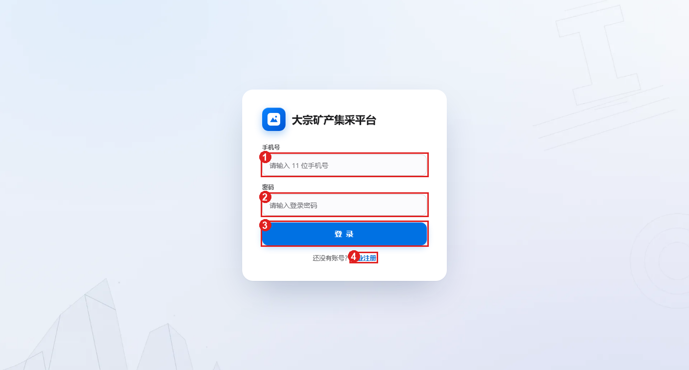

图中标注：① 手机号输入框（占位提示「请输入 11 位手机号」）② 密码输入框 ③「登 录」主按钮（提交时置灰防重复点击）④ 底部「企业注册」入口链接

#### 4.1.2 企业注册

1. 登录页底部点击「企业注册」进入注册页
2. 企业角色**仅可选择一个**：钢厂（需方）或供应商（供方），选中卡片高亮显示 ✓
3. 填写企业信息（企业名称、统一社会信用代码为必填）、联系与结算信息、登录账号与密码
4. 省份输入框支持搜索（聚焦展开列表，输入关键字实时过滤，Enter 选首项）
5. 选择营业执照文件（图片 / PDF）后点击「提交注册」
6. 注册成功后**需平台准入审核通过**方可登录使用业务功能，在此之前登录会有相应提示

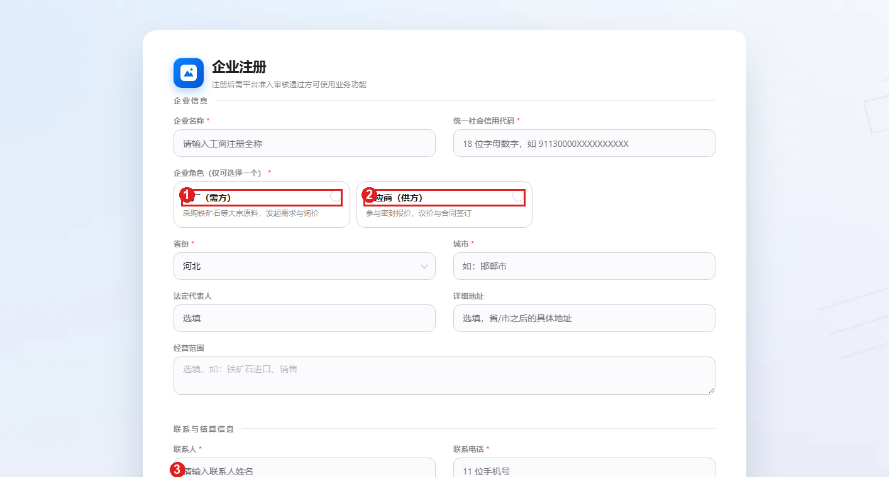

图中标注：① 企业角色卡片「钢厂（需方）」② 企业角色卡片「供应商（供方）」（两者仅可选其一）③ 页面底部「提交注册」按钮

#### 4.1.3 消息中心

1. 任意页面顶栏点击**小铃铛**图标（含未读数红色角标），右侧滑出消息抽屉
2. 抽屉内「任务」「消息」两个页签，点击「更多」进入完整消息中心页
3. 消息中心页：待办任务 / 已办任务 / 在办申请 / 已办申请；全部消息 / 通知 / 预警 / 公告 / 活动信息
4. 点击消息自动标记已读（角标递减）并跳转对应业务页面；待办任务点击「去处理」直达办理页

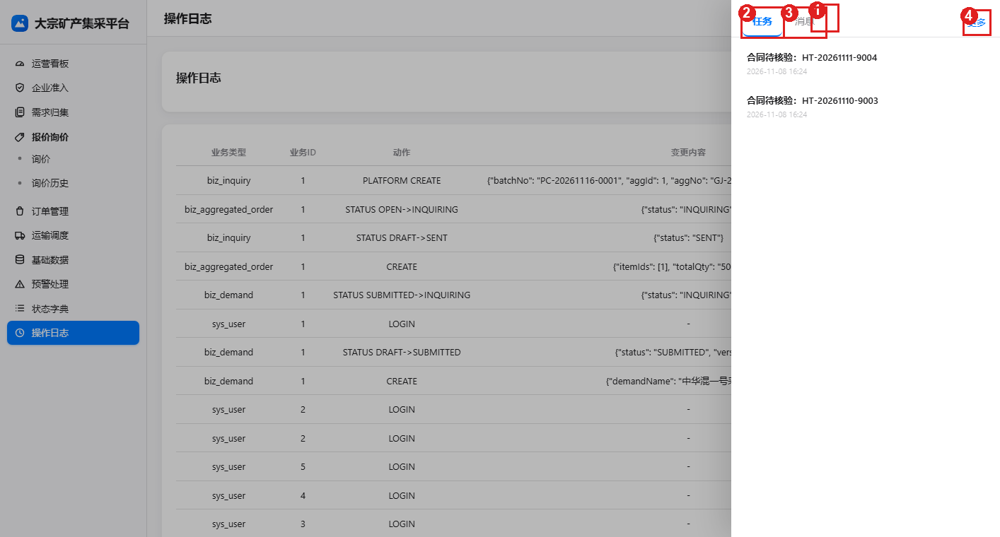

图中标注：① 顶栏消息铃铛（未读角标）② 抽屉页签「任务」③ 抽屉页签「消息」④「更多」入口（进入消息中心页）

### 4.2 平台管理员（运营）操作流程

登录平台管理员账号（13800000000 / admin123456）后进入运营看板。左侧菜单依次为：运营看板、企业准入、需求归集、报价询价、订单管理、运输调度、基础数据、预警处理、状态字典、操作日志。

#### 4.2.1 运营看板

看板自上而下依次为：统计条（准入企业 / 集采总货量 / 运单总数 / 总交易额）、黄骅港 PB粉 价格趋势与近 7 天价格行情（左右两栏）、货运趋势、矿种分布与运输方式运量对比。

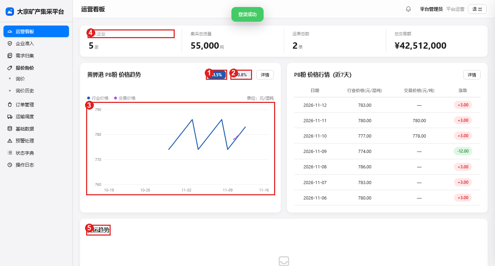

图中标注：① 品位切换按钮「61.5%」② 品位切换按钮「60.8%」（切换后趋势图与右侧行情表联动）③「黄骅港 PB粉 价格趋势」双线图（行业价格实线 / 交易价格虚线）④ 统计卡「准入企业」⑤「货运趋势」卡

#### 4.2.2 企业准入

1. 左侧菜单「企业准入」：页签「准入申请列表」「企业档案信息」，表格上方关键字筛选框（企业名称 / 信用代码 / 联系人 / 账号，输入后回车或点「查询」）
2. 行操作「审核」：通过或驳回（驳回必填原因）；通过后可「启用 / 停用」
3. 行操作「重置密码」：将该企业账号密码重置为 demo123456
4. 行操作「详情」：弹窗展示注册信息，营业执照点击即可在线预览
5. 「变更申请审核」页签（需求归集页内）处理企业信息变更申请，通过后企业信息自动更新，驳回则保持不变

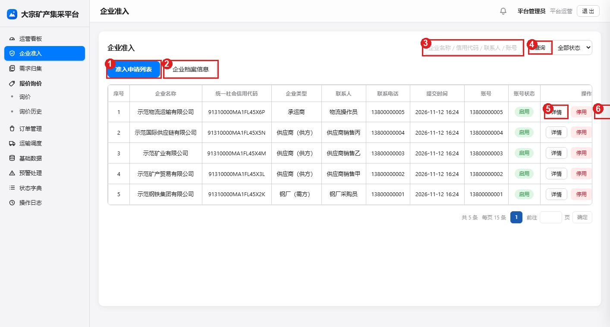

图中标注：① 页签「准入申请列表」② 页签「企业档案信息」③ 关键字筛选框 ④「查询」按钮 ⑤ 行操作「详情」⑥ 行操作「重置密码」

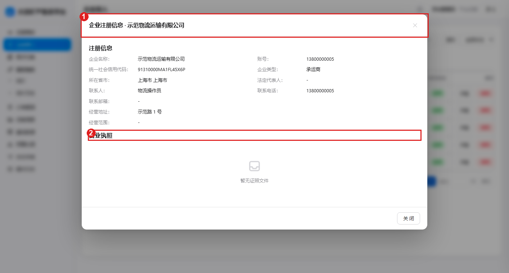

图中标注：① 准入详情弹窗标题栏（企业注册信息）②「营业执照（证照文件）」分区

#### 4.2.3 价格行情维护

1. 「基础数据」→「价格行情详情」：展示今日港口价与全部价格记录，可按品位 / 港口筛选
2. 点「价格录入」弹出录入对话框：选择产品名称、品位（61.5% / 60.8%）、港口，输入价格（元/湿吨），价格日期默认当天可修改
3. 每行「重新录入」按钮：预填该行信息修改后保存
4. 保存后本页数据、今日港口价与趋势图自动更新，钢厂端「今日基准价」随之联动

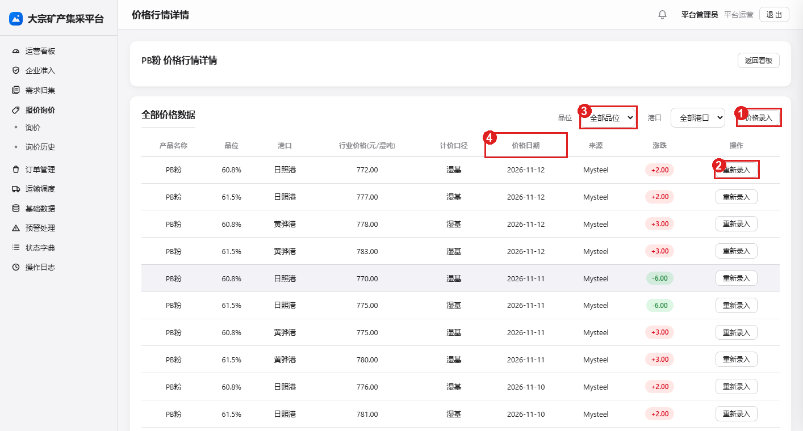

图中标注：①「价格录入」按钮（弹出录入对话框）② 行操作「重新录入」③ 品位 / 港口筛选下拉 ④ 行情表「价格日期」列

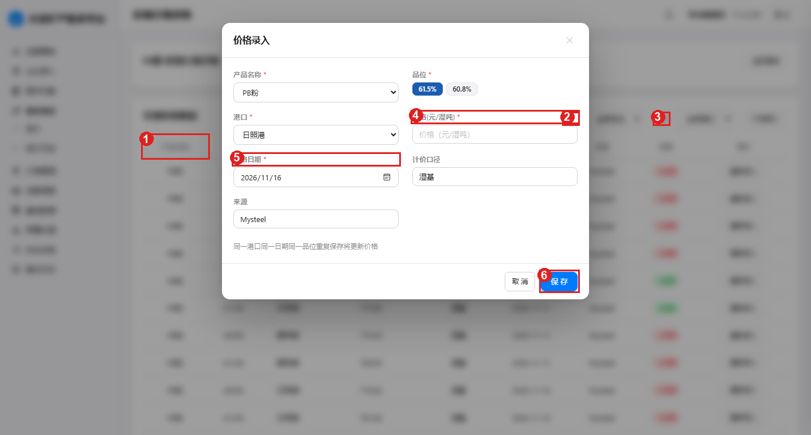

图中标注：① 产品名称下拉 ② 品位选择 ③ 港口选择 ④ 价格输入（元/湿吨）⑤ 价格日期（默认当天）⑥「保 存」按钮

#### 4.2.4 需求归集

1. 「需求归集」三个页签：需求列表（各钢厂提交的需求明细）、订单归集（归集单列表）、变更申请审核
2. 在「需求列表」勾选要合并的需求明细（可跨多家钢厂）→ 点「合并归集」→ 确认弹窗点「确 定」→ 生成 1 张归集单（整单锁货锁价）
3. 「订单归集」页签查看归集单，行操作「去询价」发起询价
4. 仅未发起询价的归集单可关闭，关闭后释放各钢厂锁定量

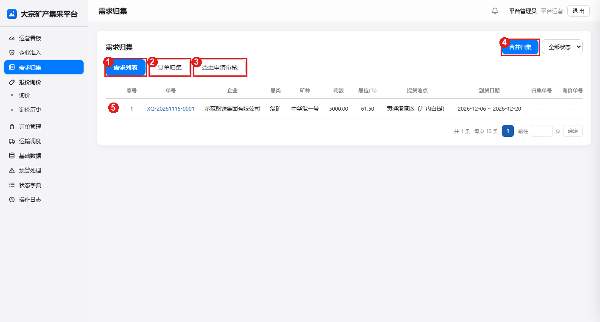

图中标注：① 页签「需求列表」② 页签「订单归集」③ 页签「变更申请审核」④ 明细勾选框（参与归集）⑤「合并归集」按钮

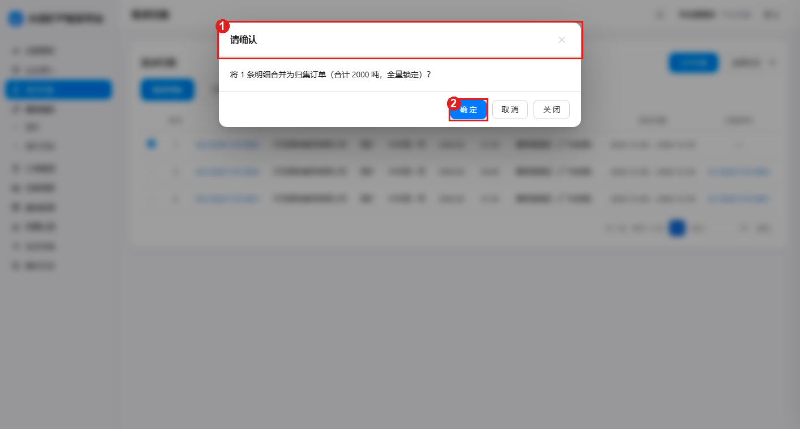

图中标注：①「请确认」弹窗标题栏 ②「确 定」确认按钮

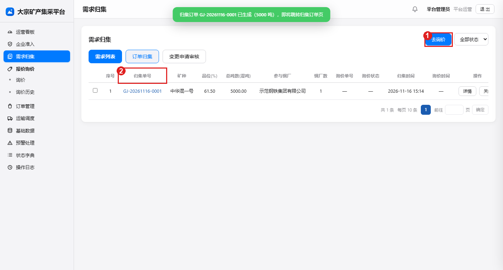

图中标注：① 行操作「去询价」按钮 ② 归集单列表（归集单号、矿种、吨数、状态等）

#### 4.2.5 发起询价与跟踪

1. 「报价询价」页点「发起询价」：选择归集订单，填写期望到货日、报价截止、最少响应家数，勾选邀请供应商，询价说明选填
2. 报价截止须 ≥ 当前时间 +2 小时且 ≤ 到货日期前 7 天，违反时弹窗内提示具体原因
3. 点「保存并发出」后系统通知被邀请供应商（供应商此前不感知任何询价信息）
4. 询价列表跟踪状态：草稿 / 已发出 / 报价中 / 已截止 / 反馈待处理 / 议价中 / 已定标 / 已流标；行操作「详情」查看邀请与响应情况
5. 「询价历史」按轮次只读追溯每轮询价、全部报价与钢厂反馈

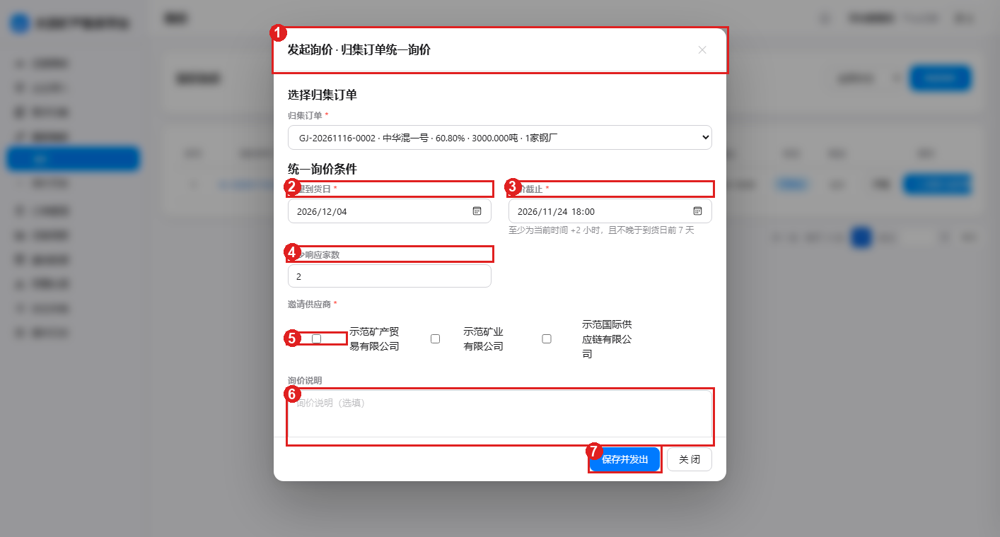

图中标注：① 发起询价弹窗标题栏 ②「期望到货日」③「报价截止」（≥当前+2h，≤到货前 7 天）④「最少响应家数」⑤ 邀请供应商复选框 ⑥「询价说明」（选填）⑦「保存并发出」按钮

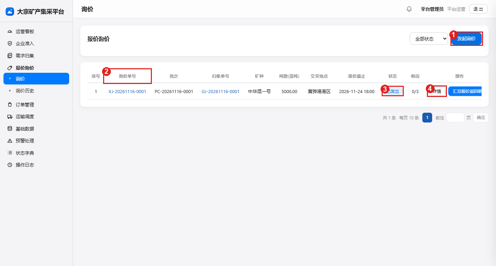

图中标注：①「发起询价」按钮 ② 归集询价列表 ③ 询价状态「已发出」④ 行操作「详情」

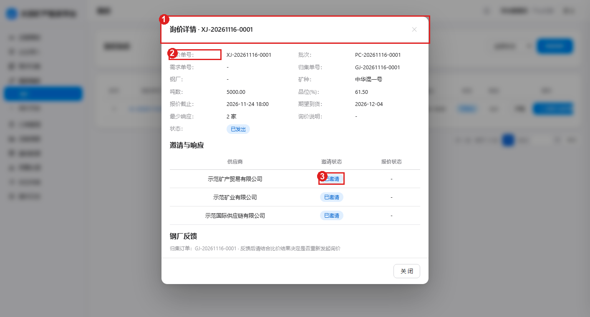

图中标注：① 询价详情弹窗标题栏 ② 询价单号字段 ③ 供应商邀请状态「已邀请」

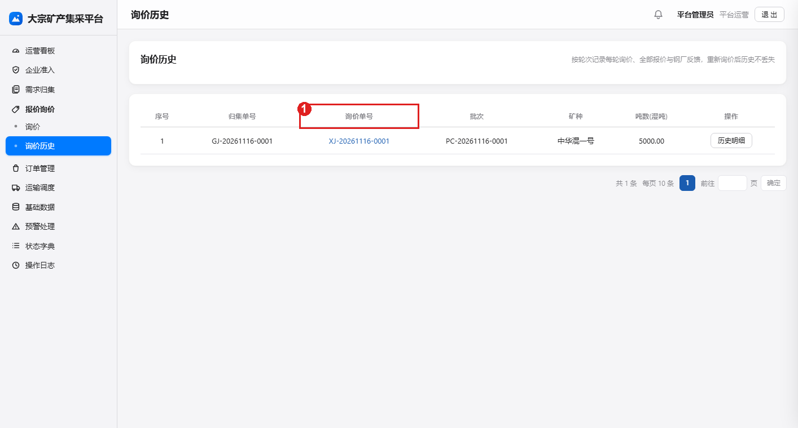

图中标注：① 询价历史列表（按轮次只读展示）

#### 4.2.6 订单管理

1. 「订单管理」查看聚合订单列表：订单号、询价单号、矿种、总吨数、供应商、参与钢厂数、提货计划进度、状态；支持订单号筛选与状态筛选
2. 行操作「详情」：弹窗展示各钢厂份额与提货计划明细（开始提货日期、日提货吨数、备注、提交时间；未提交标橙）
3. 全部钢厂提交提货计划后订单转「待制定运输方案」，行操作「运输方案」直达运输调度页

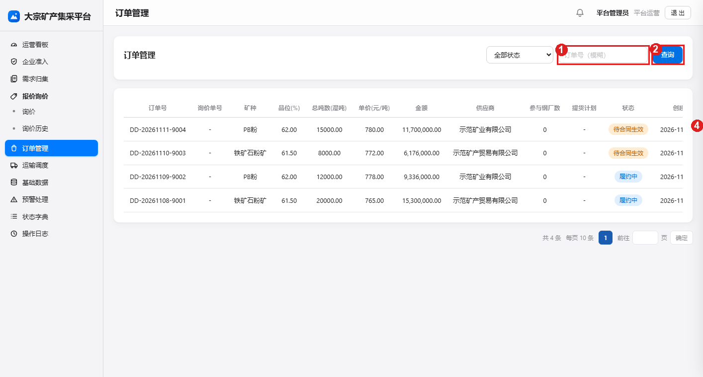

图中标注：① 订单号筛选输入框 ②「查询」按钮 ③ 行操作「详情」④ 行操作「运输方案」（跳转运输调度）

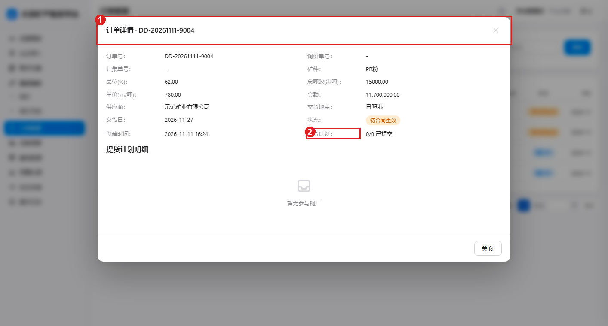

图中标注：① 订单详情弹窗标题栏 ② 提货计划明细区（未提交的钢厂行标橙）

#### 4.2.7 运输调度

1. 「运输调度」两个页签：「物流调度」（订单表，行操作「制定方案」）与「在途监控」（运单表）
2. 制定运输方案后点「新增分段运单」：运输方式（铁路直达 / 公铁联运 / 汽运直达，公铁联运必填中转站）、起运地（黄骅港 / 天津港）、到达地、预计船到港时间、计划发运日 / 计划到达日、计划量（吨）、运费（必填）、车船号；分段计划量合计与订单量偏差 >5% 须填偏差说明
3. 运单创建即确认生效（默认平台承担运输）
4. 「在途监控」按运单状态提供「节点录入 / 确认发运 / 确认到达 / 代签收」操作；节点录入弹窗选择运单当前到达节点（船到港 / 货物出港 / 到达目的地）与节点发生时间，系统自动补齐未登记的前置节点

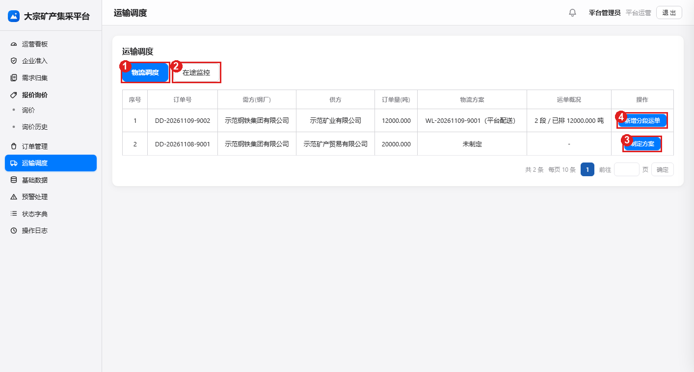

图中标注：① 页签「物流调度」② 页签「在途监控」③ 行操作「制定方案」④「新增分段运单」按钮

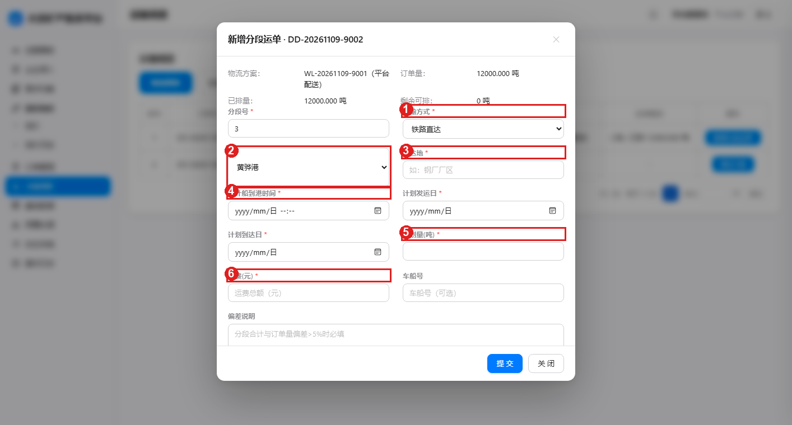

图中标注：① 运输方式（铁路直达 / 公铁联运 / 汽运直达）② 起运地下拉（黄骅港 / 天津港）③ 到达地 ④ 预计船到港时间 ⑤ 计划量（吨）⑥ 运费（必填）

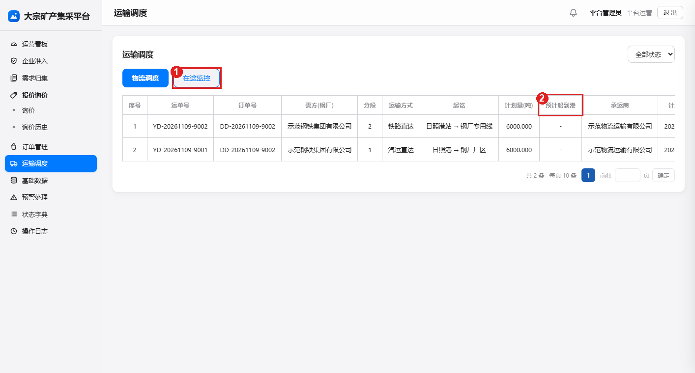

图中标注：① 页签「在途监控」②「预计船到港」列

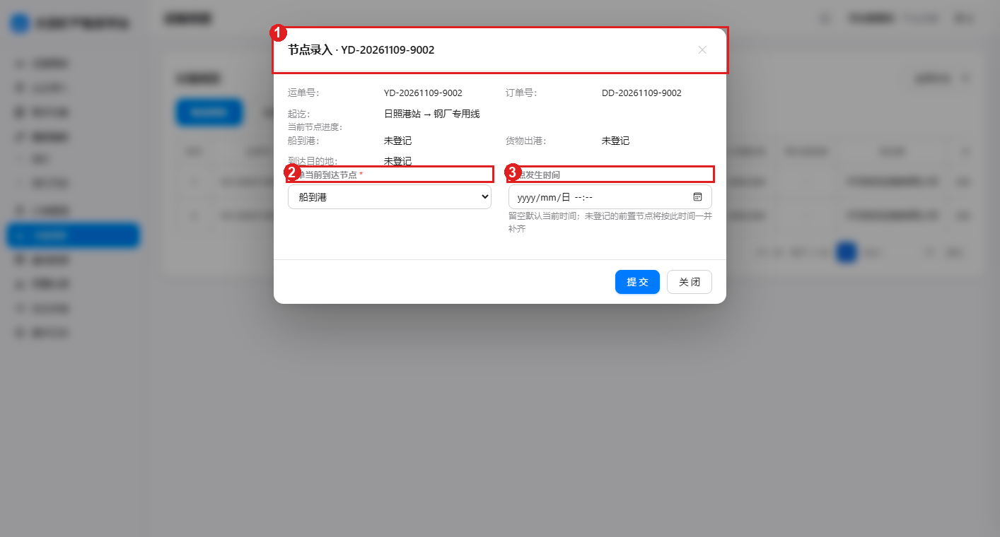

图中标注：① 节点录入弹窗标题栏 ②「运单当前到达节点」下拉（按运单状态自适应可选节点）③「节点发生时间」

#### 4.2.8 基础数据（品种维护）

1. 「基础数据」→「品种列表」：品种代码、品种名称、品类、默认品位、计量单位、状态
2. 「新增品种」添加新矿种；行操作「改品类」调整品类归属

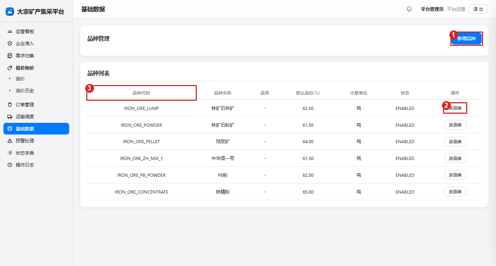

图中标注：①「新增品种」按钮 ② 行操作「改品类」③ 品种列表

#### 4.2.9 预警处理

质检到货数量偏差超允差等情形自动生成预警（同类未关闭预警去重，每天扫描一次）。平台与相关企业均可登记处理中 / 填写意见关闭，关闭须填处理意见。

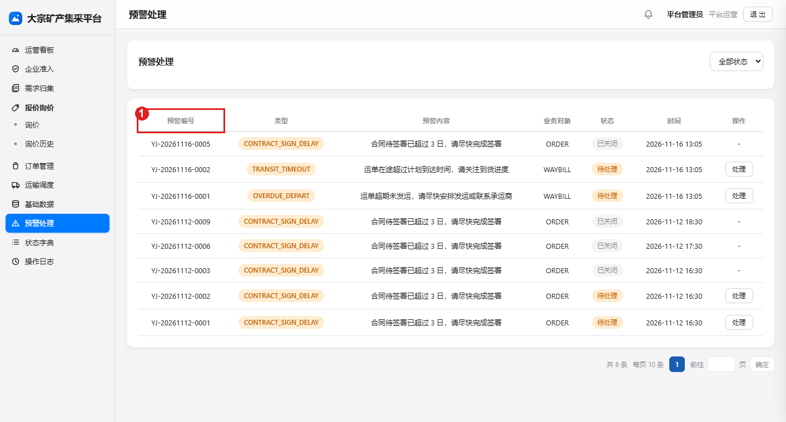

图中标注：① 预警列表（预警类型、等级、状态、发生时间等）

#### 4.2.10 状态字典与操作日志

- 「状态字典」：按业务分组展示各业务对象的状态含义、业务解释与流转路径
- 「操作日志」：按业务类型（如需求）、业务 ID 与时间范围查询操作留痕

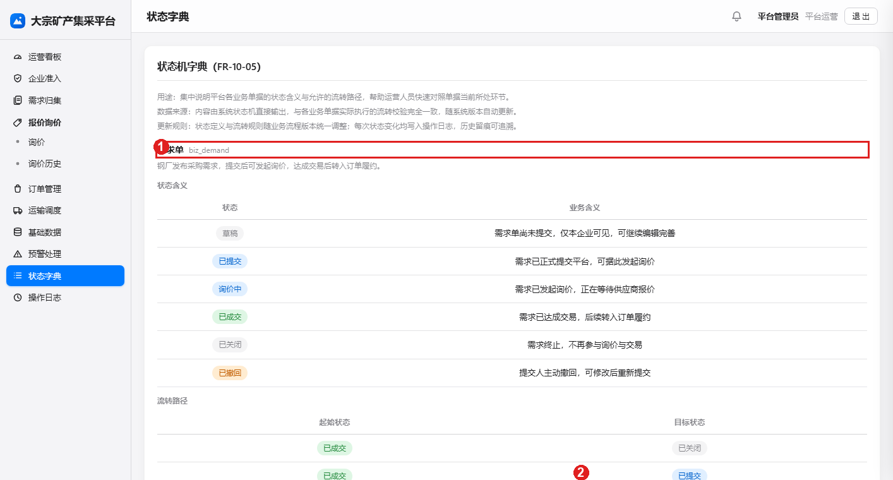

图中标注：① 业务分组「需求单」② 状态含义子表（状态 / 业务含义）

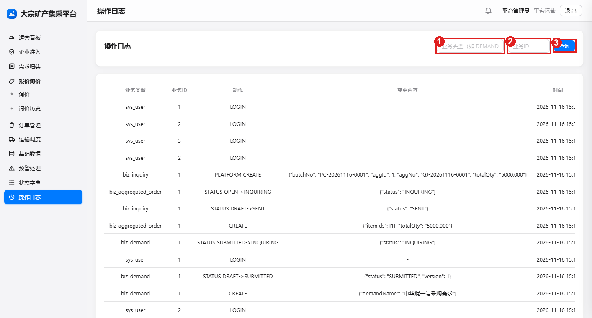

图中标注：① 业务类型筛选 ② 业务 ID 筛选 ③「查询」按钮

### 4.3 钢厂（需方）操作流程

登录钢厂账号（13800000001 / demo123456）。左侧菜单依次为：总览、需求管理、基准价行情、采购询价、议价定标、订单、物流服务、履约跟踪、企业信息。

#### 4.3.1 总览

总览页展示 KPI 卡（订单总数 / 待询价 / 运输中 / 待付款，点击卡片跳转对应页面）、「去采购」一键直达需求管理、采购全流程概览与采购订单列表。

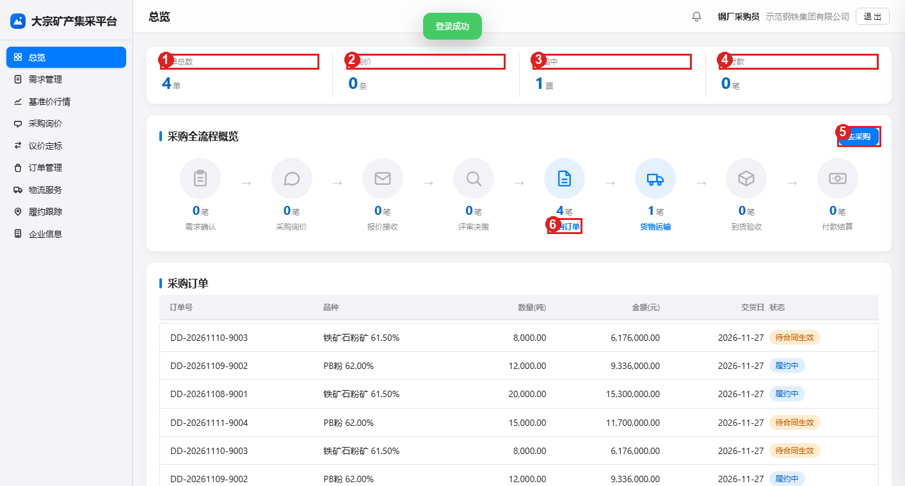

图中标注：① KPI 卡「订单总数」② KPI 卡「待询价」③ KPI 卡「运输中」④ KPI 卡「待付款」⑤「去采购」按钮（一键直达需求管理）⑥ 采购全流程概览 · 采购订单区

#### 4.3.2 需求申报

1. 「需求管理」点「新建需求」：选择产品名称（PB粉 / 中华混一号）、输入品位与数量、选择交货方式（到厂 / 到站自提）、填写交货地点、期望到货起止日期、结算方式（预付款 / 货到付款 / 账期，账期需填账期天数）、质量要求
2. 点「保 存」存为草稿；行操作「提交」正式申报（弹窗确认）
3. 提交后关键字段锁定（错误码 40901）；行操作「撤回」后修改再「重新提交」，版本号自动 +1

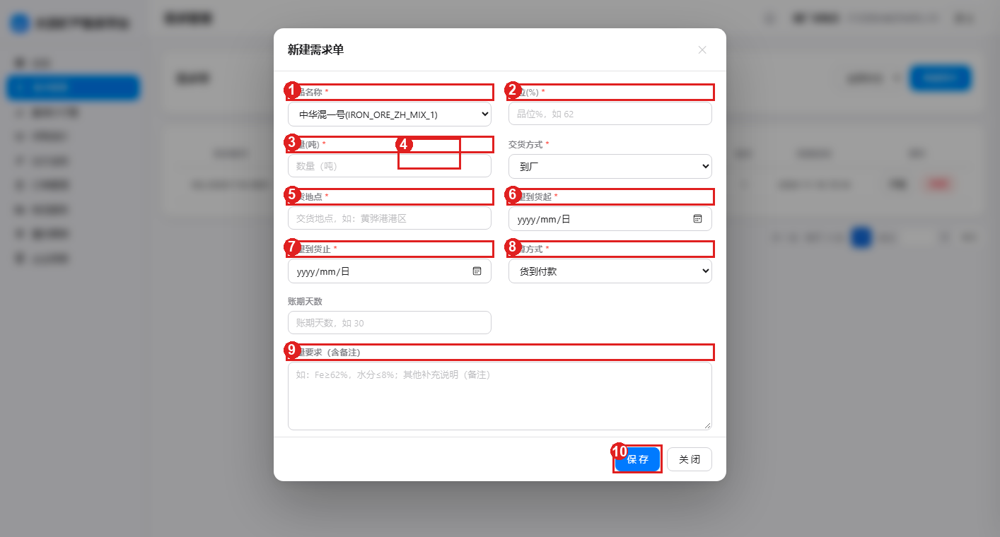

图中标注：① 产品名称下拉（PB粉 / 中华混一号）② 品位输入 ③ 数量输入 ④ 交货方式（到厂 / 到站自提）⑤ 交货地点输入 ⑥ 期望到货起 ⑦ 期望到货止 ⑧ 结算方式 ⑨ 质量要求（含备注）⑩「保 存」按钮

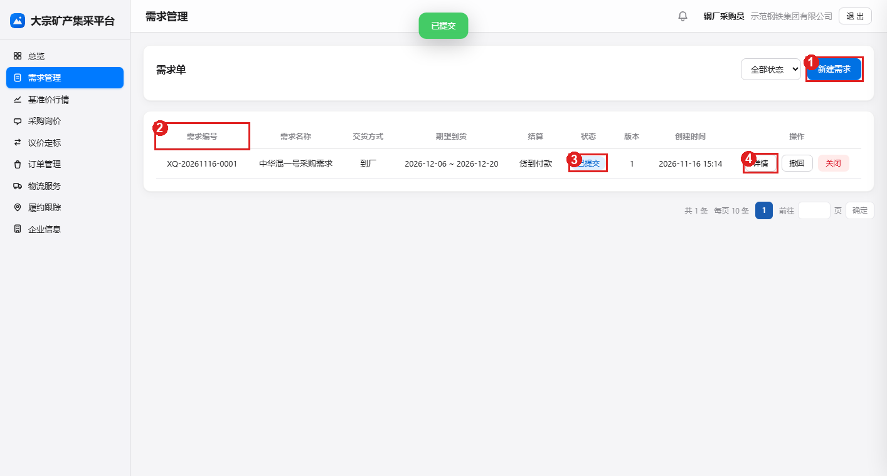

图中标注：①「新建需求」按钮 ② 需求列表表头（版本号、状态等）③ 需求状态「已提交」④ 行操作「详情」

#### 4.3.3 基准价行情

「基准价行情」展示今日基准价表（产品名称 / 品位 / 港口 / 基准价（元/湿吨）/ 计价口径 / 价格日期 / 来源，与运营端录入的港口价同源联动）与近 30 日走势图，支持品位切换。

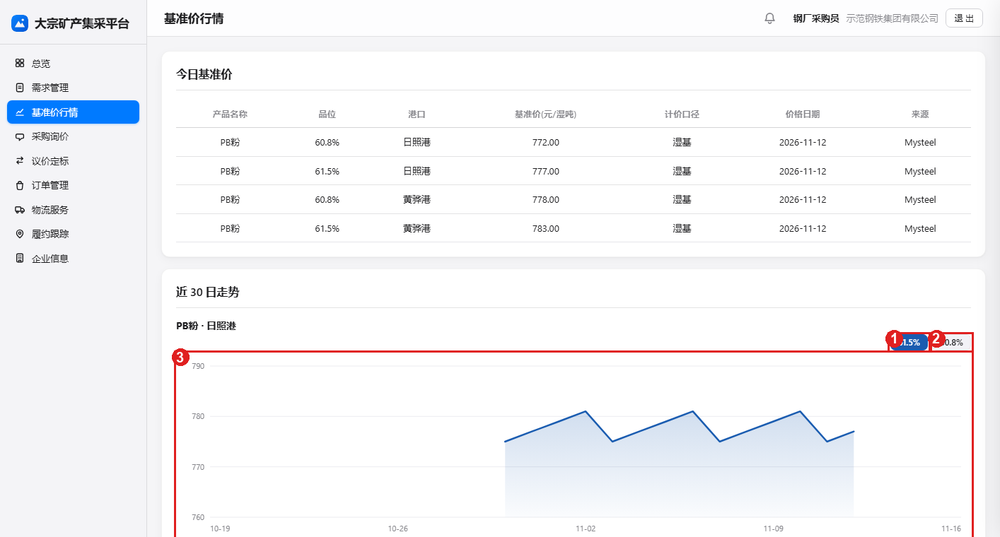

图中标注：① 品位切换「61.5%」② 品位切换「60.8%」③ 近 30 日价格走势图

#### 4.3.4 采购询价

1. 「采购询价」列表展示运营端代发的询价，可按状态筛选（全部状态 / 各询价状态）
2. 行操作「详情」：弹窗展示询价信息与报价截止；归集询价揭示后出现「报价供应商」分区展示各供应商报价
3. 反馈环节：点「认可」（确认后不可修改）或「不认可」（必填理由）；全员认可自动成单，任一不认可则询价转「反馈待处理」，由平台重新发起询价

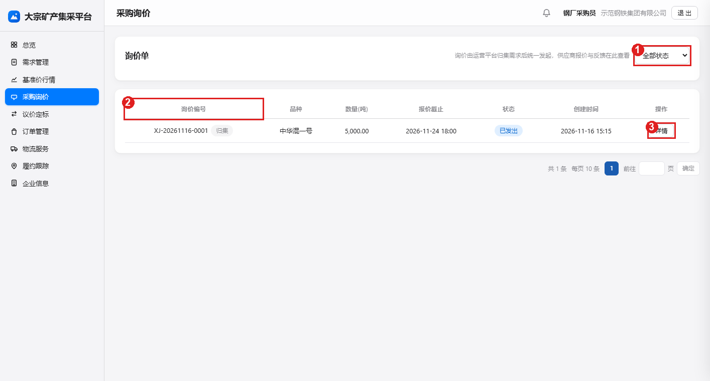

图中标注：① 询价状态筛选下拉 ② 采购询价列表（询价编号 / 品种 / 数量 / 报价截止 / 状态）③ 行操作「详情」

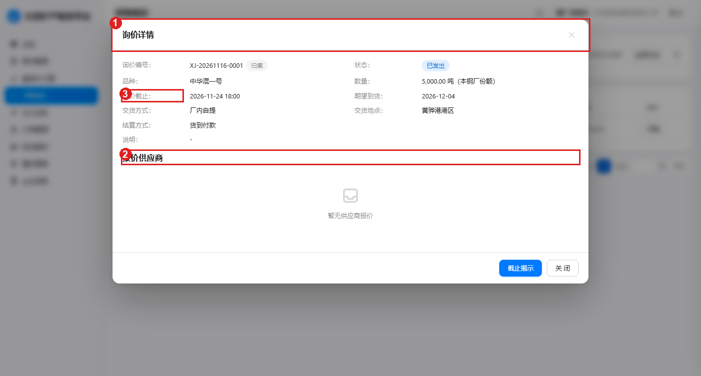

图中标注：① 询价详情弹窗标题栏 ② 报价供应商分区（归集询价）③ 报价截止字段

#### 4.3.5 议价定标（四阶段工作台）

「议价定标」顶部为四阶段步骤条，点击阶段圆点筛选对应列表：**阶段一 已揭示待议价**（评审报价并反馈认可 / 不认可）→ **阶段二 议价中**（多轮议价）→ **阶段三 已定标**（查看定标结果）→ **阶段四 反馈待处理**（钢厂不认可的询价，等待平台重新发起询价）。

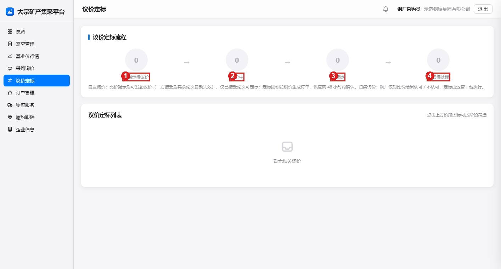

图中标注：① 阶段一 · 已揭示待议价 ② 阶段二 · 议价中 ③ 阶段三 · 已定标 ④ 阶段四 · 反馈待处理

#### 4.3.6 订单与提货计划

1. 「订单」列表展示本厂订单，行操作「详情」：弹窗含本厂份额吨数与关联合同信息
2. 在订单详情或行操作中提交**提货计划**：开始提货日期 + 日提货吨数 + 备注（选填）
3. 全部钢厂提交后订单自动转「待制定运输方案」，由平台制定运输方案

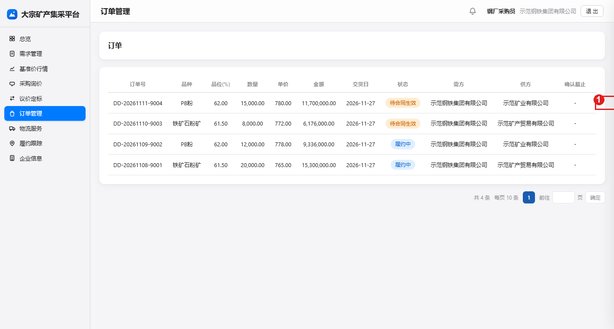

图中标注：① 行操作「详情」

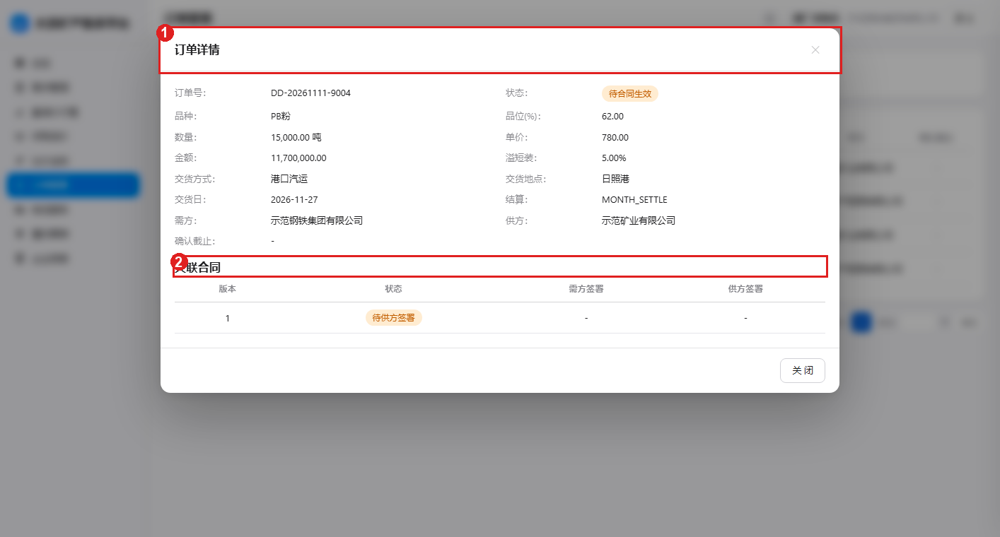

图中标注：① 订单详情弹窗标题栏 ②「关联合同」信息区

#### 4.3.7 物流服务

1. 「物流服务」页顶部「选择订单」下拉切换订单
2. 有运单时展示 95306 式物流轨迹：运单信息条 + 倒序轨迹时间线 + 运输信息面板；运营录入新节点后约 15 秒自动刷新
3. 钢厂无运输方案时提供「创建物流方案」（组织方式：平台配送 / 钢厂自提）

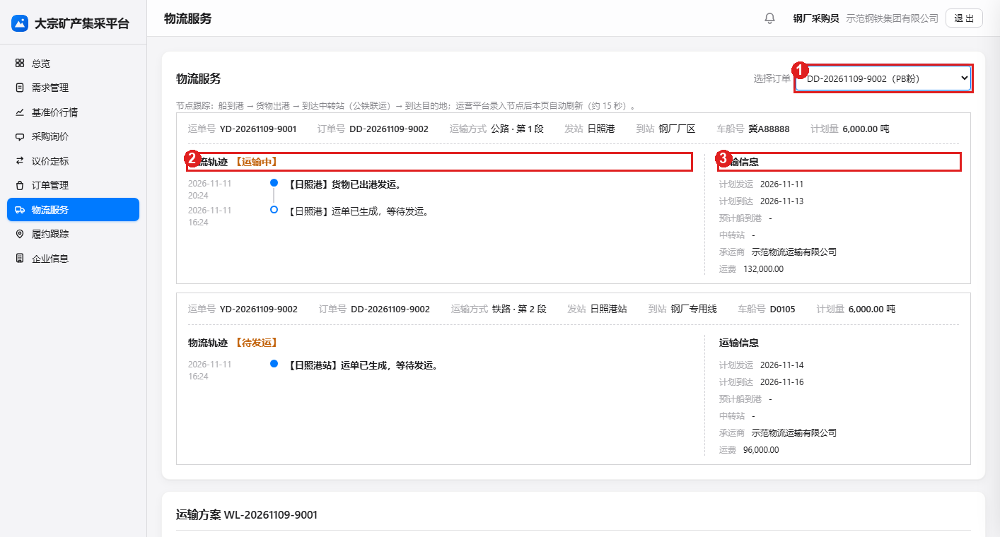

图中标注：① 订单 / 运单切换下拉 ② 95306 式物流轨迹时间线 ③ 运输信息面板

#### 4.3.8 履约跟踪

「履约跟踪」展示节点台账（倒序轨迹），顶部类型筛选：全部 / 订单 / 运单 / 结算；钢厂可使用「手工节点登记」（节点代码 + 发生时间，点「登 记」）补录线下节点。

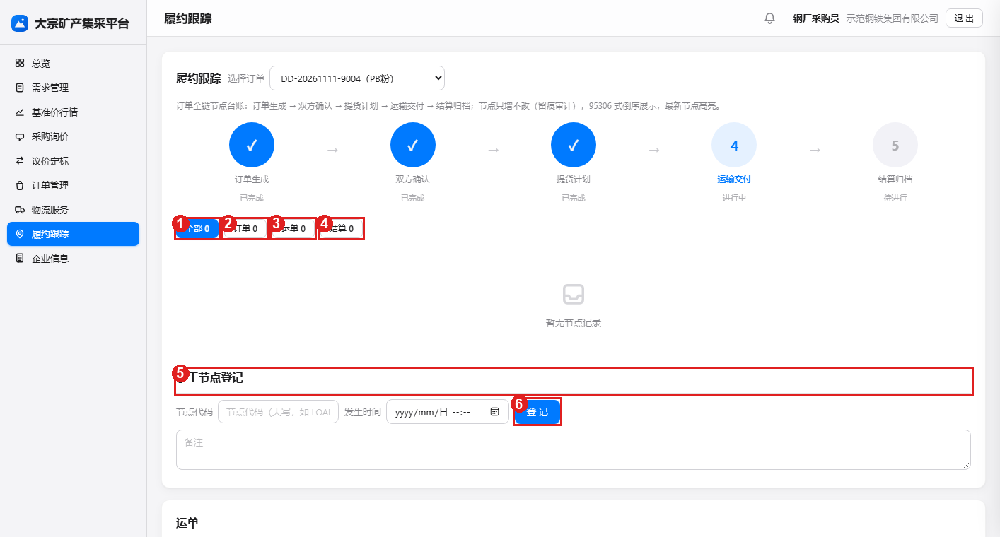

图中标注：① 节点类型筛选「全部」② 节点类型筛选「订单」③ 节点类型筛选「运单」④ 节点类型筛选「结算」⑤ 手工节点登记区 ⑥「登 记」按钮

#### 4.3.9 企业信息

「企业信息」分区展示本企业档案；「信息维护」弹窗修改信息（关键字段改动提交后需平台重新审核）；「资质证照」面板可自行上传营业执照 / 其他资质（PDF/JPG/PNG ≤20MB），支持在线预览与下载。

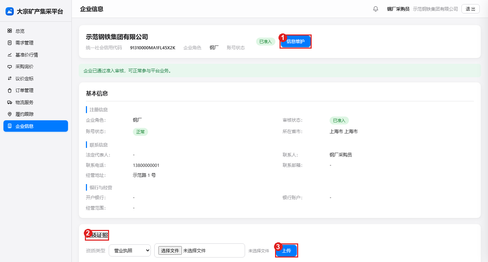

图中标注：①「信息维护」按钮 ② 资质证照面板 ③「资质上传」按钮

### 4.4 供应商（供方）操作流程

登录供应商账号（13800000002 / 13800000003 / 13800000004，密码 demo123456）。左侧菜单依次为：总览、询价报价、订单管理、物流服务、履约跟踪、企业信息。

#### 4.4.1 总览

总览页展示 KPI 五卡（总订单数 / 总交易额 / 待报价单数 / 运输中单数 / 已完成订单，点击跳转）、待办事项表（待报价询价 / 待确认订单，逐条「去处理」）与近期动态。

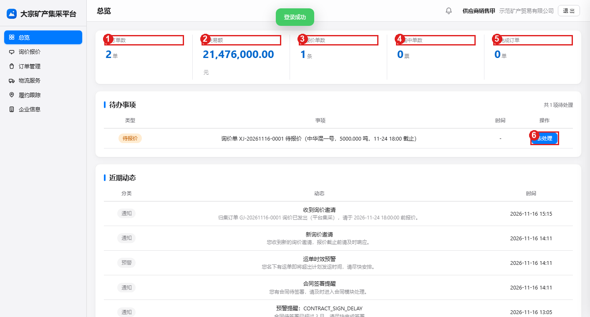

图中标注：① KPI 卡「总订单数」② KPI 卡「总交易额」③ KPI 卡「待报价单数」④ KPI 卡「运输中单数」⑤ KPI 卡「已完成订单」⑥ 待办事项「去处理」按钮

#### 4.4.2 询价与密封报价

1. 「询价报价」列表仅显示运营端代发的平台询价；状态筛选：全部 / 待报价 / 已报价 / 已截止
2. 行操作「详情」：弹窗分区展示采购需求 / 技术参数与质量要求 / 交货与结算要求 / 我的报价 / 报价附件（二次询价另有历史轮次参考）
3. 行操作「报价」打开**密封报价**弹窗：填写单价（元/吨）、含税口径、运价、可供数量、交货时间、交货方式、到货港口、付款条款，质量承诺与备注选填；可上传报价附件（PDF/JPG/PNG ≤20MB，最多 5 个），点「提交报价」
4. 密封规则：报价截止揭示前，需方与第三方均不可见报价内容；同一询价重复整单报价被拦截（错误码 40902），可修改原报价

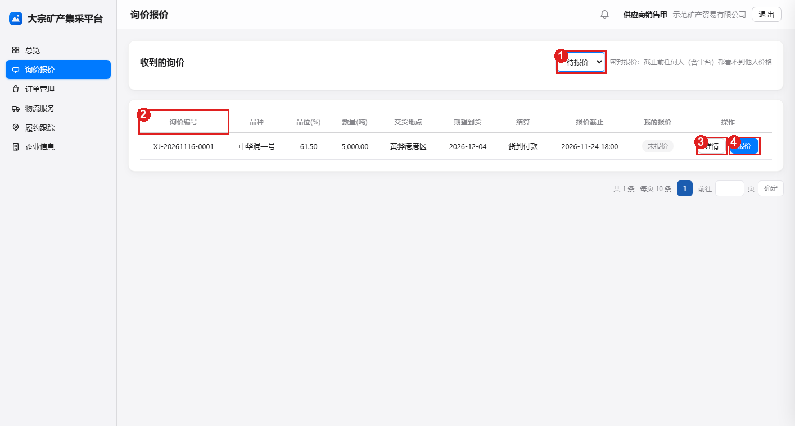

图中标注：① 列表状态筛选（全部 / 待报价 / 已报价 / 已截止）② 询价列表（密封，截止前仅见自己报价）③ 行操作「详情」④ 行操作「报价」

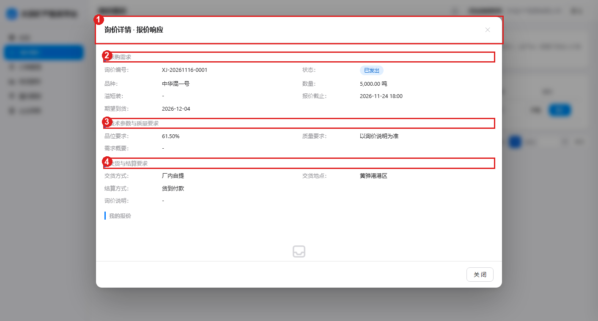

图中标注：① 询价详情弹窗标题栏 ② 分区「采购需求」③ 分区「技术参数与质量要求」④ 分区「交货与结算要求」

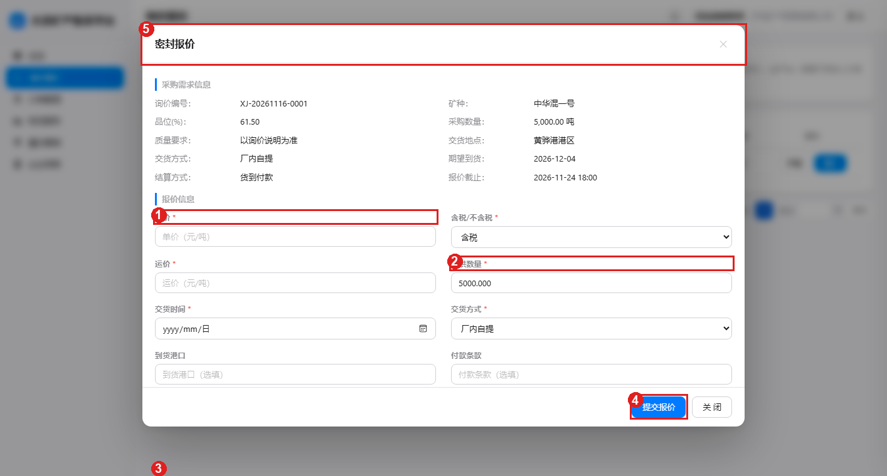

图中标注：①「单价」输入（元/吨，含税口径按页面提示）②「可供数量」输入 ③ 报价附件上传（PDF/JPG/PNG ≤20MB，最多 5 个）④「提交报价」按钮 ⑤ 报价弹窗标题栏「密封报价」

#### 4.4.3 订单管理

1. 「订单管理」列表展示与本供应商相关的聚合订单与状态（订单生成 → 待供应商确认 → 待收集提货计划 → 运输交付 → 结算归档等）
2. 行操作「详情」查看订单与关联合同；待确认订单在「订单确认」区集中处理，点「确认订单」（须在确认截止前确认，超期订单自动取消）

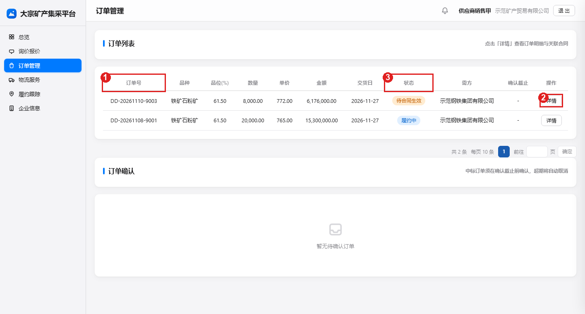

图中标注：① 订单列表 ② 行操作「详情」③ 订单状态列

#### 4.4.4 物流服务（只读）

「物流服务」为只读视图：顶部「选择订单」下拉切换订单后查看运输方案、分段运单与 95306 式物流轨迹。订单尚无运输安排时页面显示提示，待运营平台制定运输方案后自动展示。

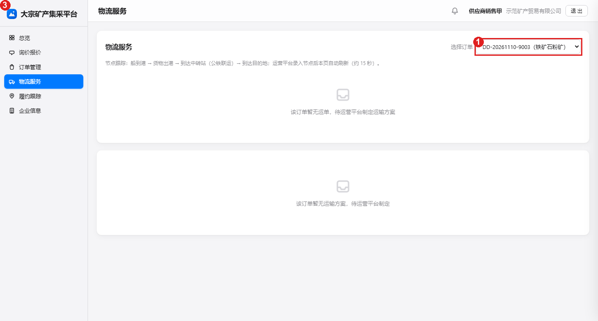

图中标注：① 订单切换下拉 ② 无运单提示「该订单暂无运单，待运营平台制定运输方案」③ 无运输方案提示「该订单暂无运输方案，待运营平台制定」

#### 4.4.5 履约跟踪（只读）

「履约跟踪」展示履约进度五阶段（订单生成 → 双方确认 → 提货计划 → 运输交付 → 结算归档）、履约节点台账（95306 式倒序轨迹）与运单列表（只读，节点类型筛选同钢厂端）。

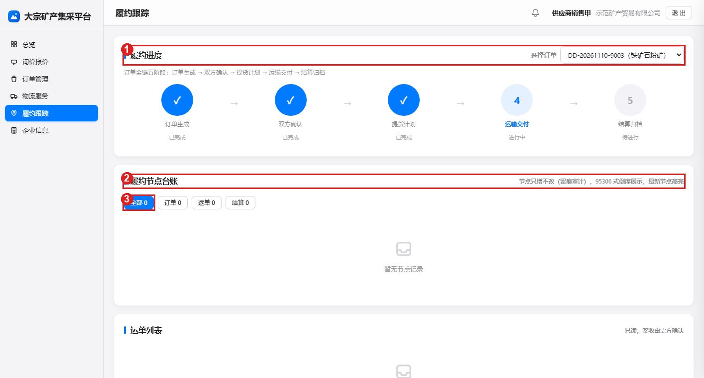

图中标注：① 履约进度五阶段 ② 履约节点台账（倒序）③ 节点类型筛选

#### 4.4.6 企业信息与资质上传

「企业信息」分区展示本企业档案；「信息维护」弹窗修改信息（关键字段改动提交后需平台重新审核）；「资质证照」面板内嵌自行上传（营业执照 / 其他资质），上传后支持预览与下载。

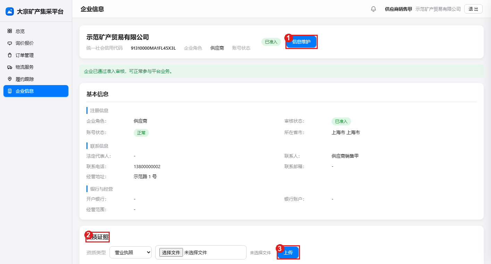

图中标注：①「信息维护」按钮 ② 资质证照面板（内嵌自行上传）③「资质上传」按钮

### 4.5 承运商说明（已下线）

当前版本平台不开放承运商角色：承运商菜单与页面已下线，承运商账号登录会提示「本平台暂不开放承运商端登录」。运输组织由平台运营方在「运输调度」中统一完成（制定运输方案、新增分段运单、节点录入与代签收），钢厂与供应商通过各自的物流服务 / 履约跟踪页只读查看。

### 4.6 推荐演示链路（全流程串讲）

使用 3.4 节演示账号，可按以下顺序完整体验业务闭环：

1. **钢厂申报**（13800000001）：需求管理 → 新建需求（如 PB粉、品位 61.5%、5000 吨、黄骅港港区）→ 保存 → 提交
2. **平台归集**（13800000000）：需求归集 → 勾选明细 → 合并归集 → 确认生成归集单
3. **平台询价**（13800000000）：报价询价 → 发起询价 → 填写截止与最少响应家数 → 勾选 3 家供应商 → 保存并发出
4. **供应商密封报价**（13800000002）：询价报价 → 报价 → 填写单价与可供数量 → 提交报价（截止前仅本人可见）
5. **截止揭示**：报价截止后询价转「已截止」，系统通知各钢厂评审
6. **钢厂评审认可**（13800000001）：采购询价 → 详情 → 认可；全员认可后自动锁货锁价生成聚合订单
7. **供应商确认订单**（13800000002）：订单管理 → 确认订单（确认截止前）
8. **钢厂提货计划**（13800000001）：订单 → 提交提货计划；全部提交后订单转「待制定运输方案」
9. **平台运输调度**（13800000000）：运输调度 → 制定方案 → 新增分段运单 → 在途监控节点录入（船到港 → 货物出港 → 到达目的地）→ 确认发运 / 确认到达 / 代签收
10. **轨迹查看**：钢厂物流服务（约 15 秒自动刷新）与供应商物流服务 / 履约跟踪查看 95306 式轨迹
11. **签收与质检归档**：签收后进入质检环节（数量偏差超允差自动预警），最终结算归档

## 5. 常见问题排查

### 5.1 启动与环境类

| 现象 | 原因与处理 |
|------|------------|
| 启动时报数据库连接失败 | 先执行 `docker compose up -d` 启动数据库容器；用 `docker ps` 确认容器在运行；端口被占用时修改 docker-compose.yml 中的映射端口，并同步设置环境变量 `MINE_PG_DSN` |
| 浏览器打开页面空白 | 确认 `python run.py` 已启动成功（控制台有监听端口输出）；确认访问地址与端口一致（默认 8000）；按 Ctrl+F5 强制刷新清缓存 |
| 8000 端口被占用 | 设置环境变量 `MINE_PORT` 为其他端口后重新启动 |
| 页面提示接口错误 / 列表为空 | 服务刚重启时浏览器可能持有过期登录态，退出登录后重新登录 |
| 演示单据缺失 | 首次启动 `python run.py` 会自动建表并写入演示数据；若曾手动清空数据库，重新执行启动即可恢复演示数据 |
| 时间显示相差 8 小时 | 确认容器与后端均使用 Asia/Shanghai 时区（环境变量 `MINE_PG_TZ`）；从早期版本升级的存量数据库请联系管理员使用项目内提供的一次性数据修正脚本处理 |

### 5.2 登录与账号类

| 现象 | 原因与处理 |
|------|------------|
| 承运商账号（13800000005）无法登录 | 设计如此：承运商端已下线，登录提示「本平台暂不开放承运商端登录」 |
| 新注册企业无法登录 | 注册后需平台管理员在「企业准入」审核通过；审核通过前登录会有相应提示 |
| 密码遗忘 | 平台管理员在「企业准入」行操作「重置密码」，重置后密码为 demo123456 |
| 登录后菜单与手册不一致 | 不同角色菜单不同（见 2.1 节），请确认当前登录的角色账号 |
| 演示账号登录失败 | 核对 3.4 节账号表；管理员密码为 admin123456，其余演示账号为 demo123456 |

### 5.3 业务操作类

| 现象 | 原因与处理 |
|------|------------|
| 新建需求保存后列表找不到 | 保存后为草稿状态，仍在需求列表中，行操作「提交」后才进入归集流程 |
| 需求无法修改（提示状态冲突） | 提交后关键字段锁定（错误码 40901）；先「撤回」再修改，重新提交后版本号自动 +1 |
| 发起询价保存失败 | 检查报价截止：须 ≥ 当前时间 +2 小时且 ≤ 期望到货日期前 7 天（错误码 40001）；最少响应家数不能超过邀请的供应商数量 |
| 供应商看不到询价 | 供应商仅能看到运营端发起并邀请本企业的询价；未勾选邀请则不可见 |
| 报价提交失败（重复报价） | 同一询价不可重复整单报价（错误码 40902），请在原报价上修改后重新提交 |
| 报价附件上传失败 | 仅支持 PDF/JPG/PNG，单个 ≤20MB，最多 5 个 |
| 全员认可自动成单未触发 | 需全部受邀钢厂均反馈「认可」；任一钢厂「不认可」（必填理由）则询价转「反馈待处理」，需运营端重新发起询价 |
| 订单确认按钮不可用 / 订单被取消 | 供应商须在确认截止（48 小时）前点「确认订单」，超期订单自动取消 |
| 提货计划无法修改 | 订单离开「待收集提货计划」后不可再改（错误码 40901） |
| 新增分段运单保存失败 | 运费必填；公铁联运必填中转站；分段计划量合计与订单量偏差 >5% 时须填写偏差说明 |
| 节点录入下拉缺少选项 | 可选节点按运单当前状态自适应；直接选择后续节点时系统自动补齐未登记的前置节点 |
| 物流轨迹长时间不更新 | 页面约 15 秒自动刷新一次；请确认运营端已录入节点且节点发生时间已到 |
| 预警列表没有新增预警 | 预警每日扫描一次且同类未关闭预警去重，非实时产生 |
| 归集单无法关闭 | 仅未发起询价的归集单可关闭，关闭后释放各钢厂锁定量 |

### 5.4 常见提示信息对照

| 提示 / 错误码 | 含义 |
|---------------|------|
| 40001 | 参数校验未通过，常见于报价截止时间规则（≥当前+2 小时、≤到货前 7 天），按弹窗内具体原因调整 |
| 40901 | 业务状态冲突：对象当前状态不允许该操作（如需求已提交锁定、提货计划已收集完毕） |
| 40902 | 重复提交：同一询价已存在整单报价，请修改原报价 |
| 「本平台暂不开放承运商端登录」 | 承运商角色已下线，属正常提示 |
| 「该订单暂无运单，待运营平台制定运输方案」 | 供应商端物流服务的正常占位提示，运营制定方案后自动展示 |

## 6. 系统使用说明更新记录

| 更新日期 | 更新说明 |
|----------|----------|
| 2026-11-16 | 按当前系统界面全面重制本手册：全部章节与界面逐一对齐，45 张截图覆盖三端核心界面与关键操作（红框标注按钮、输入区与提示位置，图文一一对应）；新增 5. 常见问题排查章节；移除已下线的承运商端、合同与结算流程相关操作说明；更新项目目录速览与演示账号说明 |
| 2026-11-15 | 补充供应商端总览、订单管理（订单确认区与确认截止规则）、物流服务只读视图、企业信息资质上传与变更审核闭环；全员认可自动成单调整为先经供应商确认订单 |
| 2026-11-14 | 新增钢厂总览「去采购」一键直达；新增议价定标四阶段工作台说明；补充全员认可自动成单流程 |
| 2026-11-13 | 订单管理页替代原单据总览；补充整单锁货锁价、提货计划收集、运输方案制定流程；移除承运商端与独立合同、结算模块的操作说明 |
| 2026-11-11 | 价格行情支持双品位（61.5% / 60.8%）切换；消息中心改版为四端统一（任务 / 消息双页签）；需求产品限定为演示品种；钢厂需求统一经平台代发询价 |
