# 大宗矿产集采平台 系统使用说明

> 版本：一期演示版
> 适用对象：平台管理员、钢厂（需方）、供应商（供方）、承运商
> 本手册是系统的**终端用户操作文档**：覆盖系统概述、功能模块、环境配置、全链路操作流程与常见问题排查，不含任何开发过程、技术实现与版本变更内容（相关记录见 [开发过程记录](开发过程记录.md)）。

---

## 1. 系统概述

大宗矿产集采平台面向钢厂、供应商、承运商与平台运营方，提供两条并行业务主线：

- **钢厂自主询价线**：需求申报 → 询价报价（密封）→ 议价 → 定标 → 订单确认 → 合同双签 → 平台核验生效 → 物流 → 质检 → 结算 → 付款 → 归档
- **平台归集集采线**：需求申报 → **需求归集（平台合并多钢厂同品种需求）→ 平台代发询价 → 供应商密封报价 → 平台汇总返回钢厂（按份额拆分）→ 成员钢厂反馈（认可/不认可）→ 运营处理反馈（重新询价/采纳）**，与自主询价线在「合同」环节汇合后走相同后续流程

配套平台准入审批、基准价与港口现价管理、需求归集与变更审核、预警与消息通知、状态机字典等运营能力。

两条业务主线的整体流转如下（供应商与承运商在各节点中的操作见 §4.3 / §4.4）：

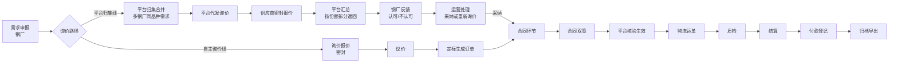

- 前端：原生 JS 单页应用（SPA，Apple HIG 风格），浏览器访问 `http://127.0.0.1:8000`
- 后端：Flask（Python 3），REST API 前缀 `/api/v1`
- 数据库：PostgreSQL 14（Docker 容器 `mine-platform-pg`）

> 关键流程须知：**合同双签后并不立即生效**，需平台管理员在「合同管理 → 合同核验」中核验通过后合同才生效、订单才进入「履约中」；**供应商密封报价三项必填**（含税口径、运费单价、交货方式），缺失将被拒绝（40001）；**需求归集环节的完整节点定义与操作指引见 §4.6**。

## 2. 系统功能模块说明

### 2.1 按角色划分

| 角色 | 登录后可用模块 |
|------|----------------|
| 平台管理员 | 运营看板（价格趋势/行情速览）、企业准入审批、基础数据（品种与基准价）、价格趋势详情/价格行情详情（含港口现价录入）、需求归集与变更审核、归集询价代发、合同平台核验、状态字典、预警处理、操作日志 |
| 钢厂（STEEL） | 需求申报（草稿/提交/撤回/重提/关闭）、基准价行情（分品位/港口）、询价管理（新建/发出/揭示/比价/定标/流标）、议价、订单确认、合同签署、物流方案与运单签收、质检录入、结算确认、付款登记、归档导出、企业信息 |
| 供应商（SUPPLIER） | 脱敏需求池浏览、询价报价（密封，截止前仅见自己报价）、多轮议价、订单确认、合同签署、运单回填、结算确认、企业信息 |
| 承运商（LOGISTICS） | 运单接单、发运/到达回填、企业信息 |

### 2.2 功能模块清单

| 模块 | 说明 |
|------|------|
| 认证与注册 | 免登录执照上传、企业注册（类型别名归一）、登录 |
| 企业准入 | 平台审批（通过/驳回需原因）、企业档案与资质 |
| 品种与基准价 | 品种维护（默认牌号按品位% 数值校验）、基准价按品种+日期录入平台综合价（重复录入为更新留痕）、港口现价按港口+日期维护、行情页按品位/港口分档展示与 30 日走势（分档演示数据由系统初始化写入） |
| 需求申报 | 需求单 CRUD、明细随表单一次录入（品种/品位/数量/溢短装%）、提交/撤回/重提（版本+1）/关闭、提交后关键字段锁定 |
| 需求池（脱敏） | 供应商可见脱敏概要，不泄露企业名称 |
| 询价报价 | 询价单创建/发出（自动邀请全部已准入供应商）、密封报价（含税口径/运费单价/交货方式必填）、截止揭示、比价快照（价格升序固化）、响应不足校验 |
| 需求归集 | 平台将多钢厂同品种同品位需求合并为归集订单（GJ 单号、全量锁定量、成员钢厂份额），代发统一询价（PC 批次、最少响应家数），报价汇总后按份额拆分推送钢厂，成员钢厂反馈认可/不认可（不认可须原因），运营可重新发起询价；含需求变更申请审核 |
| 议价 | 多轮还价/接受/拒绝，接受即其余在途轮次失效；对标面板（基准价/匿名价/近期成交均价） |
| 定标与订单 | 按报价定标生成订单与 48h 确认期限，未中标自动置 LOSE |
| 合同 | 定标后生成待签合同（需方先签）、盖章件 SHA-256 存证、作废重签版本化、双签后需平台核验方可生效 |
| 物流 | 物流方案（分段、偏差>5% 须说明）、运单指派、承运商回填、需方签收 |
| 履约时间轴 | 订单/合同/运单/系统节点汇总展示 |
| 质检与预警 | 质检记录录入、超差自动预警、预警处理（关闭须意见）、同类未关闭预警去重 |
| 结算与付款 | 按最近质检实收生成结算（系统计算金额）、双向确认冻结、付款登记后归档；结算工作台仅列「履约中」订单 |
| 归档导出 | 订单档案 zip（含 manifest.json） |
| 消息通知 | 关键节点站内消息（含合同核验结果通知） |
| 运营后台 | 状态机字典展示、企业管理、基准价录入（品种+日期平台综合价）、港口现价录入、需求归集与变更审核、合同核验入台账、预警处理 |
| 定时任务 | 截止揭示、期限预警等（可 MINE_DISABLE_JOBS 关闭） |

### 2.3 关键业务规则速查

- 询价截止时间：**≥ 当前时间 +2 小时**，且 **不晚于到货日期前 7 天**（违反返回 40001）
- 需求单状态机：`DRAFT → SUBMITTED ⇄ WITHDRAWN → SUBMITTED(版本+1)`；提交后关键字段锁定（40901）
- 需求归集：仅 **同品种同品位、已提交（SUBMITTED）、有剩余可归集量** 的明细可合并（40001）；归集即全量锁定量（`inquired_qty = quantity`）、需求转「询价中」；归集订单仅 **未询价（OPEN）** 可关闭（40901），关闭释放锁定量，需求无其他在途询价时回退「已提交」
- 归集询价：平台代发（`buyer_id=NULL`、来源=平台归集、批次号 PC 前缀），统一询价条件须 ≥当前+2h 且 ≤到货前 7 天、至少邀请 1 家供应商；**钢厂对归集询价只可反馈（认可/不认可），不可议价/定标**；不认可必须填原因，反馈后询价单转「反馈待处理」（FEEDBACK），运营重新发起询价后旧单转已处理（CLOSED）
- 归集反馈推送：报价汇总揭示后按 **成员钢厂份额拆分** 推送（钢厂仅见本厂份额量的比价表与供应商名单，不见归集总量与他人份额）
- 密封报价：截止前需方不可见任何报价，供应商不可揭示（40301）
- 报价必填：含税口径（INC_TAX 含税 / EX_TAX 不含税）、运费单价（≥0）、交货方式（PORT_FOB 港口离岸 / PORT_TRUCK 港口自提 / PLANT 厂内自提），缺失返回 40001
- 合同签署顺序：需方先签，供方后签（40901）；未生效合同可作废重签；**双签后合同状态=待平台核验，需运营核验（通过/退回附原因）合同才生效，订单随之进入履约中**
- 结算确认：双向确认后冻结，不可重复确认（40901）

## 3. 环境配置步骤

### 3.1 前置依赖

- Python 3.10+
- Docker（用于 PostgreSQL 14）
- 依赖安装：`pip install -r requirements.txt`（flask / psycopg[binary] / bcrypt / requests / pytest）

### 3.2 启动数据库

```powershell
# 在项目根目录执行（首次会创建容器与数据卷）
docker compose up -d
# 验证容器状态
docker ps --filter name=mine-platform-pg
```

默认连接参数（见 docker-compose.yml）：

- 主机/端口：`127.0.0.1:5432` · 用户：`postgres` · 密码：`Langchain2026` · 库：`mine_platform`
- 业务时区：`Asia/Shanghai`（可通过环境变量 `MINE_PG_TZ` 调整）

### 3.3 启动后端（含自动建表与演示数据）

```powershell
python run.py
```

- 首次启动自动创建表结构并写入演示数据（含 PB 粉多港口/多品位分档基准价演示数据）
- 访问：`http://127.0.0.1:8000`
- 可选环境变量：`MINE_PG_DSN`（数据库连接串）、`MINE_JWT_SECRET`、`MINE_PORT`、`MINE_DISABLE_JOBS`

### 3.4 演示账号

| 角色 | 账号 | 密码 | 企业 |
|------|------|------|------|
| 平台管理员 | 13800000000 | admin123456 | 平台运营 |
| 钢厂/需方 | 13800000001 | demo123456 | 示范钢铁集团有限公司 |
| 供应商 | 13800000002 / 13800000003 / 13800000004 | demo123456 | 示范矿产贸易 / 示范矿业 / 示范国际供应链 |
| 承运商 | 13800000005 | demo123456 | 示范物流运输有限公司 |

> 说明：以上为 `python run.py` 首次启动时系统初始化写入的示范企业账号（138 号段，密码统一 `demo123456`）。初始化幂等：对已初始化的库重复启动会跳过账号创建、仅补齐演示单据，不会覆盖已有业务数据。

## 4. 操作流程指引

### 4.1 平台管理员（运营）

管理员登录后默认进入「运营看板」，左侧菜单依次为：运营看板 / 企业准入 / 需求归集 / 报价询价 / 合同管理 / 运输调度 / 对账结算 / 基础数据 / 单据总览 / 预警处理 / 状态字典 / 操作日志。其中 运输调度、对账结算、单据总览 见 §2.2 功能清单与 §4.5 阶段五；「报价询价」为平台归集代发询价的操作页（含需求变更审核，见第 6 步）。核心操作按以下步骤：

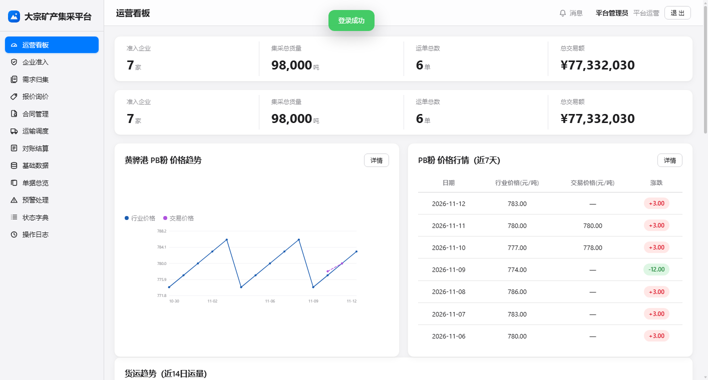

1. **运营看板**（默认首页）：顶部统计卡（准入企业/集采总货量/运单总数/总交易额）；「黄骅港 PB粉 价格趋势」双线图（行业价格 vs 交易价格）与「PB粉 价格行情（近 7 天）」，右上有「详情」按钮分别跳转价格趋势详情/价格行情详情；下方货运趋势、矿种分布、运输方式运量对比
2. **企业准入**：审核待准入企业，**驳回必须填写原因**；审核通过后企业方可使用业务功能；列表支持按审核状态筛选，行内可启用/停用企业账号

   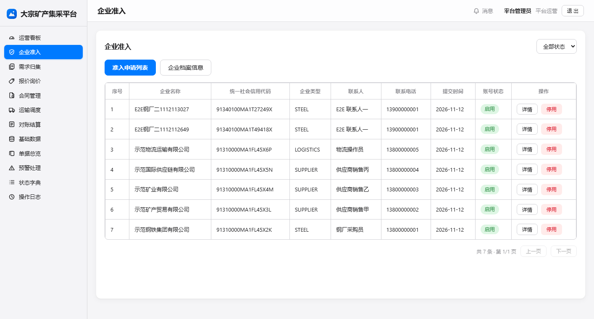
3. **基础数据**：两张卡片——「品种管理」（新增/编辑品种，默认牌号为品位% 数值，需在 0～100 之间）与「今日基准价」。点「录入基准价」弹窗填写：**品种（下拉）、报价日期、基准价（元/吨）、计价基准（湿基/干基）、数据来源说明** →「保 存」→ toast「基准价已录入」
   - 注意：基准价按 **品种+日期** 维护平台综合价，同品种同日重复录入即更新（留痕）；**分品位/分港口的多档行情数据由系统初始化自动写入**（锚定兰格钢铁网公开报价），行情页按品位/港口分档展示，无需在此逐档录入

   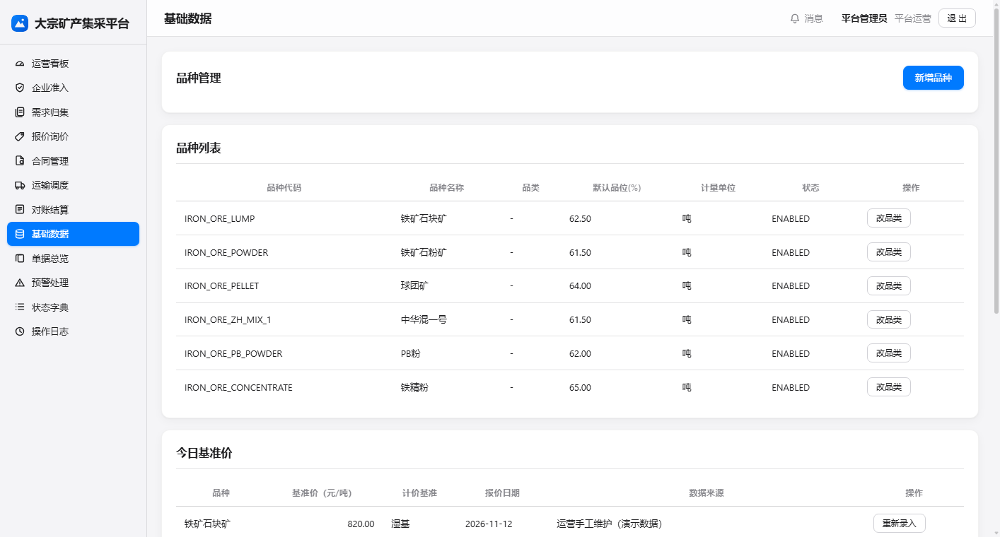

4. **价格趋势详情**：PB粉 今日港口价（每港口最新一条）、行业价格走势（分港口多图）、交易价格走势（平台成交均价）
5. **价格行情详情**：全部价格数据表（日期/行业价格/交易价格/涨跌）＋「录入 / 更新港口价格」表单（**港口名称、价格日期、价格（元/吨）**；同一港口同一日期重复保存即更新价格，toast「已保存」）

   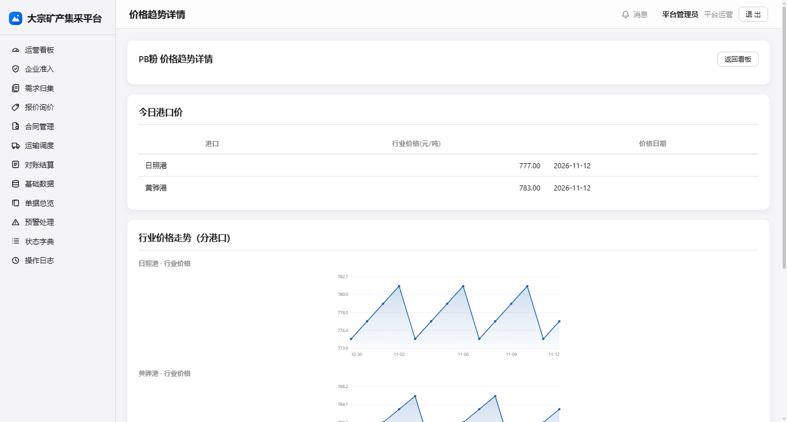

   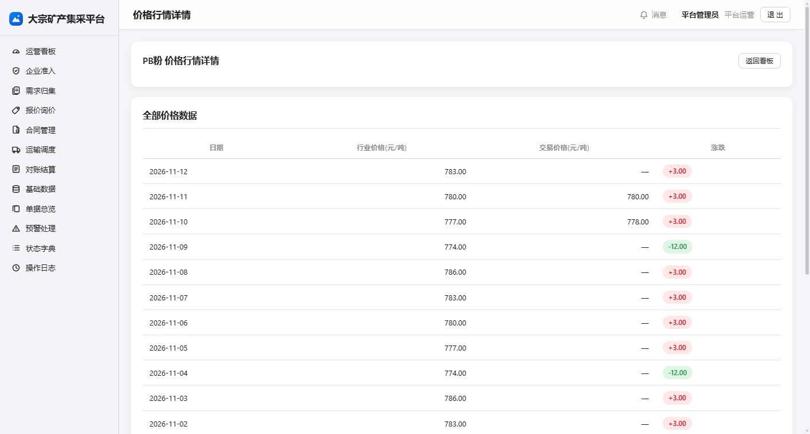

6. **需求归集**（入口页，含三个页签）：
   - 「需求列表」页签：按明细行展开汇集各钢厂需求（需求单×品种明细一行，含品种/品位/数量/已询量/剩余可归集量），可按状态筛选。**勾选同品种同品位的多条明细 → 点「合并归集」** → 生成归集订单（GJ 单号），明细剩余可归集量全量锁定，需求转「询价中」，成员钢厂收到站内信「需求已纳入归集订单」
   - 「订单归集」页签：列出已生成的归集订单（GJ 单号/品种/归集量/成员钢厂数/状态），勾选「已归集（OPEN）」订单 → 点「去询价」跳转「报价询价」页发起询价；仅 OPEN 状态可关闭（释放锁定量，需求无其他在途询价时回退已提交）
   - 「变更审核」页签：审批钢厂提交的需求变更申请（**驳回必填原因**），结论站内通知申请方
   - 注意：品位不一致（40001）、已询尽（无可归集量）、非已提交状态的需求明细不可合并；同一明细不可重复归集

   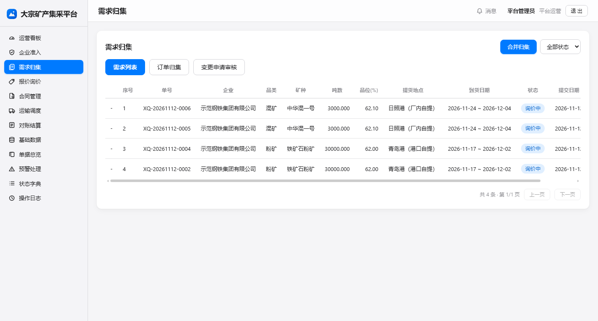

7. **报价询价**（平台归集代发询价的操作页）：左上「归集询价」列表展示平台代发的询价单（批次号 PC 前缀、状态、响应情况），右上「发起询价」按钮打开「发起询价 · 归集订单统一询价」弹窗：
   - 选择归集订单（下拉项格式：GJ 单号 · 品种 · 品位% · 归集量 · N 家钢厂）
   - 统一询价条件：**期望到货日、报价截止**（≥当前+2 小时且不晚于到货日期前 7 天）、**最少响应家数**（默认 2）
   - 邀请供应商：勾选至少 1 家已准入供应商（40001）
   - 「保存并发出」→ toast「归集询价已发出」，归集订单转「询价中」，成员钢厂收到「归集需求已发起询价」、受邀供应商收到「收到询价邀请」站内信
   - 供应商报价后，行内「汇总报价返回钢厂」按钮可执行揭示：报价按价格升序固化为快照，并**按成员钢厂份额拆分推送**（钢厂仅见本厂份额的比价表），钢厂收到「平台报价汇总推送」站内信
   - 钢厂反馈后（不认可则询价单转「反馈待处理」），行内「反馈详情」可查看各钢厂反馈结论与原因；**不认可时可在同一归集订单上再次「发起询价」**（可调整询价条件），旧询价单自动转已处理
   - 全流程图文演示见 §4.6

   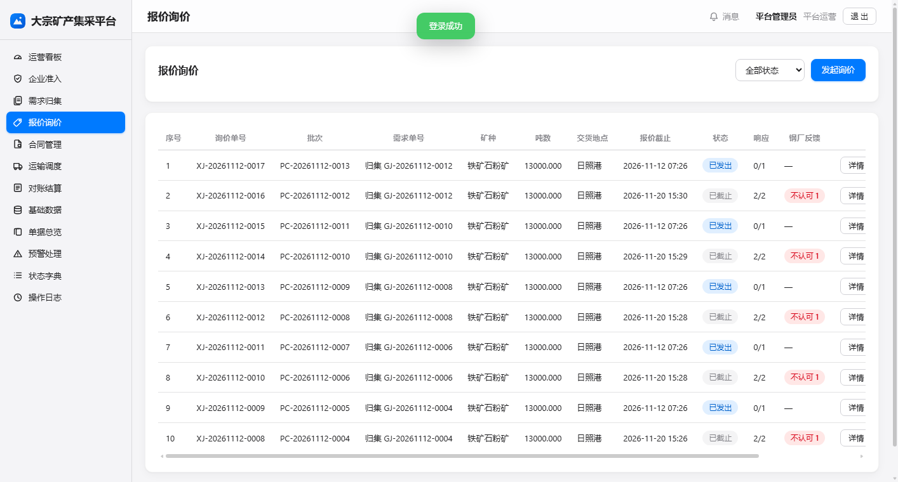

   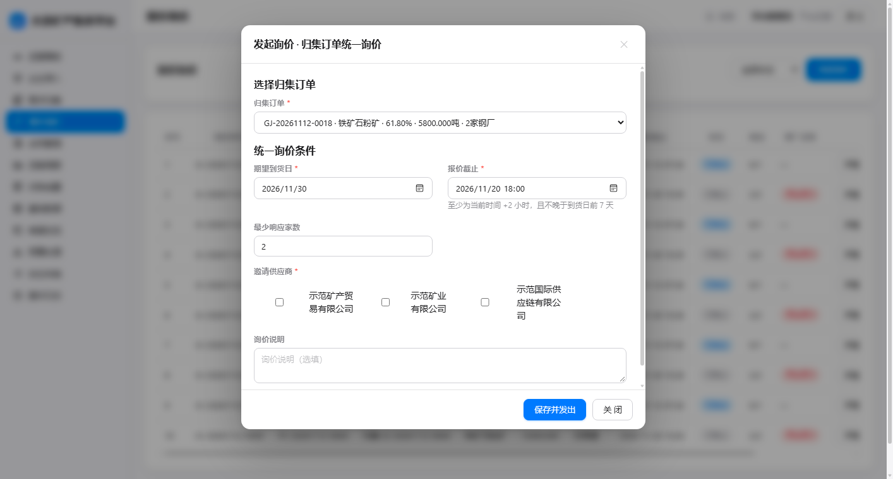

8. **合同管理**（默认「合同核验」页签）：列出双签后待核验合同（需方/供方签署时间均已有、平台状态=待核验），行内显示「核验」按钮（已核验行显示「详情」）。点「核验」→ 弹窗「合同核验 · 合同号」：核验结论默认「确认」（核验通过，合同生效入台账）；选「不确认」时**退回原因必填** →「提 交」。通过 → toast「合同已生效并纳入台账」，合同生效、订单转履约中，双方收到站内信；不确认 → toast「已退回上传方」，合同平台状态=已退回并附原因
   - 全流程演示见 §4.5 阶段四 S18（图 18-合同核验弹窗、18-合同已生效）

   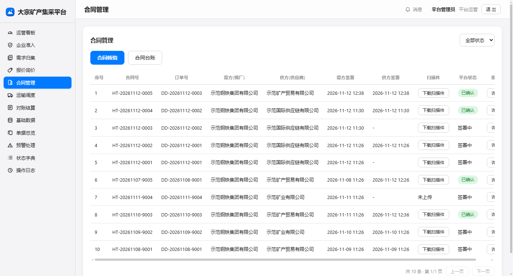

9. **状态字典**：查看各业务对象（需求/询价/报价/合同/订单/结算等）的状态含义、业务解释与流转路径，含特殊取值与业务关联规则提示——排查状态疑问时优先查此页

   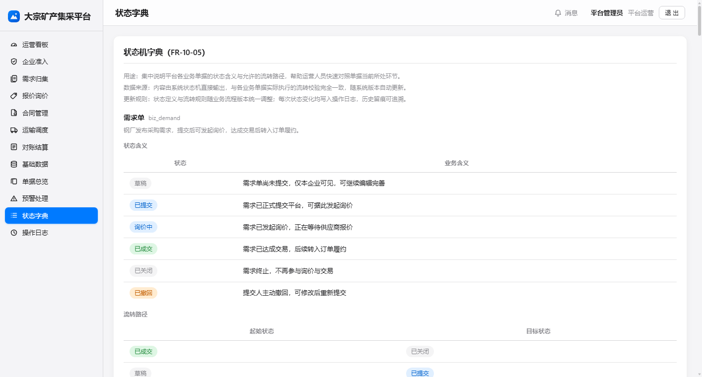

10. **预警处理**：处理质检超差等自动预警，**关闭预警必须填写处理意见**

### 4.2 钢厂（需方）核心流程

登录后落地「需求管理」，左侧菜单依次为：需求管理 / 基准价行情 / 询价报价 / 议价定标 / 订单 / 合同 / 物流方案 / 履约跟踪 / 结算管理 / 企业信息。

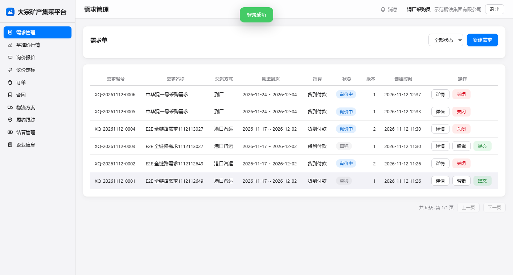

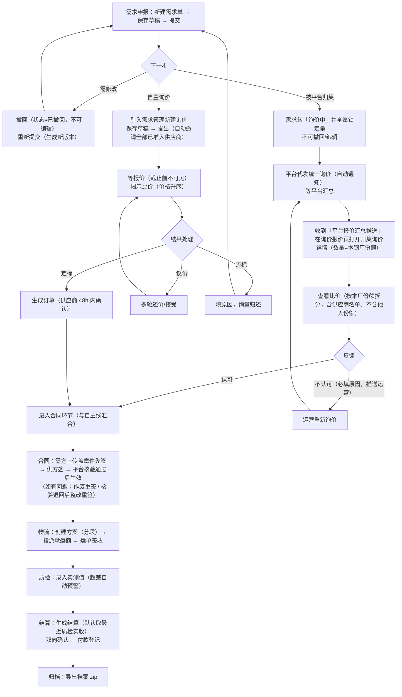

行情查看：「基准价行情」页按 **品位/港口分档** 展示当日基准价与 30 日走势（无分档信息的记录显示「平台综合」），数据来源说明见页顶锚点（兰格钢铁网）。

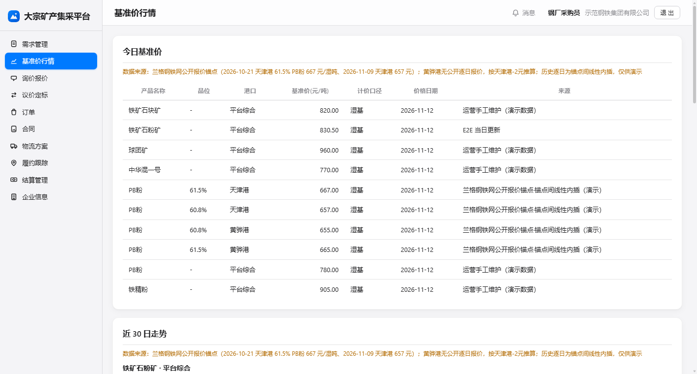

### 4.3 供应商（供方）

1. 「需求池」浏览脱敏需求（不泄露需求方企业名称）
2. 收到询价邀请（钢厂自主询价或**平台归集代发询价**，两者操作一致）→ 「密封报价」（填单价、含税口径、运费单价、可供数量、交货时间、**交货方式**；截止前可改价，仅自己可见；重复整单报价会被 40902 拦截）
3. 揭示后在比价表中被议价则响应：接受/拒绝/再还价（**归集代发询价无议价环节**，报价经平台汇总后直接推送钢厂反馈）
4. 中标 → 确认订单（48h 期限内）→ 签合同（需方先签，双签后待平台核验，核验结果有站内信通知）→ 运单回填发运/到达 → 结算确认

### 4.4 承运商

登录 → 「运单」接单 → 回填实际发运/到达时间 → 等待需方签收。

### 4.5 全流程图文操作指引（24 步）

> 本节按「示范钢铁（钢厂/需方 13800000001）＋示范矿产（供应商 13800000002）＋平台管理员（13800000000）」三账号跑通全链路（企业账号密码 `demo123456`，管理员 `admin123456`，见 §3.4）。每个操作节点给出：执行角色、菜单入口、字段级操作（含示例值）、预期页面表现（toast 文案）与对应截图（存于 `docs/shots/`，均为当前最新界面实拍）。日期类示例值均以“今天+N 天”表示，实际操作按业务填写；询价截止须 ≥ 当前+2 小时且 ≤ 到货日前 7 天（违反时后端返回 40001，弹窗内错误区常驻提示）。本节同时可作为全链路人工验收清单，逐项核对操作与预期结果。

#### 阶段一：登录与需求管理（钢厂·示范钢铁）

**S01 登录页渲染** 
- 入口：浏览器打开 `http://127.0.0.1:8000/#/login`
- 页面要素：定制背景图（矿石晶簇×钢铁线稿低调肌理，低饱和渐变 + 细噪点，随系统自动切换明/暗模式）；卡片品牌标识区（渐变 Logo 标 +「大宗矿产集采平台」主标）；带标签的手机号输入框（占位提示「请输入 11 位手机号」）、密码输入框（占位提示「请输入登录密码」）；「登 录」蓝色主按钮（提交时置灰显示「登录中…」防重复提交）
- 其他入口：底部「没有账号？立即注册」可切换到企业注册页（三角色卡片式选择）
- 预期：表单完整渲染，无样式错乱

**S02 需方登录** 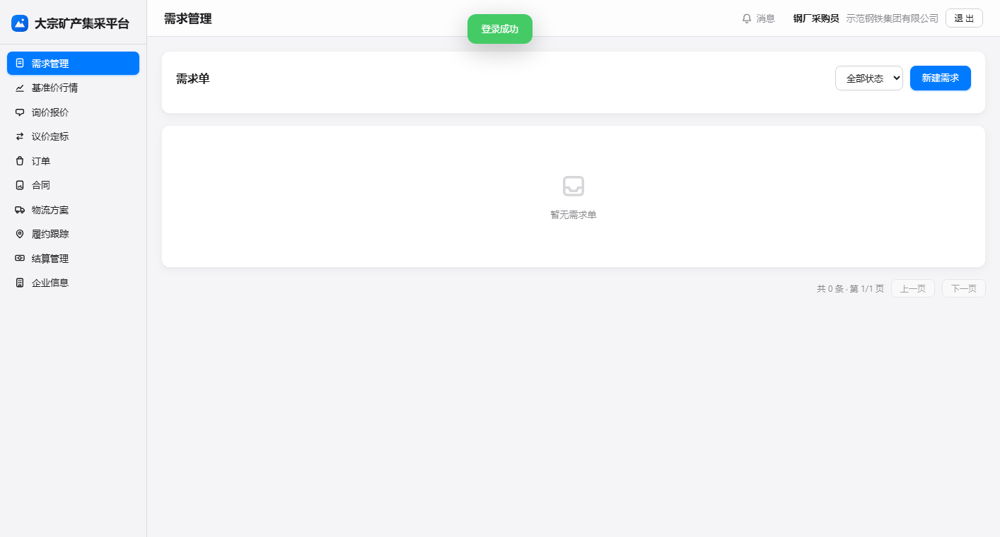
- 操作：手机号 `13800000001`、密码 `demo123456` →「登 录」
- 预期：进入主布局。左侧毛玻璃侧栏依次为「需求管理 / 基准价行情 / 询价报价 / 议价定标 / 订单 / 合同 / 物流方案 / 履约跟踪 / 结算管理 / 企业信息」十个菜单（当前项蓝色高亮，每项带线性图标）；顶栏为页面标题、消息铃铛（含未读数红色徽标）、当前用户与所属企业（如：钢厂采购员 · 示范钢铁集团有限公司）、右上角「退 出」按钮
- 注意：不同角色菜单按权限裁剪（管理员默认落地「运营看板」、供应商无需方专属项、承运商仅有物流相关项）

**S03 新建需求并提交** 　（表单全貌另见 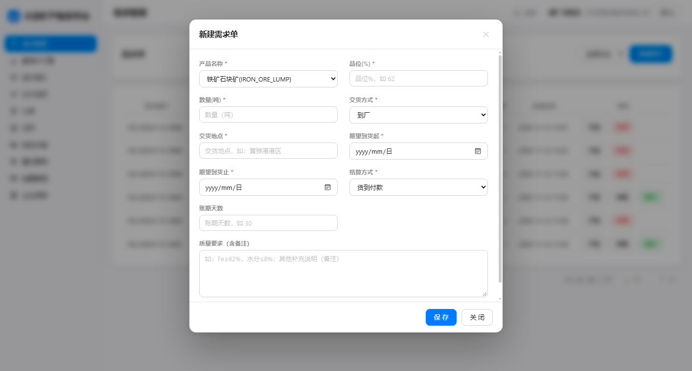）
- 入口：「需求管理」→ 右上角蓝色「新建需求」按钮，弹出「新建需求单」弹窗
- 填写（精简表单，带红星为必填，明细随表单一次录入）：产品名称=`中华混一号`（品种下拉，必选）；品位(%)=`62.1`（数字输入，必填）；数量(吨)=`3000`（数字输入，必填）；交货方式=到厂（默认，可改为到站自提）；交货地点=`日照港`（必填）；期望到货起=今天+12 天、期望到货止=今天+22 天（日期控件，必填）；结算方式=货到付款（默认，可选预付款/账期）；账期天数（选填）；质量要求（含备注）（选填）
- 保存：点「保 存」→ toast「已创建草稿」。需求名称由系统自动生成（=产品名称+“采购需求”），无需手填
- 提交：列表中点该需求行的「提交」→ 确认弹窗点「确 定」→ toast「已提交」，状态变为「已提交」
- 注意：品位为数值（品位%），填文本牌号（如 ZH-1）会保存失败；弹窗校验顺序为 产品名称→品位/数量→交货地点→到货日期→起止先后；已提交需求不可直接编辑，需「撤回」后重新提交（生成新版本，版本号 +1）

#### 阶段二：询价与密封报价

**S04 新建询价并发出**（示范钢铁） 　（表单全貌另见 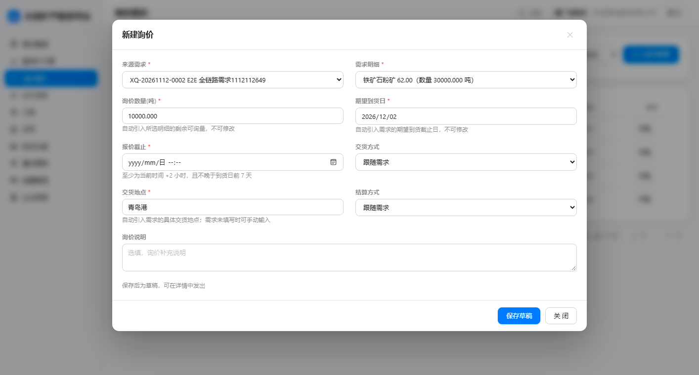）
- 入口：「询价报价」→ 右上角「引入需求管理」按钮，弹出「新建询价」弹窗
- 选择：来源需求（下拉，仅列出已提交且未关闭的需求单，默认选中最新一条）→ 需求明细（选项格式为“品种 品位（数量 N 吨）”，仅含剩余可询量大于 0 的明细）
- 自动引入（只读，不可修改）：询价数量=明细剩余可询量 `3000`；期望到货日=需求期望到货止；交货地点=需求交货地点 `日照港`
- 手动填写：报价截止=今天+2 天 18:00（datetime 控件，必填）；交货方式=跟随需求（可改为 到厂/到站自提）；结算方式=跟随需求（可改）；询价说明（选填）
- 流程：「保存草稿」→ toast「询价草稿已创建」→ 列表点「详情」→ 详情弹窗点「发出询价」→ toast「询价已发出」，状态变为「已发出」
- 注意：供应商邀请已自动化——无需勾选，保存时自动邀请全部已准入且启用的供应商；报价截止须 ≥ 当前+2 小时且 ≤ 期望到货日-7 天，违规时弹窗内红色常驻错误区提示（40001）且不会关闭；已发出询价不可再编辑

**S05 询价列表渲染**（示范钢铁） 
- 预期：列表出现刚发出的询价行（询价编号 XJ-…、品种、数量、报价截止、状态=「已发出」胶囊、邀请/响应计数如 1/0、创建时间），可按状态筛选
- 注意：列表异步加载，若网络慢稍候片刻再核对

**S06 询价详情渲染**（示范钢铁） 
- 操作：点「详情」→ 弹窗「询价详情」正常展示数量/截止/期望到货日/邀请供应商响应情况等键值信息
- 注意：密封期内「响应情况」仅显示计数，不显示任何报价金额

**S07 供方登录+收到询价**（供应商·示范矿产） 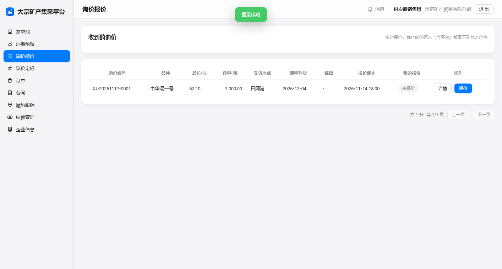
- 操作：右上角「退 出」→ 用 `13800000002 / demo123456` 登录 →「询价报价」
- 预期：收到一条询价邀请（状态=已发出），行内有「报价」按钮

**S08 密封报价提交**（示范矿产） 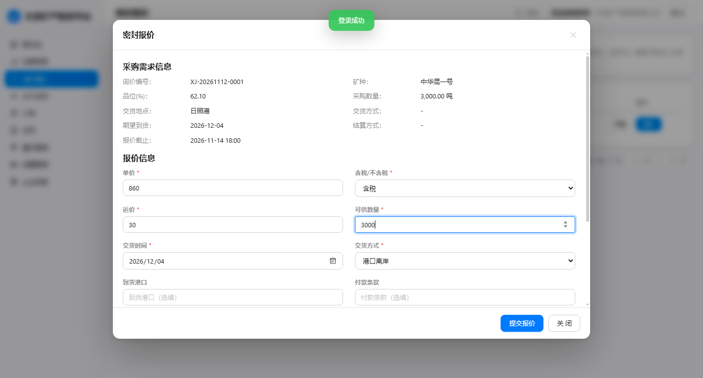 
- 操作：点「报价」→ 弹窗「密封报价」逐项填写：
  - 单价 `860`（元/吨）
  - 含税口径=含税（默认，可切不含税）
  - 运费单价 `30`（元/吨，占位「运价（元/吨）」）
  - 可供数量 `3000`（吨）
  - 交货时间=不晚于询价期望到货日（本例今天+22 天，日期控件）
  - 交货方式=港口离岸（必选；可选 港口离岸/港口自提/厂内自提；询价未指定交货方式时默认为空，**必须手动选择**）
  - 到货港口（选填）、付款条款/质量承诺/备注（选填；报价低于询价价 80% 时备注必填）
- 预期：点「提交报价」→ toast「报价已提交（密封）」；询价状态变为「已报价」；揭示前需方与他人均不可见该报价
- 注意：**含税口径、运费单价、交货方式三项必填**，缺失时后端拒绝（40001），弹窗内错误区常驻提示；**交货期承诺不得晚于询价的期望到货日**（新版询价的期望到货日由需求单自动引入），否则报「交货期承诺晚于期望到货日期」；截止前可再次「报价」更新（按钮显示「更新报价」）

#### 阶段三：揭示比价与议价定标

**S09 截止揭示+比价快照**（示范钢铁） 
- 前置：报价截止时间已过（未到期时「截止揭示」被后端 40001 拦截，toast 提示未到截止时间，属预期）；演示时可等待自然到期后操作
- 操作：「询价报价」→「详情」→「截止揭示」
- 预期：异步弹出「比价快照」弹窗：顶部为询价编号、响应情况（红色「响应不足」/绿色「满足」胶囊）、揭示时间；中部「比价表（按价格升序固化）」逐行列出 序号/单价/数量/响应率/到货日/付款条款/有效期至，行内带「议价」「定标」按钮；右下「关 闭」
- 注意：揭示后所有密封报价对所有人可见且不可篡改；响应不足（未达最少响应，默认 2 家）仍可揭示，但建议补足响应后再定标

**S10 发出还价**（示范钢铁） 
- 操作：在比价快照/详情弹窗点「议价」→ 弹窗填还价单价 `850`（元/吨）→「发出还价」
- 预期：toast「还价已发出」，产生新一轮议价；原报价轮次自动失效，供方需对新价响应

**S11 供方接受还价**（示范矿产） 
- 入口：「议价定标」→ 列表该询价行 → 点「接受」→「确 定」
- 预期：toast「已接受」；其余在途轮次自动失效

**S12 需方定标**（示范钢铁） 
- 入口：「议价定标」→ 点「比价/议价」打开比价快照 → 行内点「定标」→「确 定」
- 预期：toast「定标成功」；自动生成订单 DD-…（供方 48h 内须确认），未中标报价自动置 LOSE，询价状态变为「已定标」

#### 阶段四：订单确认、合同双签与平台核验

**S13 供方确认订单**（示范矿产） 
- 入口：「订单」→ 列表该订单行（状态=待确认）→「确认订单」→「确 定」
- 预期：toast「订单已确认」，订单进入待生成合同；48h 未确认订单自动失效

**S14 需方生成合同**（示范钢铁） 
- 入口：「订单」→「生成合同」（已确认订单行内）
- 预期：toast「合同已生成」，「合同」页可见待签合同（HT-…，状态=待需方签署，版本 1）
- 注意：合同页顶部固定提示「需方签署后供方方可签署；已生效合同不可作废」

**S15 订单详情渲染**（示范钢铁） 
- 操作：点「详情」→ 弹窗「订单详情」正常展示订单与关联合同信息（编号/品种/数量/单价/交货信息等键值网格）

**S16 需方签署合同**（示范钢铁） 
- 入口：「合同」→ 该合同行「需方签署」
- 操作：弹窗内勾选「已核对条款」复选框 → 上传盖章件（PDF/图片文件选择）→「签 署」
- 预期：toast「签署成功」，合同状态变为「待供方签署」（需方先签属预期顺序），列表「需方签署」列出现签署时间
- 注意：行内「详情」可随时查看合同；「作废」仅对未生效合同显示（红色按钮），需填作废原因

**S17 供方签署合同**（示范矿产） 
- 入口：供方登录 →「合同」→「供方签署」→ 同 S16 勾选+上传+「签 署」
- 预期：toast「签署成功」，合同状态变为「**待平台核验**」（双签完成但合同尚未生效，订单处于「待生效」——新版流程关键节点）
- 注意：此时「作废」按钮仍显示（合同未生效可作废重签）；**订单不能进入结算**，必须先完成 S18 平台核验

**S18 平台核验合同**（平台管理员） 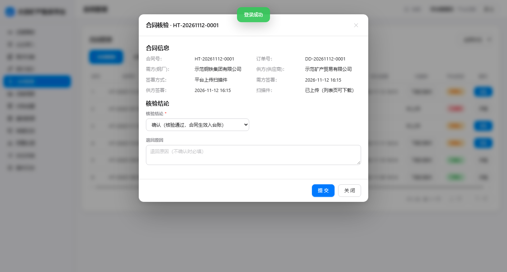 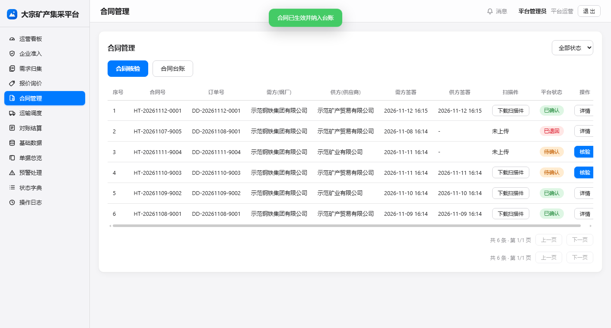
- 操作①：右上角「退 出」→ 用 `13800000000 / admin123456` 登录 → 左侧「合同管理」（默认「合同核验」页签）
- 操作②：列表首行为最新待核验合同（需方/供方签署列均有时间、平台状态=待核验、行内按钮=「核验」）→ 点「核验」
- 操作③：弹窗「合同核验 · HT-…」：核验结论=**确认**（默认；选「不确认」时退回原因必填）→ 点「提 交」
- 预期：toast「**合同已生效并纳入台账**」；列表中该行平台状态=已确认（按钮变「详情」）；合同状态=已生效；订单自动转「履约中」；供需双方各收到站内信「合同已核验生效」
- 注意：仅平台状态=待核验的合同显示「核验」按钮，其余行仅可「详情」查看；核验不通过（退回）场景与处理方式见 §5.2

#### 阶段五：质检、结算与付款

**S19 结算工作台渲染**（示范钢铁） 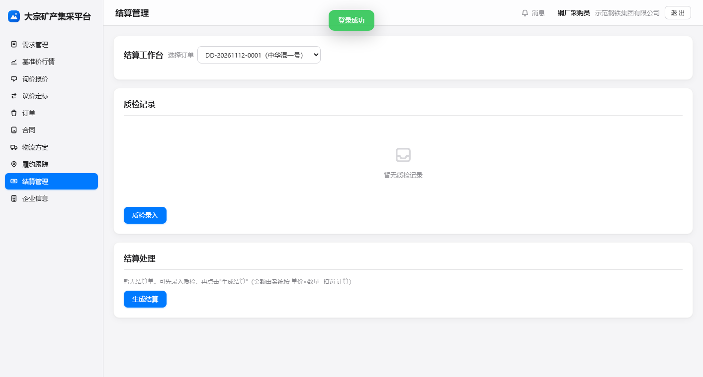
- 操作：管理员核验后，退出管理员 → `13800000001 / demo123456` 登录 →「结算管理」
- 预期：页面顶部出现「结算工作台」标题与「选择订单」下拉（选项格式：订单号 + 品种，如 DD-…-0013 (中华混一号)），刚核验生效的订单（履约中）已可选中；下方为「质检记录」「结算处理」两块卡片
- 注意：结算工作台**仅列履约中订单**——合同未核验生效的订单不会出现（见 §5.2）；按订单维度先选订单再做质检与结算

**S20 质检录入**（示范钢铁） 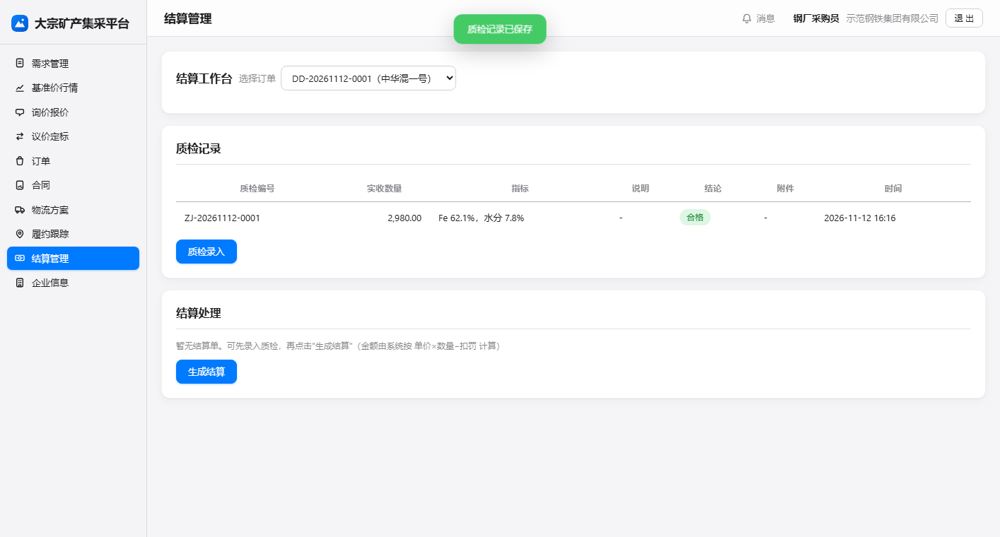
- 操作：「质检录入」→ 弹窗填实收数量 `2980`（吨，≤ 订单数量）、检验指标 `Fe 62.1%，水分 7.8%`（多行文本，结论默认合格）→「保 存」
- 预期：toast「质检记录已保存」，质检记录表新增一行（质检编号 ZJ-…、实收数量、指标、结论=合格胶囊、时间）
- 注意：实收数量超差会自动产生预警（管理员「预警处理」页可见）；可录入多条，结算默认取最近一条合格质检实收

**S21 生成结算**（示范钢铁） 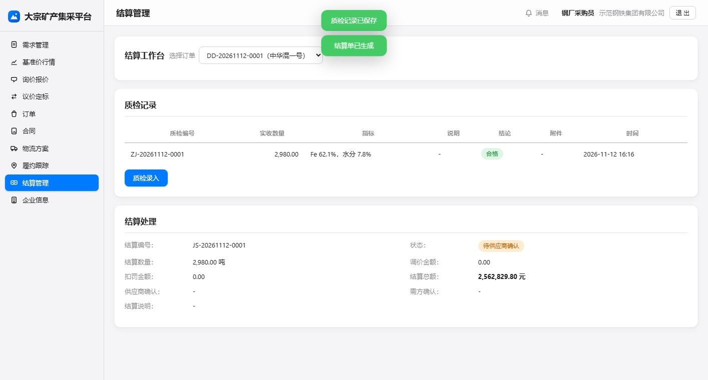
- 操作：「生成结算」→ 弹窗结算数量默认填最近合格质检实收 `2980` → 可改 →「生 成」
- 预期：toast「结算单已生成」，「结算处理」卡片展示：结算编号 JS-…、结算数量、状态=「待供应商确认」胶囊、结算金额=数量×定标单价（如 2980 × 850 = 2,533,000.00 元）

**S22 供方确认结算**（示范矿产） 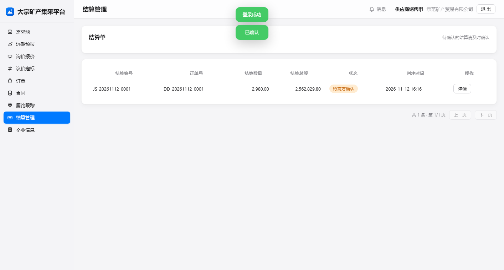
- 入口：供方登录 →「结算管理」→ 列表出现该结算单（状态=待供应商确认）→「供应商确认」→「确 定」
- 预期：toast「已确认」，状态变为待需方确认

**S23 需方确认+付款登记**（示范钢铁） 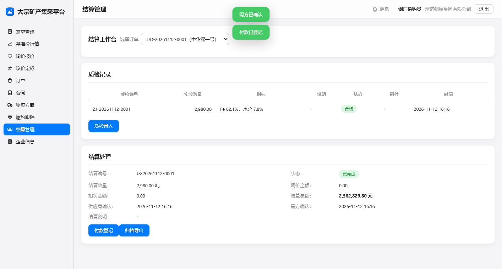
- 操作①：「结算管理」→「需方确认」→「确 定」→ toast「需方已确认」（双向确认后结算冻结，不可再改）
- 操作②：「付款登记」→ 弹窗金额预填结算总额、付款日期预填今天 → 可补充付款说明 →「登 记」→ toast「付款已登记」，结算完成（状态=已付款）
- 后续：可在「订单」页对该订单「归档导出」下载档案 zip（含需求/询价/订单/合同/结算单据）

**S24 console 错误检查** 
- 验收：全程浏览器 console 无 SEVERE 级错误（可按 F12 打开开发者工具，在 Console 面板逐页核对）
- 注意：网络 404 的静态探测请求、浏览器插件告警不计入；出现 SEVERE 需截图并附接口响应定位

### 4.6 需求归集环节图文操作指引（平台归集集采线）

> 需求归集是平台归集集采线的核心环节：平台将 **多家钢厂同品种同品位** 的采购需求合并为归集订单，以平台名义统一发起询价（钢厂无需各自询价），供应商报价后由平台汇总、按各钢厂份额拆分推送，成员钢厂反馈认可/不认可，运营据此决定采纳或重新询价。以下按节点顺序给出各角色的操作指引（配图均为当前界面实拍，存于 `docs/shots/`）。

#### 节点A：需求归集合并（平台管理员）


- 输入：各钢厂已提交（SUBMITTED）需求明细（同品种同品位、有剩余可归集量）
- 入口：「需求归集」→「需求列表」页签，按明细行勾选（剩余可归集量列 > 0）
- 操作：勾选多条同品种同品位明细 → 点「合并归集」→ 确认 → toast「归集订单已创建」（生成 GJ 单号）
- 输出：归集订单（归集量=各明细剩余可归集量之和）；明细剩余可归集量**全量锁定**（inquired_qty=quantity）；需求状态转「询价中（INQUIRING）」；成员钢厂收到站内信「需求已纳入归集订单」（内容含 GJ 单号与锁定说明）
- 注意/异常：
  - 品位不一致、非已提交状态、无可归集量的明细不可合并（40001）
  - 同一明细不可重复归集（已询量=数量的明细不再出现在可选列表）
  - 需求被归集后钢厂端不可撤回/编辑（状态已转询价中）

#### 节点B：平台代发统一询价（平台管理员）


- 输入：已归集（OPEN）状态的归集订单 + 统一询价条件 + 受邀供应商名单
- 入口：「需求归集」→「订单归集」页签勾选 OPEN 订单 →「去询价」（自动跳转「报价询价」页并打开弹窗）；或直接「报价询价」→「发起询价」
- 操作：选归集订单（下拉项=GJ 单号 · 品种 · 品位% · 归集量 · N 家钢厂）→ 填 **期望到货日**、**报价截止**（≥当前+2 小时且不晚于到货日前 7 天）、**最少响应家数**（默认 2）→ 勾选 **至少 1 家** 已准入供应商 →「保存并发出」→ toast「归集询价已发出」
- 输出：归集询价单（XJ 单号、批次号 PC 前缀、来源=平台归集、无单一看方）；归集订单转「询价中」；成员钢厂收到「归集需求已发起询价」、受邀供应商收到「收到询价邀请」站内信
- 注意/异常：
  - 报价截止 < 当前+2 小时或晚于到货日前 7 天 → 40001（弹窗错误区常驻提示）
  - 未勾选任何供应商 → 40001「请至少邀请一家供应商」
  - 归集订单已询价（非 OPEN）不可重复发起（须先等反馈处理）

#### 节点C：供应商密封报价（供应商）

- 输入：受邀的归集询价邀请（站内信或「询价报价」列表，带「归集」标签）
- 操作：与钢厂自主询价完全一致——点「报价」→ 填单价、含税口径、运费单价、可供数量、交货时间、交货方式 → 提交（截止前可改价，仅自己可见）
- 输出：报价单入库（密封）；询价单转「报价中」；平台收到「收到新报价」消息
- 注意：归集代发询价 **无议价环节**，报价截止前保密，响应家数不足最少响应家数时平台可等报价或重新询价

#### 节点D：平台汇总返回钢厂（平台管理员）

- 输入：有报价的归集询价（状态=已发出/报价中）
- 入口：「报价询价」→ 归集询价行内「汇总报价返回钢厂」
- 操作：点击执行揭示（无需确认弹窗）→ toast「已汇总推送成员钢厂」
- 输出：报价按价格升序固化为比价快照（不可篡改）；**按成员钢厂份额拆分推送**——各钢厂仅见本厂份额量的报价行与供应商名单（不见归集总量、不见他人份额）；钢厂收到「平台报价汇总推送」站内信
- 注意：揭示动作不可撤销；揭示后钢厂即可反馈，无需等全部钢厂

#### 节点E：成员钢厂反馈（钢厂）

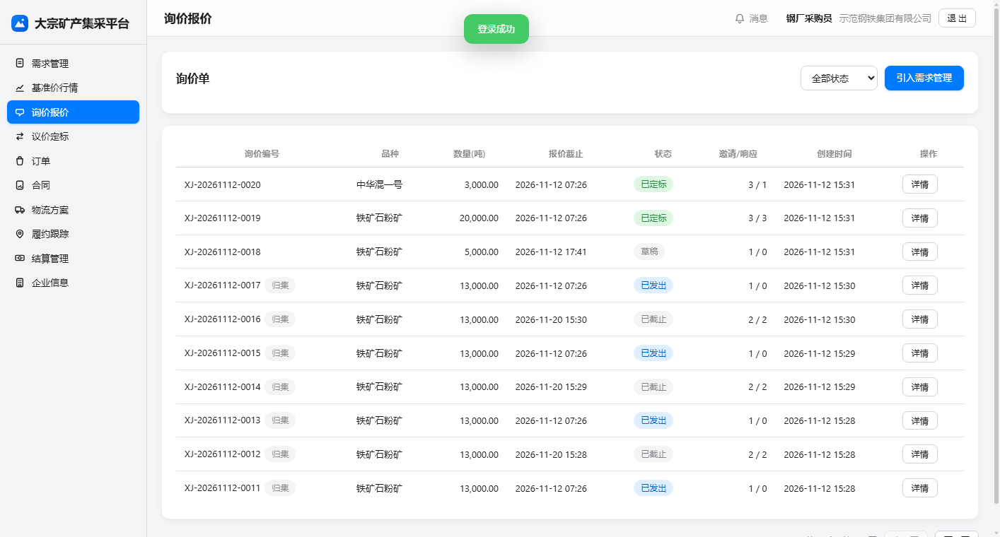

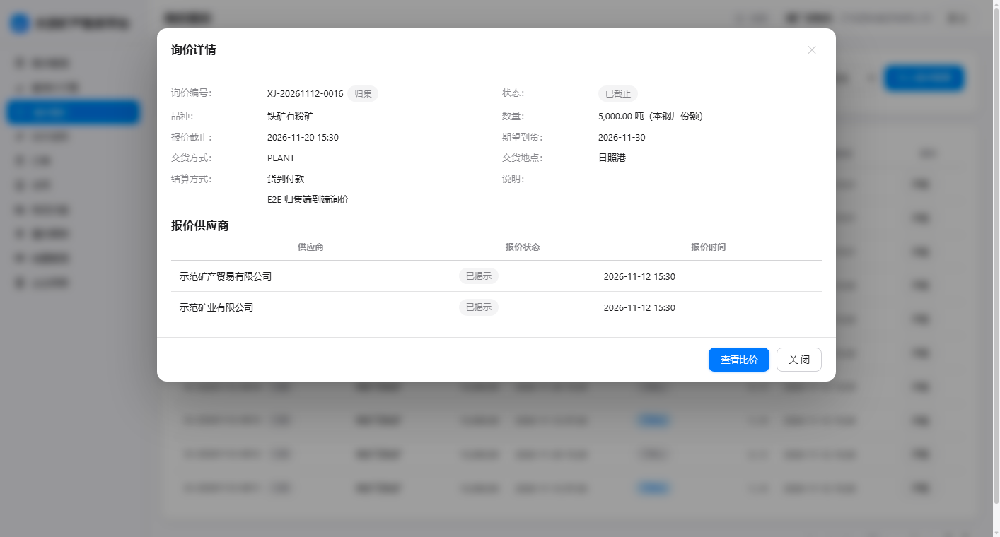

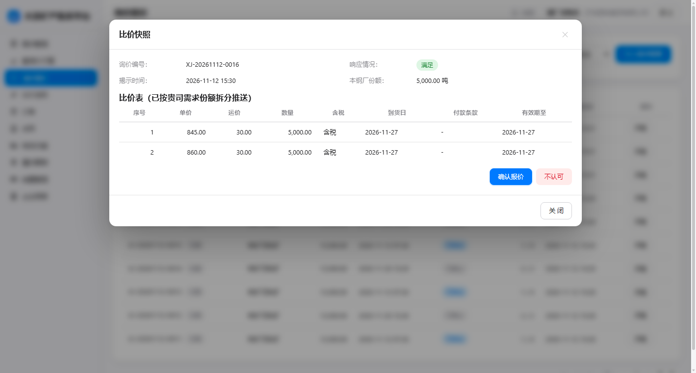

- 输入：已揭示的归集询价（「询价报价」列表带「归集」标签的行）
- 操作：点「详情」→ 详情数量列显示 **本钢厂份额**（括注「本钢厂份额」）→ 点「查看比价」→ 比价表标题为「比价表（已按贵司需求份额拆分推送）」，含「本钢厂份额」行与各供应商报价 → 点「确认报价」（认可，弹确认框）或「不认可」（必填原因）→ toast「已反馈运营平台：认可比价结果 / 不认可该报价」
- 输出：反馈结论（认可/不认可+原因）推送运营端（站内信「钢厂对归集询价反馈」）；**不认可时询价单转「反馈待处理（FEEDBACK）」**
- 注意/异常：
  - 重复反馈为更新覆盖（幂等），以最后一次为准
  - 非成员钢厂反馈被拒（40301）
  - 平台管理员不可代钢厂反馈（40301）
  - 钢厂对归集询价 **不可议价、不可定标**——决策权在反馈与运营处理

#### 节点F：运营处理反馈（平台管理员）

- 输入：钢厂反馈（认可/不认可）
- 入口：「报价询价」→ 行内「反馈详情」（查看各钢厂反馈结论与原因）
- 操作与分流：
  - **全部认可**：运营确认采纳后按线下商务流程衔接（一期演示范围：归集线闭环至钢厂反馈与运营处理，合同/订单线上化暂限钢厂自主询价线）
  - **有钢厂不认可**：在 **同一归集订单** 上再次「发起询价」（可调整询价条件/供应商/截止时间）→ 旧反馈询价单自动转「已处理（CLOSED）」，新一轮按节点 B→E 循环
- 输出：新一轮归集询价单（同批次关联）；旧询价单闭环
- 注意：重新发起询价不影响归集订单锁定量（保持 INQUIRING）

#### 节点G：归集订单关闭（平台管理员，可选）

- 输入：未询价（OPEN）的归集订单（归集后决定不询价/需方撤意）
- 入口：「需求归集」→「订单归集」页签 → 行内「关闭」
- 操作：点击关闭 → toast「归集订单已关闭」
- 输出：归集订单转「已关闭」；锁定量释放（明细剩余可归集量恢复）；**需求无其他在途询价（DRAFT/SENT/QUOTING）时回退「已提交」**（可重新编辑/撤回/参与其他归集），成员钢厂收到「归集订单已关闭」站内信
- 注意/异常：
  - 已询价（询价中/已揭示等）的归集订单不可关闭（40901）——先等询价闭环
  - 需求仍在其他归集订单或询价中占用时，关闭本单仅释放本单锁定量，需求不回退

#### 上下游衔接总览

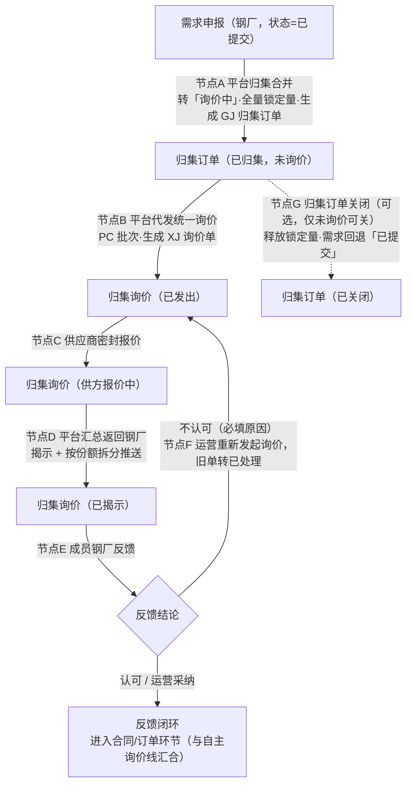

## 5. 常见问题排查方案

### 5.1 启动类

| 现象 | 排查步骤 |
|------|----------|
| `python run.py` 报数据库连接失败 | ① `docker ps` 确认容器在运行；② `docker compose up -d` 启动；③ 核对 `MINE_PG_DSN` 与 docker-compose.yml 中端口/密码一致 |
| 端口 8000 被占用 | `Get-NetTCPConnection -LocalPort 8000` 找到 PID → `Stop-Process -Id <PID> -Force`；或改 `MINE_PORT` 启动 |
| 页面空白/静态资源 404 | 确认从项目根目录启动（前端目录 frontend 由后端托管） |
| 登录提示账号不存在 | 核对所用账号与 §3.4 一致：演示账号由 `python run.py` 首次启动初始化写入（138 号段示范企业，密码 `demo123456`）；管理员 13800000000 / admin123456。若库为空，重启 `python run.py` 完成初始化后登录日志应输出「演示数据已写入」 |

### 5.2 业务操作类

| 现象 | 原因与处理 |
|------|------------|
| 报价提交被拒，提示含税口径/运费/交货方式缺失（40001） | 新版报价三项必填：含税口径、运费单价（≥0）、交货方式。询价未指定交货方式时报价弹窗默认为空，需手动选择 港口离岸/港口自提/厂内自提；补齐后重新提交 |
| 双签后合同一直不生效、订单停在「待生效」 | 属预期：双签后需平台管理员在「合同管理 → 合同核验」核验通过才生效（§4.5 S18） |
| 结算工作台「选择订单」下拉里没有目标订单 | 结算工作台仅列「履约中」订单。该订单合同尚未核验生效 → 通知管理员完成核验；订单未确认/已失效同样不会出现 |
| 合同核验弹窗提交后 toast「已退回上传方」 | 管理员选了「不确认」且填写了退回原因：合同平台状态=已退回，后签方收到站内信「合同扫描件被退回」。处理：按原因整改后在「合同」页作废该合同并重新生成、重新双签，再提请核验 |
| 合同无法供方先签 | 属预期顺序：需方先签（40901） |
| 询价保存失败提示「2 小时/7 天」 | 截止时间必须 ≥ 当前+2h 且 ≤ 到货日期前 7 天。弹窗底部错误区显示具体原因（不会静默失败）；注意用**本地北京时间**填写 |
| 页面时间与本地时间差 8 小时（历史数据） | 存量数据需执行一次性时区修复迁移（方法见 README 常见问题 Q7）；新环境已通过业务时区（Asia/Shanghai）根治 |
| 需求单提交后无法修改名称等字段 | 属预期：提交后关键字段锁定（40901）。需先「撤回」，状态为「已撤回」后「重新提交」生成新版本（撤回态不可直接编辑） |
| 供应商看不到他人报价 | 属预期：密封报价，截止揭示前仅见自己的报价；需方在截止前也不可见 |
| 揭示按钮不可用 | 询价未到截止时间（40001）；紧急验证时可直连库把 deadline 调到过去（仅测试） |
| 重复报价被拦截（40902） | 同一询价同一供应商存在在途报价，请先在报价列表修改/撤回原报价 |
| 结算无法再次确认（40901） | 双向确认后结算冻结，属预期 |
| 企业注册提示重复信用代码（40902） | 换未注册的统一社会信用代码 |
| 上传文件失败 | 单文件 ≤20MB；执照仅注册流程免登录上传，其余需登录 |
| 基准价行情某行品位/港口显示「—」或「平台综合」 | 该条为品种+日期维度的平台综合价（无品位/港口分档信息），分档行情由系统初始化写入的分档数据提供 |
| 需求被归集后钢厂无法撤回/编辑 | 属预期：归集即全量锁定量、需求转「询价中」（40901）。需联系管理员在「订单归集」页签关闭归集订单（仅未询价可关），锁定量释放后需求回退「已提交」 |
| 管理员合并归集提示 40001 | 归集要求：同品种+同品位、需求状态=已提交、剩余可归集量>0。核对勾选明细的品位/状态列 |
| 关闭归集订单后需求仍是「询价中」 | 属预期：需求仍被其他在途询价（草稿/已发出/报价中）占用时不回退。待相关询价闭环（定标/流标/关闭）后需求自动回退 |
| 钢厂看不到「议价/定标」按钮（归集询价详情） | 属预期：平台归集代发询价无议价/定标环节，钢厂仅可反馈认可/不认可（节点E，§4.6） |
| 钢厂反馈后询价单显示「反馈待处理」 | 有成员钢厂反馈不认可。运营在「报价询价」→「反馈详情」查看原因，可重新发起询价（§4.6 节点F） |
| 归集询价详情数量与需求量不一致 | 详情数量=本钢厂份额（拆分推送），非归集总量；比价表中的报价行数量同样按份额拆分 |

### 5.3 时间与时区专题

- 平台统一业务时区为 **Asia/Shanghai**：由系统环境配置统一保证（可通过环境变量 `MINE_PG_TZ` 调整）
- 验证方法：任一列表页「创建时间」应与本地时间一致（±1 分钟）
- 若发现整库时间仍差 8 小时：重启服务与数据库容器后复测；存量历史数据的一次性修复方法见 README 常见问题 Q7
