# 大宗矿产集采平台 系统使用说明

> 版本：一期演示版（v1.3） · 更新日期：2026-11-14
> 适用对象：平台管理员、钢厂（需方）、供应商（供方）
> 文档体系：[交付报告](交付报告.md)（交付范围与修改记录，**后续修改需按维护约定追加记录**）｜[前端可视化专项检测报告](docs/前端可视化专项检测报告-20261108.md)（UI 专项检测）｜[E2E 测试档案报告](test-evidence-20261108/reports/业务流程工作档案报告.html)（test-evidence-20261108/ 档案封面）
> v1.4 变更摘要（2026-11-15）：供应商端新增「总览」首页（KPI 五卡：总订单数/总交易额/待报价单数/运输中单数/已完成订单 + 待办事项列表 + 近期动态）；删除供应商端「需求池」「远期预报」「议价定标」功能（议价仅保留钢厂端工作台）；供应商「询价报价」界面改版（列表状态筛选下拉、详情弹窗竖线分区标题展示需求/技术参数/交货要求、报价弹窗支持附件上传）；供应商端「订单」菜单升级为「订单管理」（订单列表 + 订单详情弹窗 + 订单确认区）；供应商端新增「物流服务」只读菜单（运输方案 + 分段运单 + 95306 式物流轨迹，同钢厂端）；供应商端「履约跟踪」改版（履约进度/节点台账/运单只读三分区）；企业信息资质证照面板内嵌自行上传；**企业信息变更审核闭环**（变更暂存待审 → 运营端审核弹窗对比变更 → 通过自动更新/驳回保持不变）；**三端全链路流转验证后修正**（集采订单成单先经供应商确认再收集提货计划；运单创建即确认生效、默认平台承担运输，移除待指派/待承运商接单环节）。**全链路复核修复 6 处问题**（运营端新增运单「预计船到港」时间格式转换；钢厂端物流方案组织方式对齐 平台配送/钢厂自提；节点录入按运单状态自适应可选节点；清理承运商指派残留入口与文案；企业信息维护回显经营范围；组织方式显示标签修正）。详见交付报告 §50~§63。
> v1.3 变更摘要（2026-11-14）：钢厂端总览「采购全流程概览」右上角新增「去采购」按钮（一键直达需求管理）；钢厂端「议价定标」页重构为四阶段工作台（流程步骤条计数 + 点击筛选 + 全阶段列表 + 议价/定标工作台弹窗，已定标行可跳转订单）；归集询价**全员认可自动成单**（无需运营端手动定标，自动选价格升序首个可供量覆盖份额总量的报价，运营端手动定标保留为兜底）；补记 2026-11-13 系统所有端合同号展示移除。详见交付报告 §38~§40。
> v1.2 变更摘要（2026-11-13）：运营端新增「订单管理」并删除「单据总览」；归集询价改为**整单锁货锁价**（1 张订单 + 各钢厂份额），新增**提货计划收集**与「待制定运输方案」状态；运输方案表单改为铁路直达/公铁联运/汽运直达（公铁联运需中转站）、起运地限黄骅港/天津港、新增预计船到港时间、运费必填；**承运商端下线**，合同、结算相关板块下线；价格行情详情新增「重新录入」列、基础数据删除今日基准价面板。详见交付报告 §37。
> v1.1 变更摘要：运营端新增 合同管理/运输调度/对账结算 模块；消息中心四端改版（铃铛抽屉 + 任务/消息中心）；需求产品限定 PB粉/中华混一号；钢厂今日基准价与运营端今日港口价同源联动；全系统时间格式改为阿拉伯数字；PB粉 港口价新增双品位维度（61.5%/60.8%，看板/趋势详情/钢厂端/录入面板均可切换，行业价格与交易价格同品位联动），价格行情详情支持品位/港口筛选、每页 15 条分页、录入面板隐藏化、保存后数据自动更新；趋势图横轴为整月（4 周）且刻度严格每 7 天一档、价格图纵轴步长全站统一（10）；企业准入列表一页 15 条、新增账号列与重置密码（demo123456）、企业类型中文显示、提交时间精确到秒、准入详情展示注册信息且营业执照点击在线预览；预警提醒降频（扫描每天一次 + 24h 生成节流）；钢厂自发询价不再直接推送供应商（提交后进运营端需求归集，由运营平台代发后才联系供应商，供应商端仅见平台询价）。详见交付报告 §11、§16~§23。

---

## 1. 系统概述

大宗矿产集采平台面向钢厂、供应商、承运商与平台运营方，提供从 **需求申报 → 询价报价（密封）→ 议价 → 定标 → 合同 → 物流 → 质检 → 结算 → 付款 → 归档** 的全流程线上化集采服务，配套平台准入审批、基准价管理、预警与消息通知、状态机字典等运营能力。

- 前端：原生 JS 单页应用（SPA），浏览器访问 `http://127.0.0.1:8000`
- 后端：Flask（Python 3），REST API 前缀 `/api/v1`
- 数据库：PostgreSQL 14（Docker 容器 `mine-platform-pg`）

## 2. 系统功能模块说明

### 2.1 按角色划分

| 角色 | 登录后可用模块 |
|------|----------------|
| 平台管理员 | 运营看板、企业准入（审批+企业档案）、需求归集、报价询价（二级菜单：询价、询价历史）、订单管理（整单锁货锁价、提货计划汇总、转运输方案）、运输调度（物流调度/在途监控）、基础数据（品种/港口价）、预警处理、状态字典、操作日志、消息中心 |
| 钢厂（STEEL） | 总览（KPI + 采购全流程概览 + 采购订单滚动列表，概览右上角「去采购」一键直达需求管理）、需求申报（草稿/提交/撤回/重提/关闭）、询价管理（新建/发出/揭示/比价/定标/流标）、订单（确认、聚合订单份额查看与**提货计划提交**）、物流服务（**95306 式物流轨迹** + 运输方案/运单签收）、履约跟踪（**五阶段进度条**：订单生成→双方确认→提货计划→运输交付→结算归档；节点类型筛选 + 95306 式倒序节点台账）、企业信息（**身份横幅 + 审核状态提示条 + 分区信息**：注册/联系/银行与经营；**资质证照在线上传**（营业执照/其他资质，PDF/JPG/PNG ≤20MB）支持下载；信息维护弹窗改关键字段自动重审）、消息中心 |
| 供应商（SUPPLIER） | 总览首页（KPI：总订单数/总交易额/待报价单数/运输中单数/已完成订单 + 待办事项列表 + 近期动态）、询价报价（密封，截止前仅见自己报价；列表**全部/待报价/已报价/已截止状态筛选下拉**；详情弹窗分区标题**竖线样式**，分区展示**采购需求、技术参数与质量要求、交货与结算要求、我的报价、报价附件**，被再次邀请时顶部显示**历史轮次参考**（当前第几轮、各轮询价单号、我的上轮报价、钢厂反馈理由）；报价弹窗支持**附件上传**（PDF/JPG/PNG ≤20MB，最多 5 个，修改报价可增补）并同样显示**历史轮次参考**提示块）、订单管理（**订单列表** + **订单详情**弹窗 + **订单确认**区）、物流服务（**只读**：运输方案 + 分段运单 + **95306 式物流轨迹**，同钢厂端展示，约 15 秒自动刷新）、履约跟踪（**履约进度五阶段** + **履约节点台账**（类型筛选 + 95306 倒序轨迹）+ 运单列表**只读**）、企业信息（**资质证照面板内嵌自行上传**，2026-11-15：资质类型 + 文件选择 + 上传按钮，列表预览/下载）、消息中心 |

> 演示账号补充（2026-11-15）：钢厂「示范特钢集团有限公司」13800000008 / demo123456（第二钢厂成员，可演示跨钢厂合并归集：双钢厂需求合并 → 归集询价 → 双钢厂认可 → 自动成单多成员 → 双提货计划）；供应商「河北联铁贸易有限公司」13800000006 / demo123456（注册准入审核全流程演示素材）。

> 说明（2026-11-13）：本轮采购平台设计**不涉及承运商**，承运商端已下线（原承运商账号登录返回「本平台暂不开放承运商端登录」）；合同、结算相关板块一并下线，后台接口与数据保留。


> 消息中心（v1.1，四端一致）：顶栏**小铃铛**（未读角标）→ 右侧抽屉（任务/消息页签 + 更多）；「更多」进入消息中心页——**任务**（待办任务/已办任务/在办申请/已办申请）与**消息**（全部消息/通知/预警/公告/活动信息）两个页签，点击消息自动标记已读（角标递减）并跳转对应业务页面，待办任务点击「去处理」直达办理页。

### 2.2 功能模块清单（前后端对应）

| 模块 | 说明 | 主要代码 |
|------|------|----------|
| 认证与注册 | 免登录执照上传、企业注册（类型别名归一）、登录、JWT 鉴权 | backend/api/auth.py、frontend/js/pages/auth.js |
| 总览 | 钢厂端首页：KPI（订单/金额/在途/待结算）+ 采购全流程概览 + 滚动订单列表；供应商端首页：KPI 五卡（总订单数/总交易额/待报价单数/运输中单数/已完成订单，点击跳转对应页面）+ 待办事项列表（待报价询价单/待确认订单，逐条「去处理」直达）+ 近期动态（本企业最近 10 条站内消息） | backend/api/order.py（/buyer/overview、/supplier/overview）、frontend/js/pages/overview.js |
| 企业准入 | 平台审批（通过/驳回需原因）、企业档案与资质；「准入申请列表」「企业档案信息」两个页签表格上方均有**关键字筛选框**（企业名称/信用代码/联系人/账号，回车或点「查询」），准入列表可与审核状态组合筛选 | backend/api/company.py、backend/api/admin.py、frontend/js/pages/misc.js、admin.js |
| 品种与基准价 | 品种维护（一期演示品种为 **PB粉、中华混一号**）、今日港口价录入（品种×港口×品位，运营端维护，单位**元/湿吨**，来源标注 **Mysteel**）、当前价与 30 日走势；**PB粉 双品位 61.5%/60.8%**（60.8% 价格约低 5 元/湿吨）——运营看板「黄骅港 PB粉 价格趋势」工具栏与价格趋势详情分港口趋势图名称行下方均可**切换品位**（图表与行情表联动）；「价格行情详情」全部价格数据支持**品位/港口筛选**，「价格录入」按钮**弹出录入对话框**（填产品名称、品位、港口、价格、价格日期（默认当天，可自行选择），计价口径湿基、来源 Mysteel 由系统自动补充），每行另有「**重新录入**」按钮可预填该行信息修改；保存后页面数据与趋势图自动更新；钢厂端「今日基准价」与运营端今日港口价**同源联动**（运营改价钢厂端自动变，双品位各显示一行） | backend/api/base.py、frontend/js/pages/price.js、admin.js |
| 需求申报 | 需求单 CRUD、明细（品种/品位/数量/增减幅度，**产品仅可选 PB粉/中华混一号**）、提交/撤回/重提（版本+1）/关闭、提交后关键字段锁定 | backend/api/demand.py、frontend/js/pages/demand.js |
| 询价报价 | 运营端归集询价创建/发出（邀请供应商）、密封报价、截止揭示、比价快照（价格升序固化）、最少响应校验；**钢厂端「采购询价」页仅接收运营端发起的询价与报价反馈**（2026-11-15 起移除「引入需求管理」新建入口，钢厂需求经需求管理提交后由运营端归集询价）；供应商侧列表**待报价/已报价/已截止状态筛选下拉**（后端 tab 过滤）、询价详情**分区展示采购需求/技术参数（品位、质量要求、溢短装）/交货与结算要求/我的报价/报价附件**（分区标题竖线样式，同钢厂端）、报价弹窗**附件上传**（`biz_quote_file` 表，经通用 /files 落盘后关联，归属校验、≤5 个，修改报价整体替换） | backend/api/inquiry.py、frontend/js/pages/trade.js |
| 议价 | 多轮还价/接受/拒绝，接受即其余在途轮次失效；对标面板（基准价/匿名价/近期成交均价）；**供应商端「议价定标」页已下线**（2026-11-15，仅保留钢厂端议价定标工作台，供应商不再响应议价轮次），后端接口保留 | backend/api/bargain.py |
| 定标与订单 | 按报价定标生成订单与 48h 确认期限，未中标自动置 LOSE；**供应商端菜单为「订单管理」**（订单列表 + 订单详情弹窗分区展示 + 订单确认区集中处理待确认订单，2026-11-15 改版）；**归集询价全员认可自动成单**：运营端揭示比价后按份额拆分推送各钢厂评审，全部钢厂认可后系统**自动锁货锁价生成 1 张聚合订单**（自动选价格升序首个可供量覆盖份额总量的报价，buyer_id 为空、各钢厂份额写入成员明细），并通知各钢厂提交提货计划与供应商已定标；任一钢厂不认可（必填理由）则询价转「反馈待处理」，由运营端重新发起询价；运营端「报价汇总 → 按份额定标」保留为兜底手动定标 | backend/api/order.py、admin.py、inquiry.py |
| 合同（已下线） | 合同面板已从钢厂端/供应商端/运营端下线，本轮平台设计暂不涉及线上签署与线上归集；后端 `backend/api/contract.py` 接口与数据保留 | backend/api/contract.py |
| 订单管理（运营端） | 订单列表（订单号/询价单号/矿种/总吨数/供应商/参与钢厂数/提货计划进度/状态），关键字与状态筛选；详情展示各钢厂份额与提货计划明细（未提交标橙）；「运输方案」跳转运输调度 | backend/api/admin.py、frontend/js/pages/admin.js |
| 运输调度（运营端) | 物流调度：调度订单列表，点击订单展示关联「保税进出库存分析表」（可编辑：改单元格/加行/加列/删行/删列/恢复默认，按订单本地保存）；新增分段运单表单：运输方式（铁路直达/公铁联运/汽运直达，公铁联运必填中转站）、起运地（黄骅港/天津港）、到达地、**预计船到港时间**、计划发运/到达日、计划量、**运费（必填）**（运单创建即确认生效，默认平台承担运输）；**95306 式节点录入**支持按运单状态自适应可选节点（已到达运单仅可补录船到港）；在途监控：运单在途列表（含预计船到港） | frontend/js/pages/admin.js、backend/api/admin.py |
| 物流 | 物流服务（钢厂端改名）：**95306 式物流轨迹**（顶部运单信息条：运单号/订单号/运输方式/发站/到站/车船号/计划量；左侧倒序轨迹时间线【地点+事件描述，最新高亮，状态橙色标注】；右侧运输信息（计划/承运商/运费），无地图；**运营端录入后约 15 秒自动刷新**）、物流方案（组织方式：平台配送/钢厂自提；分段偏差>5% 须说明）、运营端 95306 式「**节点录入**」（选择运单当前到达节点 + 发生时间，系统自动补齐未登记的前置节点；与确认发运/确认到达/代签收并存）、需方签收（承运商端已下线，运单由平台创建并承担运输、节点由平台维护）；**供应商端物流服务为只读视图**（2026-11-15 新增）：按订单查看运输方案与分段运单（无创建/新增入口，操作列不展示签收/指派），95306 轨迹与钢厂端同款 | backend/api/logistics.py、track.py、admin.py |
| 履约时间轴 | 订单/合同/运单/系统节点汇总展示 | backend/api/track.py |
| 质检与预警 | 质检记录录入（钢厂端，履约中订单，聚合订单成员钢厂均可）、到货数量偏差超溢短装允差自动预警（通知需方成员钢厂与供方）、预警处理（平台与相关企业均可登记处理中/填写意见关闭，关闭须意见）、同类未关闭预警去重 | backend/api/alert.py、settlement.py |
| 结算与付款（已下线） | 结算面板已从钢厂端/供应商端/运营端下线，后端 `backend/api/settlement.py` 接口与数据保留 | backend/api/settlement.py |
| 归档导出 | 订单档案 zip（含 manifest.json） | backend/api/order.py |
| 消息与任务中心 | 站内消息（通知/预警/公告/活动四类，平台广播全端可见）+ 按角色聚合的任务中心（待办/已办/在办申请/已办申请）；铃铛抽屉、点击已读跳转、未读角标 | backend/api/message.py、frontend/js/pages/misc.js、app.js |
| 运营后台 | 状态机字典展示、企业管理、基准价录入、预警处理 | backend/api/admin.py、frontend/js/pages/admin.js |
| 定时任务 | 截止揭示、期限预警等（可 MINE_DISABLE_JOBS 关闭） | backend/jobs.py |

### 2.3 关键业务规则速查

- 询价截止时间：**≥ 当前时间 +2 小时**，且 **不晚于到货日期前 7 天**（违反返回 40001）
- 需求单状态机：`DRAFT → SUBMITTED ⇄ WITHDRAWN → SUBMITTED(版本+1)`；提交后关键字段锁定（40901）
- 密封报价：截止前需方不可见任何报价，供应商不可揭示（40301）
- 整单定标（全员认可自动成单）：运营端揭示比价后各钢厂评审（认可/不认可必填理由）；**全部成员钢厂认可后系统自动锁货锁价**，生成 **1 张聚合订单**（价格升序取首个可供量覆盖份额总量的报价，各钢厂份额记入成员明细），订单状态「**待供应商确认**」；不认可则询价转「反馈待处理」，由运营端重新发起询价；运营端手动按份额定标保留为兜底。**供应商在确认截止前确认订单后**，订单转「待收集提货计划」，各钢厂收到提交提货计划通知（2026-11-15 调整：成单先经供应商确认，48h 未确认订单自动取消）
- 订单 48h 超时失效回退（定时任务小时级执行）：订单置「已失效」，中标报价回退可重新定标；**集采聚合订单**同时回退各钢厂成交回填与归集锁定量、需求「已成交」回退「已提交」、归集订单重开「询价中」（可重新发起询价），并通知全部成员钢厂与中标供应商
- 归集单关闭（仅未发起询价的 OPEN 状态）：释放各钢厂锁定量；需求无其他在途询价时自动回退「已提交」
- 提货计划：每家钢厂提交「开始提货日期 + 日提货吨数（+备注）」；全部提交后订单自动转「待制定运输方案」；订单离开该状态后不可再改（40901）
- 运输方案：运输方式限 铁路直达/公铁联运/汽运直达，公铁联运必填中转站；起运地仅 黄骅港/天津港；预计船到港时间与运费必填；分段计划量合计与订单量偏差 >5% 须填偏差说明
- 合同与结算：相关面板已下线，本轮不涉及（接口保留）
- 承运商：承运商端已下线，仅承运商角色的账号不可登录（40301）

## 3. 环境配置步骤

### 3.1 前置依赖

- Python 3.10+
- Docker（用于 PostgreSQL 14）
- 依赖安装：`pip install -r requirements.txt`（flask / psycopg[binary] / bcrypt / requests / pytest）

### 3.2 启动数据库

```powershell
# 在项目根目录执行（首次会创建容器与数据卷）
docker compose up -d
# 验证容器状态
docker ps --filter name=mine-platform-pg
```

默认连接参数（见 docker-compose.yml 与 backend/db.py）：

- 主机/端口：`127.0.0.1:5432` · 用户：`postgres` · 密码：`Langchain2026` · 库：`mine_platform`
- 业务时区：`Asia/Shanghai`（容器环境变量 TZ/PGTZ + 后端会话时区双重保证，可用 `MINE_PG_TZ` 覆盖）

### 3.3 启动后端（含自动建表与演示数据）

```powershell
python run.py
```

- 首次启动自动创建表结构（docs/schema_postgresql.sql）并写入演示数据
- 访问：`http://127.0.0.1:8000`
- 可选环境变量：`MINE_PG_DSN`（数据库连接串）、`MINE_JWT_SECRET`、`MINE_PORT`、`MINE_DISABLE_JOBS`

### 3.4 演示账号

| 角色 | 账号 | 密码 | 企业 |
|------|------|------|------|
| 平台管理员 | 13800000000 | admin123456 | 平台运营 |
| 钢厂（需方） | 13800000001 | demo123456 | 示范钢铁集团有限公司 |
| 供应商（供方） | 13800000002 / 13800000003 / 13800000004 | demo123456 | 示范矿产贸易 / 示范矿业 / 示范国际供应链 |
| 承运商（已下线） | 13800000005 | demo123456 | 示范物流运输有限公司（登录提示「本平台暂不开放承运商端登录」） |

> 说明：以上为当前演示库的实际账号（2026-11-12 实测，`python run.py` 全新 seed 口径，与 backend/seed.py 一致）。若使用 2026-11-08 重建的历史基线库，则为 139 号段（13900000001 中矿/13900000002 普阳/13900000003 承运商）——两套口径不要混用，以能登录的号段为准。

### 3.5 运行测试

```powershell
# 7 个 BUG 修复的回归测试（需服务已启动）
python tests\test_bugfix_regression.py

# E2E 全链路回归（注册→…→归档导出，需服务已启动）
python tests\e2e_full_chain.py

# 前端全流程可视化专项检测（Selenium Edge headless，23 步，截图至 docs\shots\）
python tests\ui_e2e.py
```

UI 专项检测最新结果：**23/23 PASS**（覆盖需求→询价→密封报价→揭示比价→议价→定标→订单→合同双签→质检→结算→双方确认→付款登记全链路，无 console 错误），过程详见 `docs/前端可视化专项检测报告-20261108.md`。

### 3.6 历史数据时区迁移（仅存量环境需要一次）

若数据库在 2026-11-08 之前已产生数据（时区修复部署前的 UTC 时间戳），执行一次性迁移：

```powershell
Get-Content docs\migrations\20261108_bug06_timezone_fix.sql -Raw | docker exec -i mine-platform-pg psql -U postgres -d mine_platform -v ON_ERROR_STOP=1
```

全新初始化的环境无需执行。

## 4. 操作流程指引

### 4.1 平台管理员（运营）

1. 登录 → 顶栏**小铃铛**可打开消息抽屉（任务/消息），「更多」进入**消息中心**（任务：待办任务/已办任务/在办申请/已办申请；消息：全部消息/通知/预警/公告/活动信息；点击消息自动已读并跳转）
2. 「企业准入」：准入申请列表展示账号（注册手机号，各端注册后自动出现）、企业类型（中文）、提交时间（精确到秒）；「详情」查看**注册信息**，营业执照**点击即可在线预览**（无需下载）；操作列可「审核」（驳回必填原因）、「重置密码」（重置为 demo123456）；通过后可「启用/停用」；「企业档案信息」页签查看企业档案（详情内容不变：基本信息/营业执照/准入信息/合作信息/企业变更信息）
3. 「需求归集」：查看各钢厂提交的需求单——钢厂端**询价提交后，对应明细行会显示关联询价（单号/状态/报价截止）**；「报价询价」：对归集订单**平台代发询价**（此时才通知供应商）并跟踪报价进展、汇总返回钢厂；钢厂反馈「不认可」时可在同一行「重新询价」并在询价说明中带入反馈意见；询价「已截止」后可在「报价汇总」中**按份额整单定标**（所有钢厂认可报价后，整张询价单锁货锁价生成 **1 张订单**）；「询价历史」：按轮次只读追溯每一轮询价、全部报价与钢厂反馈（重新询价后历史不丢失）
4. 「订单管理」：查看聚合订单列表（订单号/询价单号/矿种/总吨数/供应商/参与钢厂数/提货计划进度/状态）；「详情」查看各钢厂份额与提货计划明细（开始提货日期、日提货吨数、备注、提交时间；未提交标橙）；全部钢厂提交提货计划后订单转「待制定运输方案」，点「运输方案」进入运输调度
5. 「运输调度」：物流调度页签点击订单行查看/编辑「保税进出库存分析表」（可加行/加列/修改，自动保存）；为订单「新增分段运单」：运输方式（铁路直达/公铁联运/汽运直达，公铁联运须填中转站）、起运地（黄骅港/天津港）、到达地、预计船到港时间、计划发运/到达日、计划量、运费（必填）；创建后运单即确认生效（平台承担运输，直接进入待发运），在「在途监控」维护发运/到达节点
6. 「基础数据」→ 价格行情详情：全部价格数据面板可按**品位/港口筛选**；点「价格录入」弹出对话框录入/更新今日港口价（品种×港口，品位在 **61.5%/60.8%** 间切换，输入价格单位元/湿吨），每行「重新录入」可预填修改——保存后本页数据、今日港口价与趋势图**自动更新**，钢厂端「今日基准价」随之联动
7. 「状态字典」：查看各业务对象的状态含义、业务解释与流转路径（含特殊取值与业务关联规则提示）
8. 「预警处理」：处理质检超差等自动预警（关闭须填处理意见）

### 4.2 钢厂（需方）核心流程

```
注册/登录 → 总览（KPI + 采购全流程概览 + 采购订单滚动列表；概览右上角「去采购」一键直达需求管理）→ 需求申报（新建草稿→添加明细→提交）
   ├─ 需改：撤回（状态=已撤回，不可编辑）→ 重新提交（生成新版本）
   └─ 询价（2026-11-15 调整）：钢厂端不自行发起询价，「采购询价」页已移除「引入需求管理」
        新建入口，仅接收运营端发起的询价与供应商报价反馈（状态筛选 + 详情）
        → 归集询价揭示后在详情反馈认可 / 不认可（全员认可自动成单）
        → 归集询价整单定标后：本厂在「订单管理」页查看份额吨数 → 提交「提货计划」
          （开始提货日期 + 日提货吨数 + 备注）→ 等运营端制定运输方案
        → 物流服务：节点跟踪（船到港 → 货物出港 → 到达中转站 → 到达目的地）→ 运单签收
        → 履约跟踪：查看订单/运单/系统节点时间轴
```

> 注（v1.1）：新建/编辑需求明细时，产品下拉仅可选 **PB粉、中华混一号**；钢厂端「基准价行情 → 今日基准价」与运营端维护的今日港口价同源联动，运营端改价后刷新页面即生效（双品位各显示一行）；「近 30 日走势」每港口一张图，名称行下方右侧可**切换品位**（61.5%/60.8%，同运营端）。

> 注（v1.3）：钢厂端「议价定标」页提供**四阶段流程步骤条**（已揭示待议价 → 议价中 → 已定标 → 反馈待处理，圆内为各阶段数量，点击筛选/再点取消，悬停看阶段说明）；自发询价在「议价 / 定标」工作台弹窗内比价、多轮议价（一方接受其余轮次自动失效）与定标（锁货锁价生成订单，供应商 48 小时内确认），已定标行可「查看订单」直达订单管理页；归集询价仅「查看比价」并反馈认可 / 不认可，定标由运营平台执行。

### 4.3 供应商（供方）

0. 「总览」为登录后首页：KPI 五卡（总订单数/总交易额/待报价单数/运输中单数/已完成订单，点击跳转对应页面）、待办事项列表（待报价询价单/待确认订单，逐条直达）、近期动态（本企业站内消息）
1. 「询价报价」仅显示**运营端平台代发/归集询价**（钢厂自发询价不直接推送供应商，由运营端归集后代发），列表右上**状态筛选下拉**（全部 / 待报价 / 已报价 / 已截止）→「密封报价」（截止前可改价，仅自己可见；重复整单报价会被 40902 拦截）
2. 「详情」弹窗分区（标题竖线样式）展示：采购需求（品种/品位/数量/溢短装/报价截止/期望到货）、技术参数与质量要求（品位要求/质量要求/需求概要）、交货与结算要求（交货方式/地点/结算/询价说明）、我的报价与**报价附件**（可预览/下载）
3. 「报价」弹窗上半为采购需求信息（只读，含质量要求与溢短装），下半为报价操作区：报价信息（单价/含税/运价/可供数量）、交货响应（交货时间/方式/到货港口）、商务响应（付款条款/质量承诺/有效期/备注）与**附件资料**（PDF/JPG/PNG ≤20MB，最多 5 个，提交时经通用 /files 上传关联；修改报价可增补，整体替换）
4. 「订单管理」含两个板块：**订单列表**（分页展示全部订单，「详情」弹窗分区展示基本信息/交货与结算/需供双方/关联合同）与**订单确认**（待确认订单集中展示，须在确认截止前「确认订单」，超期自动取消）；中标 → **确认订单（2026-11-15 起集采订单成单即待供应商确认，确认后转待收集提货计划并通知各钢厂）** → 履约跟踪查看订单/运单进度（议价响应入口已随供应商端「议价定标」下线移除）
5. 「物流服务」为**只读视图**（同钢厂端 95306 式展示）：顶部按订单切换，上半为物流轨迹时间线（船到港 → 货物出港 → 到达中转站（公铁联运）→ 到达目的地，运营平台录入节点后约 15 秒自动刷新），下半为该订单的运输方案（方案编号/组织方式/创建时间）与分段运单列表（无创建/签收/指派等操作入口）
6. 「履约跟踪」三个分区（2026-11-15 改版）：**履约进度**（五阶段流程条：订单生成 → 双方确认 → 提货计划 → 运输交付 → 结算归档，✓ 已完成/高亮进行中/灰待进行）、**履约节点台账**（全部/订单/运单/结算类型筛选 + 95306 式倒序轨迹，节点只增不改留痕审计）、**运单列表**（只读，签收由需方确认）
7. 「企业信息」的**资质证照面板支持自行上传**（2026-11-15 改版，原弹窗入口改为面板内嵌）：面板顶部为上传行——资质类型（营业执照/其他资质文件）+ 文件选择（选中后显示文件名与大小，PDF/JPG/PNG ≤20MB）+「上传」按钮即时提交；下方列表展示文件名/类型/上传时间，支持预览与下载
8. **企业信息变更审核闭环**（2026-11-15 新增）：已准入企业点「信息维护」修改信息提交后**不即时生效**——变更暂存进入运营端审核（企业状态转待审核、站内消息通知），企业信息页展示的仍是变更前信息并显示「信息变更审核中」提示条；运营端「企业准入」审核弹窗展示「当前生效信息」与「待审核变更内容（字段/当前值/变更后）」对比，**审核通过后企业信息自动更新**（状态恢复已准入），驳回则丢弃变更、企业信息保持不变并通知原因；未准入企业的首次登记/重新提交登记仍走原直接更新流程

### 4.4 承运商（已下线）

本轮采购平台设计不涉及承运商：承运商端菜单、运单作业页面已移除，仅承运商角色的账号登录会提示「本平台暂不开放承运商端登录」。运单的创建、承运商指派与发运/到达节点由运营端「运输调度」维护。

### 4.5 全流程图文操作指引（UI 专项检测 23 步）

> **注意（2026-11-13）**：本节为历史 UI 检测留档（截图对应旧版界面）。当前版本已下线承运商端、合同与结算板块，运营端新增「订单管理」并按整单定标 + 提货计划流程执行；菜单与页面以第 2 章「功能模块清单」和第 4.1~4.4 节为准。

> 本节按「普阳（钢厂 13900000002）＋中矿（供应商 13900000001）」双账号，密码均为 `demo123456`，完整跑通一遍全链路。每个操作节点给出：执行角色、菜单入口、字段级操作（含示例值）、预期页面表现（toast 文案）与对应截图（存于 `docs/shots/`，均为当前最新界面实拍）。日期类示例值均以"今天+N 天"表示，实际操作按业务填写；询价截止须 ≥ 当前+2 小时且 ≤ 到货日前 7 天（违反时后端返回 40901，前端 toast 提示）。检测脚本 `tests/ui_e2e.py`（Selenium Edge headless），最新结果 **23/23 PASS、无 console 错误**。所有截图与操作说明均基于当前 Apple HIG 风格新版界面。

#### 阶段一：登录与需求管理（钢厂·普阳）

**S01 登录页渲染** 
- 入口：浏览器打开 `http://127.0.0.1:8000/#/login`
- 页面要素：定制背景图（矿石晶簇×钢铁线稿低调肌理，低饱和渐变 + 细噪点，随系统自动切换明/暗模式）；卡片品牌标识区（渐变 Logo 标 +「大宗矿产集采平台」主标）；带标签的手机号输入框（占位提示「请输入 11 位手机号」）、密码输入框（占位提示「请输入登录密码」）；「登 录」蓝色主按钮（提交时置灰显示「登录中…」防重复提交）
- 其他入口：底部「没有账号？立即注册」可切换到企业注册页（三角色卡片式选择）
- 预期：表单完整渲染，无样式错乱

**S02 普阳登录** 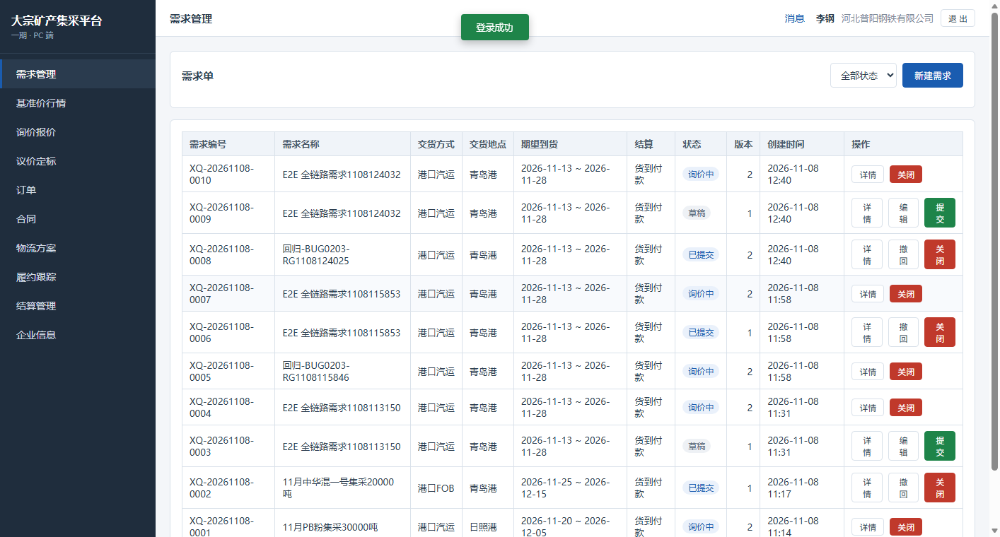
- 操作：手机号 `13900000002`、密码 `demo123456` →「登 录」
- 预期：进入主布局。左侧毛玻璃侧栏依次为「需求管理 / 基准价行情 / 询价报价 / 议价定标 / 订单 / 合同 / 物流方案 / 履约跟踪 / 结算管理 / 企业信息」十个菜单（当前项蓝色高亮，每项带线性图标）；顶栏为页面标题、消息铃铛（含未读数红色徽标）、当前用户「李钢」与所属企业、右上角「退 出」按钮
- 注意：不同角色菜单按权限裁剪（如中矿无「基准价行情」之外的需方专属项、承运商仅有物流相关项）

**S03 新建需求并提交** 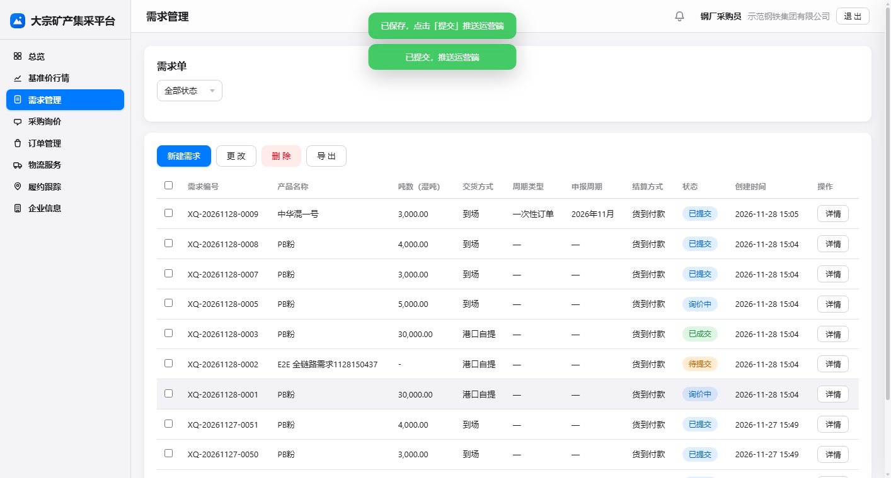
- 入口：「需求管理」→ 右上角蓝色「新建需求」按钮，弹出「新建需求单」弹窗
- 填写（双列表单，带红星为必填）：需求名称=`UI检测-中华混一号采购`；交货方式=港口 FOB（默认）；交货地点=`日照港`；价格意向（选填）；期望到货起=今天+12 天、期望到货止=今天+22 天（日期控件）；结算方式=货到付款（默认）；账期天数（选填）；质量要求/备注（选填）
- 添加明细：点「添加明细」在弹窗内选择品种=`中华混一号`（下拉）、品位(%)=`62.1`（数字输入）、数量=`3000`（吨）→「保 存」
- 预期：toast「已创建草稿」，明细行出现在弹窗列表
- 提交：点「提交」→ 确认弹窗点「确 定」→ toast「已提交」，列表中该需求状态变为「已提交」
- 注意：已提交需求不可直接改明细，需「撤回」后编辑再重新提交（版本号 +1）

#### 阶段二：询价与密封报价

**S04 新建询价并发出**（普阳） 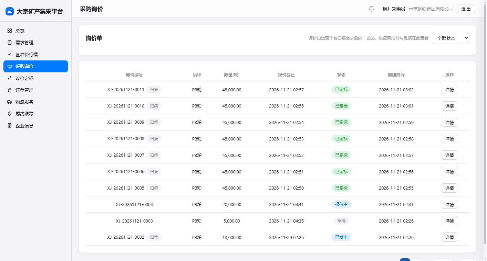
- 入口：「询价报价」→ 右上角「新建询价」按钮
- 填写：需求明细（下拉，选项格式为"需求编号-明细"，并标注剩余可询数量，选 S03 刚提交的明细）；询价数量 `3000`；期望到货日=今天+25 天；报价截止=今天+2 天 18:00（datetime 控件）；勾选邀请供应商（如中矿）
- 流程：「保存草稿」→ toast「询价草稿已创建」→ 列表点「详情」→ 详情弹窗点「发出询价」→ toast「询价已发出」，状态变为「已发出」
- 注意：报价截止须 ≥ 当前+2 小时且 ≤ 期望到货日-7 天，否则 toast 报错（40901）；已发出询价不可再编辑

**S05 询价列表渲染**（普阳） 
- 预期：列表出现刚发出的询价行（询价编号 XJ-…、品种、数量、报价截止、状态=「已发出」胶囊、邀请/响应计数如 1/0、创建时间），可按状态筛选
- 注意：列表异步加载，若网络慢稍候片刻再核对

**S06 询价详情渲染**（普阳） 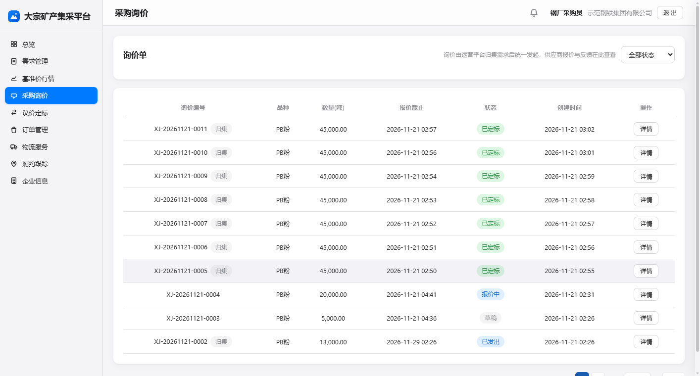
- 操作：点「详情」→ 弹窗「询价详情」正常展示数量/截止/期望到货日/邀请供应商响应情况等键值信息
- 注意：密封期内「响应情况」仅显示计数，不显示任何报价金额

**S07 中矿登录+收到询价**（供应商·中矿） 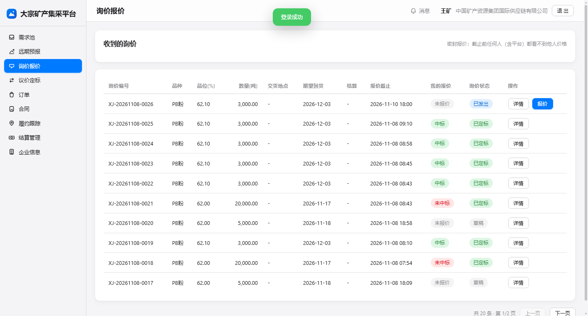
- 操作：右上角「退 出」→ 用 `13900000001 / demo123456` 登录 →「询价报价」
- 预期：收到一条询价邀请（状态=已发出），行内有「报价」按钮
- 注意（v1.1 流程调整）：钢厂自发询价**不再直接推送供应商**——按新流程本步骤应通过运营端「报价询价」**平台代发**后供应商才能收到；历史截图为调整前记录，复测时以运营端代发链路为准

**S08 密封报价提交**（中矿） 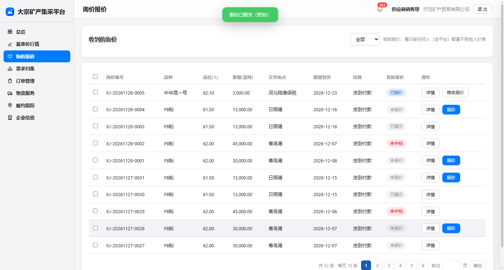
- 操作：点「报价」→ 弹窗填写单价 `860`（元/吨）、数量 `3000`、到货日=今天+25 天 →「提交报价」
- 预期：toast「报价已提交（密封）」；揭示前需方与他人均不可见该报价（密封隔离），询价状态变为「已报价」

#### 阶段三：揭示比价与议价定标

**S09 截止揭示+比价快照**（普阳） 
- 前置：报价截止时间已过（未到期时「截止揭示」被后端 40901 拦截，toast 提示未到截止时间，属预期）；检测脚本通过 SQL 将该询价截止时间改为过去来模拟自然到期，手工演示亦可等待到期
- 操作：「询价报价」→「详情」→「截止揭示」
- 预期：异步弹出「比价快照」弹窗：顶部为询价编号、最少响应（如 2 家）、响应情况（红色「响应不足」/绿色胶囊）、揭示时间；中部「比价表（按价格升序固化）」逐行列出 序号/单价/数量/响应率/到货日/付款条款/有效期至，行内带「议价」「定标」按钮；右下「关 闭」
- 注意：揭示后所有密封报价对所有人可见且不可篡改；响应不足仍可揭示，但建议响应数 ≥ 最少响应再定标

**S10 发出还价**（普阳） 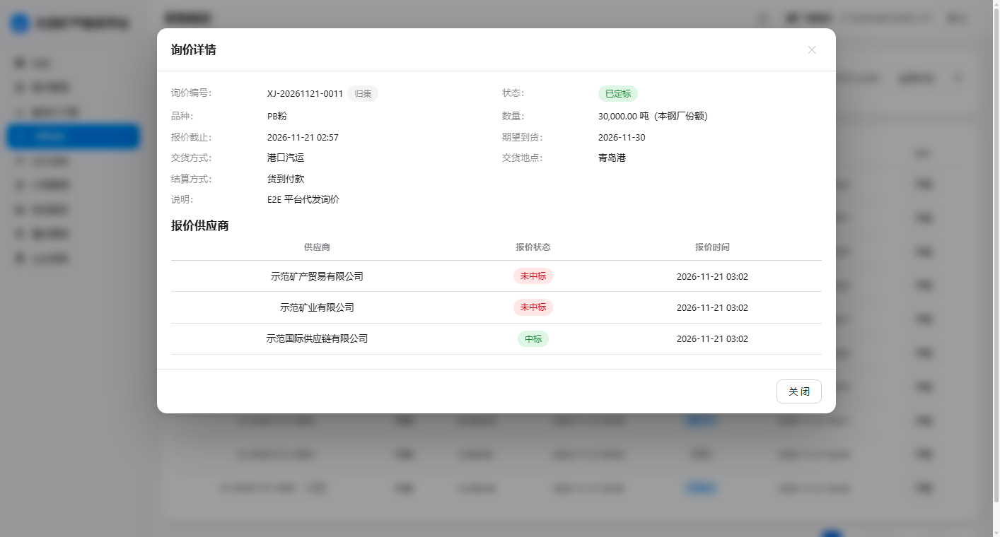
- 操作：在比价快照/详情弹窗点「议价」→ 弹窗填还价单价 `850`（元/吨）→「发出还价」
- 预期：toast「还价已发出」，产生新一轮议价；原报价轮次自动失效，供方需对新价响应

**S11 中矿接受还价**（中矿） 
- 入口：「议价定标」→ 列表该询价行 → 点「接受」→「确 定」
- 预期：toast「已接受」；其余在途轮次自动失效

**S12 普阳定标**（普阳） 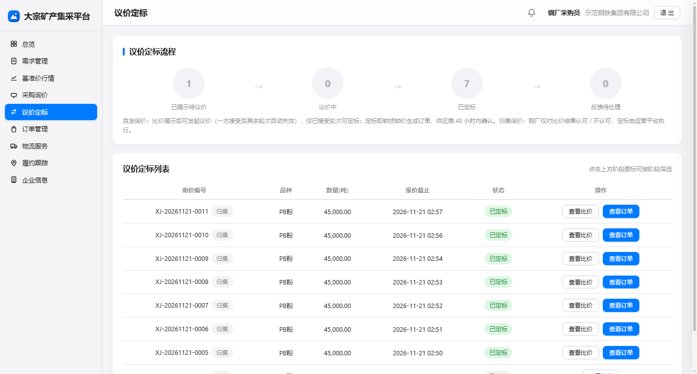
- 入口：「议价定标」→ 点「比价/议价」打开比价快照 → 行内点「定标」→「确 定」
- 预期：toast「定标成功」；自动生成订单 DD-…（供方 48h 内须确认），未中标报价自动置 LOSE，询价状态变为「已定标」

#### 阶段四：订单与合同双签

**S13 中矿确认订单**（中矿） 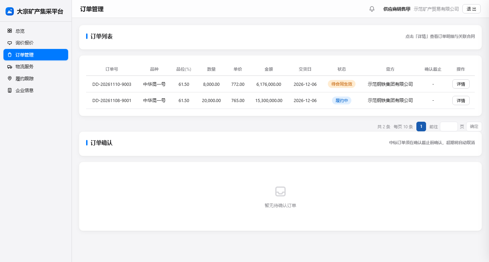
- 入口：「订单」→ 列表该订单行（状态=待确认）→「确认订单」→「确 定」
- 预期：toast「订单已确认」，订单进入待生成合同；48h 未确认订单自动失效

**S14 普阳生成合同**（普阳） 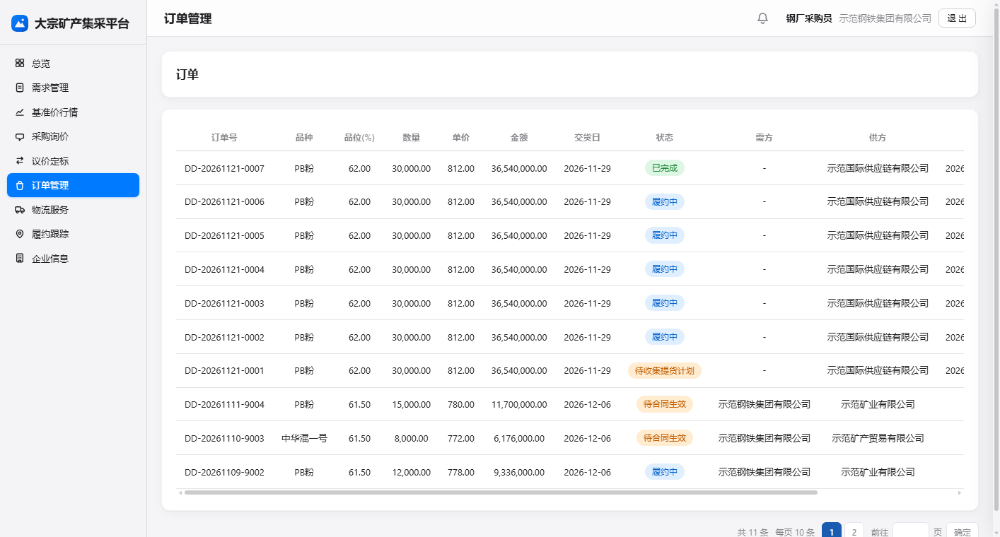
- 入口：「订单」→「生成合同」（已确认订单行内）
- 预期：toast「合同已生成」，自动跳转/前往「合同」页可见待签合同（HT-…，状态=待供方签署，版本 1）
- 注意：合同页顶部固定提示「需方签署后供方方可签署；已生效合同不可作废」

**S15 订单详情渲染**（普阳） 
- 操作：点「详情」→ 弹窗「订单详情」正常展示订单与关联合同信息（编号/品种/数量/单价/交货信息等键值网格）

**S16 需方签署合同**（普阳） 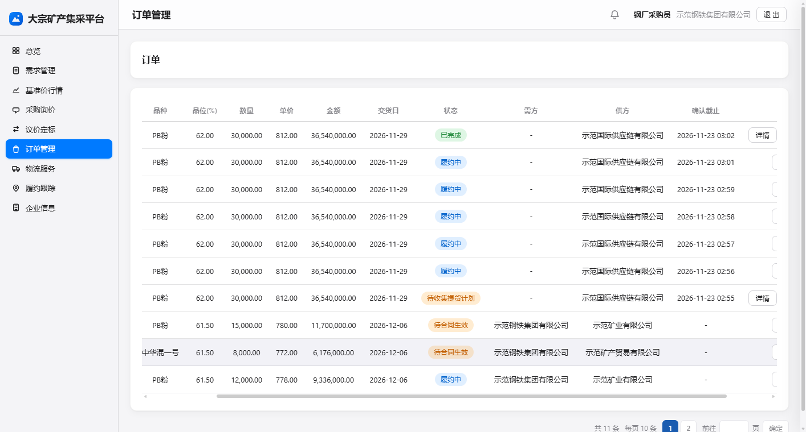
- 入口：「合同」→ 该合同行「需方签署」
- 操作：弹窗内勾选「已核对条款」复选框 → 上传盖章件（PDF/图片文件选择）→「签 署」
- 预期：toast「签署成功」，合同状态变为「待供方签署」（需方先签属预期顺序），列表「需方签署」列出现签署时间
- 注意：行内「详情」可随时查看合同，下载可导出；「作废」仅对未生效合同显示（红色按钮），需填作废原因

**S17 供方签署合同**（中矿） 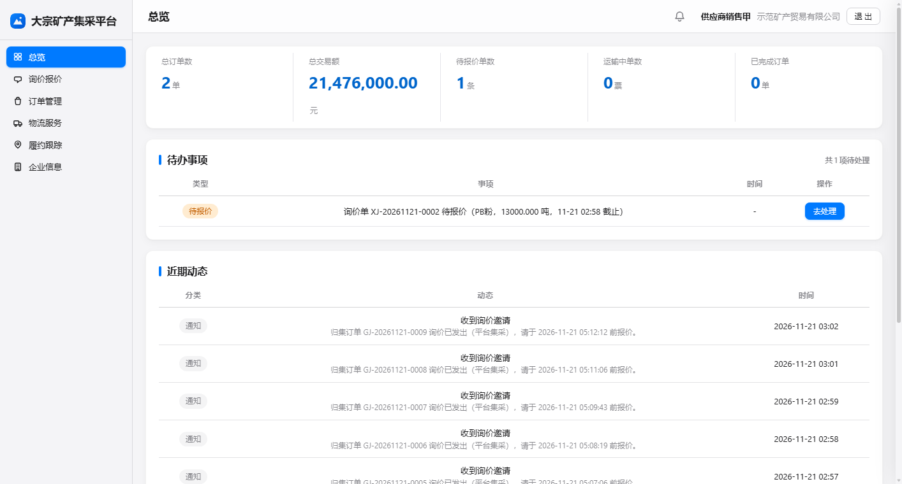
- 入口：中矿登录 →「合同」→「供方签署」→ 同 S16 勾选+上传+「签 署」
- 预期：toast「签署成功」，合同状态变为「已生效」，订单进入履约中；此时「作废」按钮消失

#### 阶段五：质检、结算与付款

**S18 结算工作台渲染**（普阳） 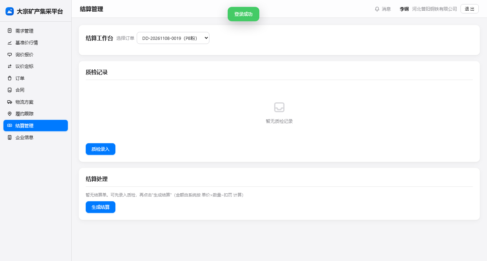
- 入口：「结算管理」→ 页面顶部出现「结算工作台」标题与「选择订单」下拉（选项格式：订单号 + 品种，如 DD-…-0013 (PB粉)），下方为「质检记录」「结算处理」两块卡片
- 注意：结算工作台按订单维度组织，先选订单再做质检与结算

**S19 质检录入**（普阳） 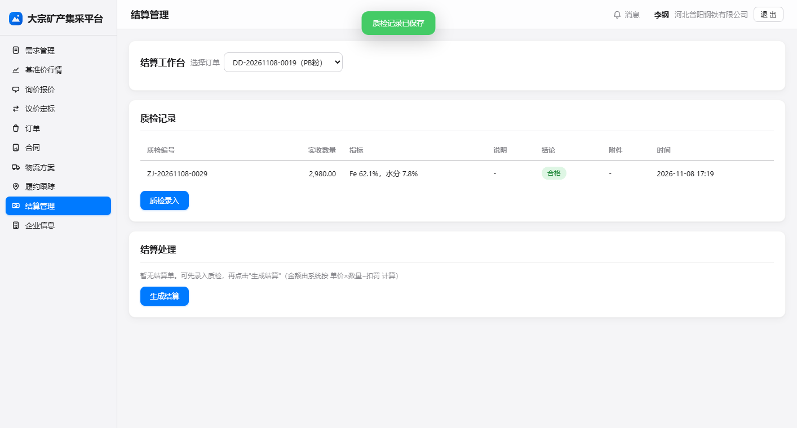
- 操作：「质检录入」→ 弹窗填实收数量 `2980`（吨，≤ 订单数量）、检验指标 `Fe 62.1%，水分 7.8%`（多行文本，结论默认合格）→「保 存」
- 预期：toast「质检记录已保存」，质检记录表新增一行（质检编号 ZJ-…、实收数量、指标、结论=合格胶囊、时间）
- 注意：实收数量超差会自动产生预警（预警处理页可见）；可录入多条，结算默认取最近一条合格质检实收

**S20 生成结算**（普阳） 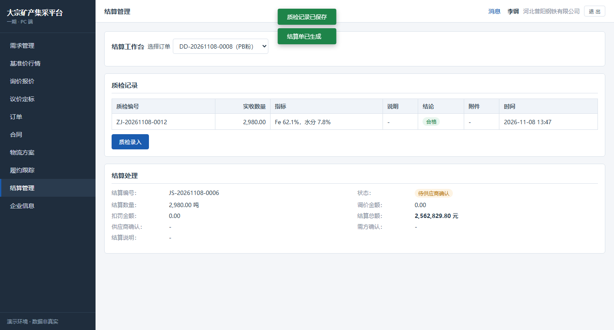
- 操作：「生成结算」→ 弹窗结算数量默认填最近合格质检实收 `2980` → 可改 →「生 成」
- 预期：toast「结算单已生成」，「结算处理」卡片展示：结算编号 JS-…、结算数量、状态=「待供应商确认」胶囊、结算金额=数量×定标单价（如 2980 × 860 = 2,562,829.80 元）

**S21 中矿供应商确认结算**（中矿） 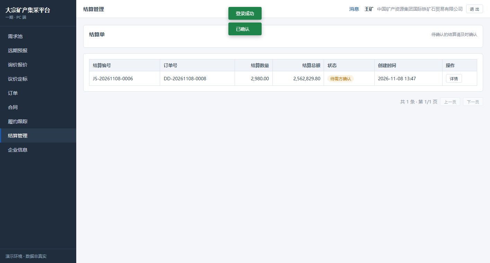
- 入口：中矿登录 →「结算管理」→ 列表出现该结算单（状态=待供应商确认）→「供应商确认」→「确 定」
- 预期：toast「已确认」，状态变为待需方确认

**S22 普阳需方确认+付款登记**（普阳） 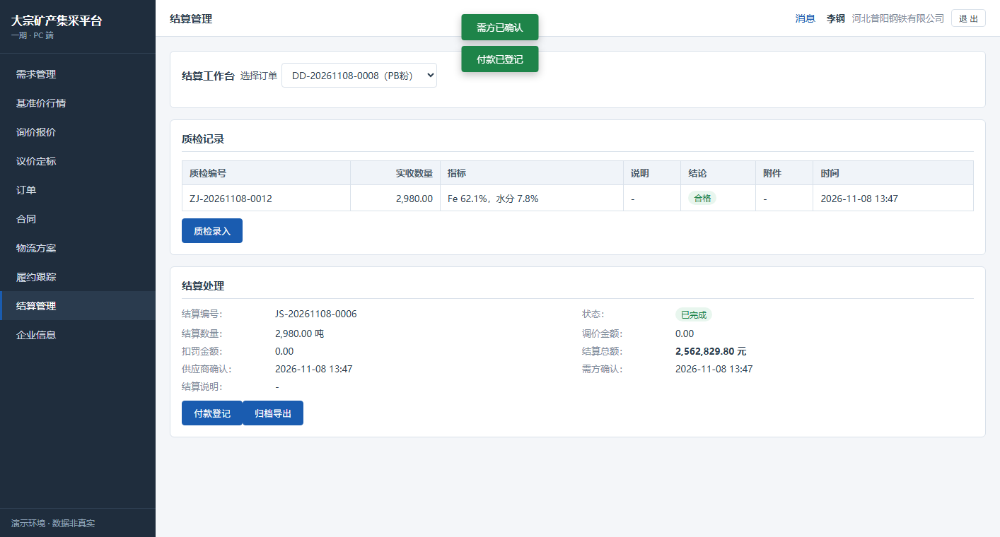
- 操作①：「结算管理」→「需方确认」→「确 定」→ toast「需方已确认」（双向确认后结算冻结，不可再改）
- 操作②：「付款登记」→ 弹窗金额预填结算总额、付款日期预填今天 → 可补充付款说明 →「登 记」→ toast「付款已登记」，结算完成（状态=已付款）
- 后续：可在「订单管理」页对该订单「归档导出」下载档案 zip（含需求/询价/订单/合同/结算单据）

**S23 console 错误检查** 
- 验收：全程浏览器 console 无 SEVERE 级错误（检测脚本由 Selenium 逐页收集判定；手工检测可按 F12 打开开发者工具在 Console 面板核对）
- 注意：网络 404 的静态探测请求、浏览器插件告警不计入；出现 SEVERE 需截图并附接口响应定位

## 5. 常见问题排查方案

### 5.1 启动类

| 现象 | 排查步骤 |
|------|----------|
| `python run.py` 报数据库连接失败 | ① `docker ps` 确认容器在运行；② `docker compose up -d` 启动；③ 核对 `MINE_PG_DSN` 与 docker-compose.yml 中端口/密码一致 |
| 端口 8000 被占用 | `Get-NetTCPConnection -LocalPort 8000` 找到 PID → `Stop-Process -Id <PID> -Force`；或改 `MINE_PORT` 启动 |
| 页面空白/静态资源 404 | 确认从项目根目录启动（前端目录 frontend 由后端托管） |
| 登录提示账号不存在 | 先核对所用账号与 3.4 节口径一致：当前演示库为全新 seed 口径——138 号段（13800000001 钢厂 / 13800000002~04 供应商 / 13800000005 承运商，密码均 demo123456）；管理员 13800000000 两种环境均存在。若库为 2026-11-08 历史基线则用 139 号段 |

### 5.2 业务操作类

| 现象 | 原因与处理 |
|------|------------|
| 询价保存失败提示「2 小时/7 天」 | 截止时间必须 ≥ 当前+2h 且 ≤ 到货日期前 7 天。弹窗底部会显示具体原因（修复后不再静默失败）；注意用**本地北京时间**填写 |
| 页面时间与本地时间差 8 小时（历史数据） | 存量数据需执行第 3.6 节迁移脚本；新环境已通过会话时区（Asia/Shanghai）根治 |
| 需求单提交后无法修改名称等字段 | 属预期：提交后关键字段锁定（40901）。需先「撤回」，状态为「已撤回」后「重新提交」生成新版本（撤回态不可直接编辑） |
| 供应商看不到他人报价 | 属预期：密封报价，截止揭示前仅见自己的报价；需方在截止前也不可见 |
| 揭示按钮不可用 | 询价未到截止时间（40901）；紧急验证时可直连库把 deadline 调到过去（仅测试） |
| 合同无法供方先签 | 属预期顺序：需方先签（40901） |
| 重复报价被拦截（40902） | 同一询价同一供应商存在在途报价，请先在报价列表修改/撤回原报价 |
| 结算无法再次确认（40901） | 双向确认后结算冻结，属预期 |
| 企业注册提示重复信用代码（40902） | 换未注册的统一社会信用代码 |
| 上传文件失败 | 单文件 ≤20MB；执照仅注册流程免登录上传，其余需登录 |

### 5.3 时间与时区专题（BUG-06 相关）

- 平台统一业务时区为 **Asia/Shanghai**：数据库会话时区由后端固定（`backend/db.py` 的 `BUSINESS_TZ`，可用 `MINE_PG_TZ` 覆盖），容器环境变量 TZ/PGTZ 已同步设置
- 验证方法：任一列表页「创建时间」应与本地时间一致（±1 分钟）
- 若发现整库时间仍差 8 小时：确认后端已重启到修复后版本，并已执行 3.6 节迁移

### 5.4 测试与验证

- 回归测试失败先确认：服务在 8000 端口运行中、数据库可达、基线账号未被删除
- E2E 全链路脚本会自适应发现基线账号并在供应商不足 3 家时自动补位注册
- 测试证据（截图/结果）存于 `test-evidence-20261108/`

## 6. 目录结构速览

```
mine_platform_demo/
├── run.py                  # 启动入口（建表+seed+Flask）
├── docker-compose.yml      # PostgreSQL 14 容器（含时区配置）
├── requirements.txt
├── backend/                # Flask 后端（api/ 业务接口，state_machine.py 状态机，seed.py 演示数据）
├── frontend/               # 原生 JS SPA（js/pages/ 各页面模块）
├── docs/
│   ├── schema_postgresql.sql       # 建表脚本
│   ├── migrations/                 # 一次性数据迁移（如 BUG-06 时区修复）
│   └── PROJECT_GUIDE.md            # 项目内部指南
├── tests/                  # e2e_full_chain.py 全链路 / test_bugfix_regression.py BUG 回归 / e2e_helpers.py 封装
└── test-evidence-20261108/ # 本轮测试与修复证据
```

## 7. 已知问题修复记录（2026-11-08）

| BUG | 现象 | 根因 | 修复 | 回归验证 |
|-----|------|------|------|----------|
| BUG-01 | 管理后台状态字典页显示"无流转" | 后端 /admin/dicts 返回嵌套 dict `{from:[to...]}`，前端按行数组渲染 | frontend/js/pages/admin.js 展开嵌套 dict 为行数组 | 回归 PASS |
| BUG-02 | 新建需求明细：下拉已选品种仍报"明细不完整" | 明细行 select 默认显示第一项但未回写数据模型 | frontend/js/pages/demand.js 默认选中项回写模型 | 回归 PASS |
| BUG-03 | 编辑需求明细弹窗恒显示"暂无明细"，误存清空明细 | 编辑时 items=[] 未从 existing.items 回填 | frontend/js/pages/demand.js 回填并映射既有明细 | 回归 PASS（回读+原样回存） |
| BUG-04 | 需求撤回后无重提入口，流程中断 | 后端支持 WITHDRAWN→SUBMITTED（版本+1），UI 缺按钮 | frontend/js/pages/demand.js 增加"重新提交"入口并修正撤回文案 | 回归 PASS（version==2） |
| BUG-05 | 企业用户个人资料页误显示"平台管理员无企业档案" | /companies/me 对企业用户返回平铺字段，前端只读 d.company 嵌套 | frontend/js/pages/misc.js 兼容平铺/嵌套两种形状 | 回归 PASS |
| BUG-06 | 页面时间差 8 小时；按页面时间+3h 填截止被"+2h"拦截 | PG 容器 UTC，DB now() 与应用/用户本地语义不一致 | 三层修复：会话时区（backend/db.py、backend/__init__.py）+ 容器 TZ/PGTZ（docker-compose.yml）+ 存量数据迁移（docs/migrations/） | 回归 PASS（created_at=本地±10min；+2h10min 可建、+1h 被拦） |
| BUG-07 | 询价弹窗校验失败仅 toast 3 秒即消失，"静默失败" | 弱反馈：toast 短暂 + 弹窗常开无错误区 | frontend/js/pages/trade.js 弹窗内持久错误区 + 本地预校验 | 回归 PASS（40001 message 明确） |
| BUG-08 | 所有日期/数字输入框实际都是纯文本框（type 参数被忽略，涉及 13 处：到货日/截止时间/品位/金额等） | frontend/js/ui.js 的 UI.input 未把 type 赋给 input 元素 | UI.input 增加 `if (type) el.type = type` | UI 专项 S03/S04 日期渲染为 date/datetime-local 控件，PASS |
| BUG-09 | 新建需求保存必失败，报"数值格式错误：grade" | 品位字段用文本框+「牌号」文案引导输文本（如 ZH-1），而 DB 字段为 NUMERIC(5,2) 数值品位 | frontend/js/pages/demand.js 改数字输入+「品位(%)」标签；trade/order/admin 展示文案同步为品位(%) | UI 专项 S03 输入 62.1 保存+提交 PASS；E2E 97/97 PASS |
| BUG-10 | 「合同」页永远空白：无表格、无空态、无网络请求、无报错（静默失败） | frontend/js/pages/order.js 的 Pages.contract 定义了 load() 但从未调用（探针证实 fetch 从未发出） | 函数结尾补 `await load();` | UI 专项 S16 合同列表出现待签行并完成需方签署，PASS |
| BUG-11 | 供应商「结算管理」页永远空白（与 BUG-10 同为静默失败模式） | frontend/js/pages/settle.js 供应商分支定义 load()/acts() 但从未调用 | 结尾补 `await load();`；并系统化排查全部 17 个 Pages 函数确认无同类遗漏 | UI 专项 S21 供应商结算列表出现「供应商确认」按钮，PASS |

修复验证结果：BUG 回归 17/17 PASS；E2E 全链路 97/97 PASS（FAIL 0）；UI 可视化专项 23/23 PASS（FAIL 0，过程见 4.5 节与 `docs/前端可视化专项检测报告-20261108.md`）。
