# 大宗矿产集采平台 系统使用说明

> 版本：一期演示版（v1.0） · 更新日期：2026-11-08
> 适用对象：平台管理员、钢厂（需方）、供应商（供方）、承运商
> 文档体系：[交付报告](交付报告.md)（交付范围与修复过程记录）｜[前端可视化专项检测报告](docs/前端可视化专项检测报告-20261108.md)（UI 专项检测）｜[E2E 测试档案报告](test-evidence-20261108/reports/业务流程工作档案报告.html)（test-evidence-20261108/ 档案封面）

---

## 1. 系统概述

大宗矿产集采平台面向钢厂、供应商、承运商与平台运营方，提供从 **需求申报 → 询价报价（密封）→ 议价 → 定标 → 合同 → 物流 → 质检 → 结算 → 付款 → 归档** 的全流程线上化集采服务，配套平台准入审批、基准价管理、预警与消息通知、状态机字典等运营能力。

- 前端：原生 JS 单页应用（SPA），浏览器访问 `http://127.0.0.1:8000`
- 后端：Flask（Python 3），REST API 前缀 `/api/v1`
- 数据库：PostgreSQL 14（Docker 容器 `mine-platform-pg`）

## 2. 系统功能模块说明

### 2.1 按角色划分

| 角色 | 登录后可用模块 |
|------|----------------|
| 平台管理员 | 企业准入审批、品种与基准价管理、状态机字典、预警处理、运营导出 |
| 钢厂（STEEL） | 需求申报（草稿/提交/撤回/重提/关闭）、询价管理（新建/发出/揭示/比价/定标/流标）、订单确认、合同签署、物流方案与运单签收、质检录入、结算确认、付款登记、归档导出、企业信息 |
| 供应商（SUPPLIER） | 脱敏需求池浏览、询价报价（密封，截止前仅见自己报价）、多轮议价、订单确认、合同签署、运单回填、结算确认、企业信息 |
| 承运商（LOGISTICS） | 运单接单、发运/到达回填、企业信息 |

### 2.2 功能模块清单（前后端对应）

| 模块 | 说明 | 主要代码 |
|------|------|----------|
| 认证与注册 | 免登录执照上传、企业注册（类型别名归一）、登录、JWT 鉴权 | backend/api/auth.py、frontend/js/pages/auth.js |
| 企业准入 | 平台审批（通过/驳回需原因）、企业档案与资质 | backend/api/company.py、frontend/js/pages/misc.js |
| 品种与基准价 | 品种维护（默认牌号数值校验）、基准价当日新增/更新留痕、当前价与 30 日走势 | backend/api/base.py、frontend/js/pages/price.js |
| 需求申报 | 需求单 CRUD、明细（品种/品位/数量/增减幅度）、提交/撤回/重提（版本+1）/关闭、提交后关键字段锁定 | backend/api/demand.py、frontend/js/pages/demand.js |
| 需求池（脱敏） | 供应商可见脱敏概要，不泄露企业名称与价格意向 | 同上 |
| 询价报价 | 询价单创建/发出（邀请供应商）、密封报价、截止揭示、比价快照（价格升序固化）、最少响应校验 | backend/api/inquiry.py、frontend/js/pages/trade.js |
| 议价 | 多轮还价/接受/拒绝，接受即其余在途轮次失效；对标面板（基准价/匿名价/近期成交均价） | backend/api/bargain.py |
| 定标与订单 | 按报价定标生成订单与 48h 确认期限，未中标自动置 LOSE | backend/api/order.py |
| 合同 | 定标后生成待签合同（需方先签）、盖章件 SHA-256 存证、作废重签版本化 | backend/api/contract.py |
| 物流 | 物流方案（分段、偏差>5% 须说明）、运单指派、承运商回填、需方签收 | backend/api/logistics.py |
| 履约时间轴 | 订单/合同/运单/系统节点汇总展示 | backend/api/track.py |
| 质检与预警 | 质检记录录入、超差自动预警、预警处理（关闭须意见）、同类未关闭预警去重 | backend/api/alert.py |
| 结算与付款 | 按最近质检实收生成结算（系统计算金额）、双向确认冻结、付款登记后归档 | backend/api/settlement.py |
| 归档导出 | 订单档案 zip（含 manifest.json） | backend/api/order.py |
| 消息通知 | 关键节点站内消息 | backend/api/message.py |
| 运营后台 | 状态机字典展示、企业管理、基准价录入、预警处理 | backend/api/admin.py、frontend/js/pages/admin.js |
| 定时任务 | 截止揭示、期限预警等（可 MINE_DISABLE_JOBS 关闭） | backend/jobs.py |

### 2.3 关键业务规则速查

- 询价截止时间：**≥ 当前时间 +2 小时**，且 **不晚于到货日期前 7 天**（违反返回 40001）
- 需求单状态机：`DRAFT → SUBMITTED ⇄ WITHDRAWN → SUBMITTED(版本+1)`；提交后关键字段锁定（40901）
- 密封报价：截止前需方不可见任何报价，供应商不可揭示（40301）
- 合同签署顺序：需方先签，供方后签（40901）；未完整签署可作废重签
- 结算确认：双向确认后冻结，不可重复确认（40901）

## 3. 环境配置步骤

### 3.1 前置依赖

- Python 3.10+
- Docker（用于 PostgreSQL 14）
- 依赖安装：`pip install -r requirements.txt`（flask / psycopg[binary] / bcrypt / requests / pytest）

### 3.2 启动数据库

```powershell
# 在项目根目录执行（首次会创建容器与数据卷）
docker compose up -d
# 验证容器状态
docker ps --filter name=mine-platform-pg
```

默认连接参数（见 docker-compose.yml 与 backend/db.py）：

- 主机/端口：`127.0.0.1:5432` · 用户：`postgres` · 密码：`Langchain2026` · 库：`mine_platform`
- 业务时区：`Asia/Shanghai`（容器环境变量 TZ/PGTZ + 后端会话时区双重保证，可用 `MINE_PG_TZ` 覆盖）

### 3.3 启动后端（含自动建表与演示数据）

```powershell
python run.py
```

- 首次启动自动创建表结构（docs/schema_postgresql.sql）并写入演示数据
- 访问：`http://127.0.0.1:8000`
- 可选环境变量：`MINE_PG_DSN`（数据库连接串）、`MINE_JWT_SECRET`、`MINE_PORT`、`MINE_DISABLE_JOBS`

### 3.4 演示账号

| 角色 | 账号 | 密码 | 企业 |
|------|------|------|------|
| 平台管理员 | 13800000000 | admin123456 | 平台运营 |
| 供应商（中矿） | 13900000001 | demo123456 | 中国矿产资源集团国际供应链有限公司 |
| 钢厂（普阳） | 13900000002 | demo123456 | 河北普阳钢铁有限公司 |
| 承运商 | 13900000003 | demo123456 | 测试承运物流有限公司 |

> 说明：以上为当前演示库的基线账号（2026-11-08 起，企业账号密码统一为 `demo123456`，详见交付报告 §9 FIX-2/§9.2）。**全新初始化**（`python run.py` 首次 seed）写入的是 138 号段示范企业（13800000001 示范钢铁集团 / 13800000002~04 示范矿产等供应商 / 13800000005 示范物流，密码均为 `demo123456`）；本演示库基线已重建为上表 139 号段，两套口径不要混用。

### 3.5 运行测试

```powershell
# 7 个 BUG 修复的回归测试（需服务已启动）
python tests\test_bugfix_regression.py

# E2E 全链路回归（注册→…→归档导出，需服务已启动）
python tests\e2e_full_chain.py

# 前端全流程可视化专项检测（Selenium Edge headless，23 步，截图至 docs\shots\）
python tests\ui_e2e.py
```

UI 专项检测最新结果：**23/23 PASS**（覆盖需求→询价→密封报价→揭示比价→议价→定标→订单→合同双签→质检→结算→双方确认→付款登记全链路，无 console 错误），过程详见 `docs/前端可视化专项检测报告-20261108.md`。

### 3.6 历史数据时区迁移（仅存量环境需要一次）

若数据库在 2026-11-08 之前已产生数据（时区修复部署前的 UTC 时间戳），执行一次性迁移：

```powershell
Get-Content docs\migrations\20261108_bug06_timezone_fix.sql -Raw | docker exec -i mine-platform-pg psql -U postgres -d mine_platform -v ON_ERROR_STOP=1
```

全新初始化的环境无需执行。

## 4. 操作流程指引

### 4.1 平台管理员（运营）

1. 登录 → 「企业审批」：审核待准入企业（驳回必须填原因）
2. 「品种管理」：维护品种与默认牌号；「基准价」：按品种+日期录入当日基准价（同日重复录入为更新留痕）
3. 「状态字典」：查看各业务对象状态机流转矩阵
4. 「预警处理」：处理质检超差等自动预警（关闭须填处理意见）

### 4.2 钢厂（需方）核心流程

```
注册/登录 → 需求申报（新建草稿→添加明细→提交）
   ├─ 需改：撤回（状态=已撤回，不可编辑）→ 重新提交（生成新版本）
   └─ 询价：新建询价（选需求明细、填截止/到货/最少响应、勾选供应商）→ 发出
        → 等报价（截止前不可见）→ 揭示比价（价格升序）
             ├─ 议价：多轮还价/接受
             ├─ 定标：按某报价定标 → 生成订单（供应商 48h 内确认）
             └─ 流标：填原因，询量归还
        → 合同：需方上传盖章件先签 → 供方签 → 生效（如有问题：作废重签）
        → 物流：创建方案（分段）→ 指派承运商 → 运单签收
        → 质检：录入实测值（超差自动预警）
        → 结算：生成结算（默认取最近质检实收）→ 双向确认 → 付款登记
        → 归档：导出档案 zip
```

### 4.3 供应商（供方）

1. 「需求池」浏览脱敏需求（无企业名/价格意向）
2. 收到询价邀请 → 「密封报价」（截止前可改价，仅自己可见；重复整单报价会被 40902 拦截）
3. 揭示后在比价表中被议价则响应：接受/拒绝/再还价
4. 中标 → 确认订单（48h 期限内）→ 签合同（需方先签）→ 运单回填发运/到达 → 结算确认

### 4.4 承运商

登录 → 「运单」接单 → 回填实际发运/到达时间 → 等待需方签收。

### 4.5 全流程图文操作指引（UI 专项检测 23 步）

> 本节按「普阳（钢厂 13900000002）＋中矿（供应商 13900000001）」双账号，密码均为 `demo123456`，完整跑通一遍全链路。每个操作节点给出：执行角色、菜单入口、字段级操作（含示例值）、预期页面表现（toast 文案）与对应截图（存于 `docs/shots/`，均为当前最新界面实拍）。日期类示例值均以"今天+N 天"表示，实际操作按业务填写；询价截止须 ≥ 当前+2 小时且 ≤ 到货日前 7 天（违反时后端返回 40901，前端 toast 提示）。检测脚本 `tests/ui_e2e.py`（Selenium Edge headless），最新结果 **23/23 PASS、无 console 错误**。所有截图与操作说明均基于当前 Apple HIG 风格新版界面。

#### 阶段一：登录与需求管理（钢厂·普阳）

**S01 登录页渲染** 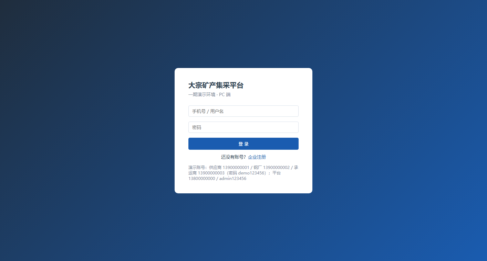
- 入口：浏览器打开 `http://127.0.0.1:8000/#/login`
- 页面要素：定制背景图（矿石晶簇×钢铁线稿低调肌理，低饱和渐变 + 细噪点，随系统自动切换明/暗模式）；卡片品牌标识区（渐变 Logo 标 +「大宗矿产集采平台」主标）；带标签的手机号输入框（占位提示「请输入 11 位手机号」）、密码输入框（占位提示「请输入登录密码」）；「登 录」蓝色主按钮（提交时置灰显示「登录中…」防重复提交）
- 其他入口：底部「没有账号？立即注册」可切换到企业注册页（三角色卡片式选择）
- 预期：表单完整渲染，无样式错乱

**S02 普阳登录** 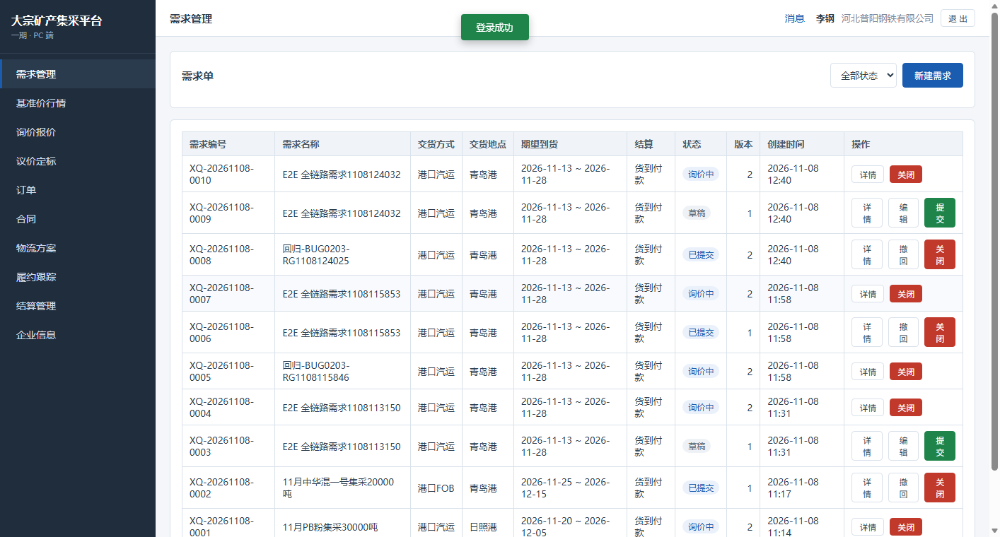
- 操作：手机号 `13900000002`、密码 `demo123456` →「登 录」
- 预期：进入主布局。左侧毛玻璃侧栏依次为「需求管理 / 基准价行情 / 询价报价 / 议价定标 / 订单 / 合同 / 物流方案 / 履约跟踪 / 结算管理 / 企业信息」十个菜单（当前项蓝色高亮，每项带线性图标）；顶栏为页面标题、消息铃铛（含未读数红色徽标）、当前用户「李钢」与所属企业、右上角「退 出」按钮
- 注意：不同角色菜单按权限裁剪（如中矿无「基准价行情」之外的需方专属项、承运商仅有物流相关项）

**S03 新建需求并提交** 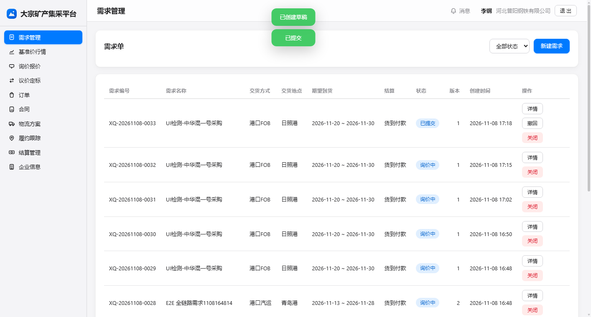
- 入口：「需求管理」→ 右上角蓝色「新建需求」按钮，弹出「新建需求单」弹窗
- 填写（双列表单，带红星为必填）：需求名称=`UI检测-中华混一号采购`；交货方式=港口 FOB（默认）；交货地点=`日照港`；价格意向（选填）；期望到货起=今天+12 天、期望到货止=今天+22 天（日期控件）；结算方式=货到付款（默认）；账期天数（选填）；质量要求/备注（选填）
- 添加明细：点「添加明细」在弹窗内选择品种=`中华混一号`（下拉）、品位(%)=`62.1`（数字输入）、数量=`3000`（吨）→「保 存」
- 预期：toast「已创建草稿」，明细行出现在弹窗列表
- 提交：点「提交」→ 确认弹窗点「确 定」→ toast「已提交」，列表中该需求状态变为「已提交」
- 注意：已提交需求不可直接改明细，需「撤回」后编辑再重新提交（版本号 +1）

#### 阶段二：询价与密封报价

**S04 新建询价并发出**（普阳） 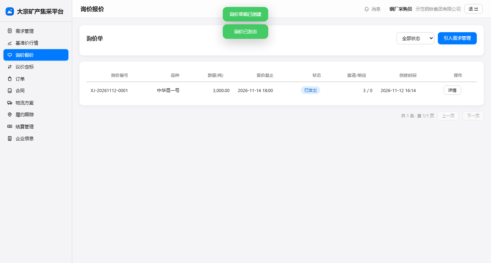
- 入口：「询价报价」→ 右上角「新建询价」按钮
- 填写：需求明细（下拉，选项格式为"需求编号-明细"，并标注剩余可询数量，选 S03 刚提交的明细）；询价数量 `3000`；期望到货日=今天+25 天；报价截止=今天+2 天 18:00（datetime 控件）；勾选邀请供应商（如中矿）
- 流程：「保存草稿」→ toast「询价草稿已创建」→ 列表点「详情」→ 详情弹窗点「发出询价」→ toast「询价已发出」，状态变为「已发出」
- 注意：报价截止须 ≥ 当前+2 小时且 ≤ 期望到货日-7 天，否则 toast 报错（40901）；已发出询价不可再编辑

**S05 询价列表渲染**（普阳） 
- 预期：列表出现刚发出的询价行（询价编号 XJ-…、品种、数量、报价截止、状态=「已发出」胶囊、邀请/响应计数如 1/0、创建时间），可按状态筛选
- 注意：列表异步加载，若网络慢稍候片刻再核对

**S06 询价详情渲染**（普阳） 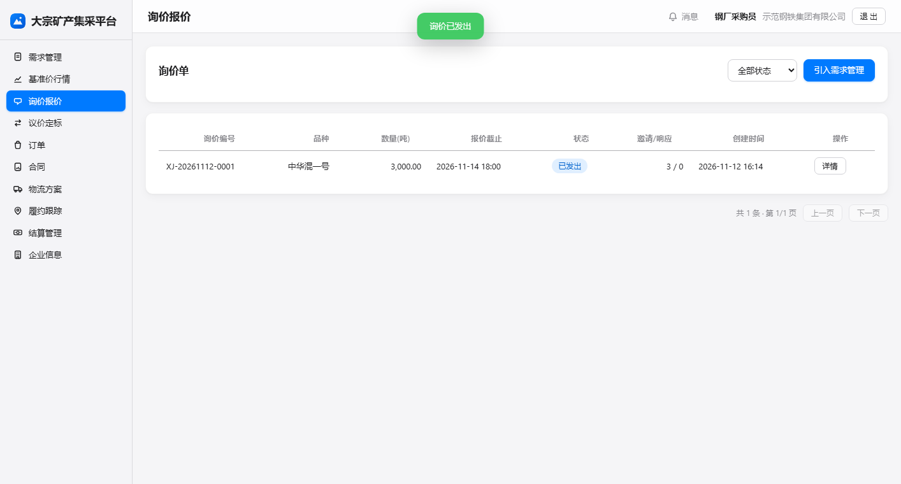
- 操作：点「详情」→ 弹窗「询价详情」正常展示数量/截止/期望到货日/邀请供应商响应情况等键值信息
- 注意：密封期内「响应情况」仅显示计数，不显示任何报价金额

**S07 中矿登录+收到询价**（供应商·中矿） 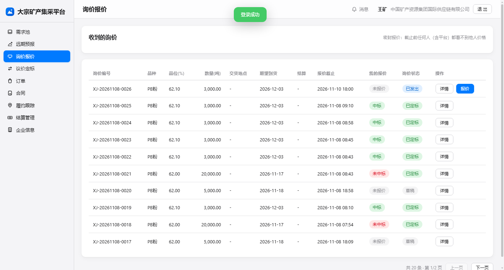
- 操作：右上角「退 出」→ 用 `13900000001 / demo123456` 登录 →「询价报价」
- 预期：收到一条询价邀请（状态=已发出），行内有「报价」按钮

**S08 密封报价提交**（中矿） 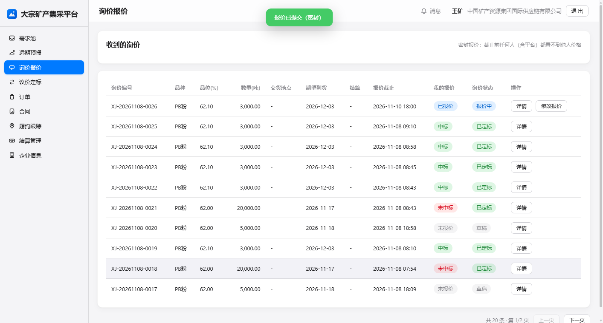
- 操作：点「报价」→ 弹窗填写单价 `860`（元/吨）、数量 `3000`、到货日=今天+25 天 →「提交报价」
- 预期：toast「报价已提交（密封）」；揭示前需方与他人均不可见该报价（密封隔离），询价状态变为「已报价」

#### 阶段三：揭示比价与议价定标

**S09 截止揭示+比价快照**（普阳） 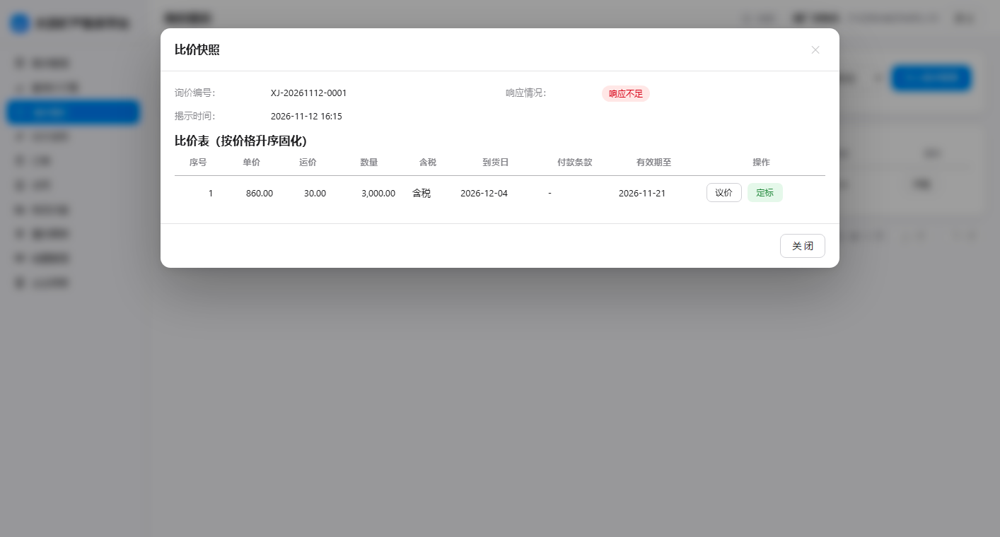
- 前置：报价截止时间已过（未到期时「截止揭示」被后端 40901 拦截，toast 提示未到截止时间，属预期）；检测脚本通过 SQL 将该询价截止时间改为过去来模拟自然到期，手工演示亦可等待到期
- 操作：「询价报价」→「详情」→「截止揭示」
- 预期：异步弹出「比价快照」弹窗：顶部为询价编号、最少响应（如 2 家）、响应情况（红色「响应不足」/绿色胶囊）、揭示时间；中部「比价表（按价格升序固化）」逐行列出 序号/单价/数量/响应率/到货日/付款条款/有效期至，行内带「议价」「定标」按钮；右下「关 闭」
- 注意：揭示后所有密封报价对所有人可见且不可篡改；响应不足仍可揭示，但建议响应数 ≥ 最少响应再定标

**S10 发出还价**（普阳） 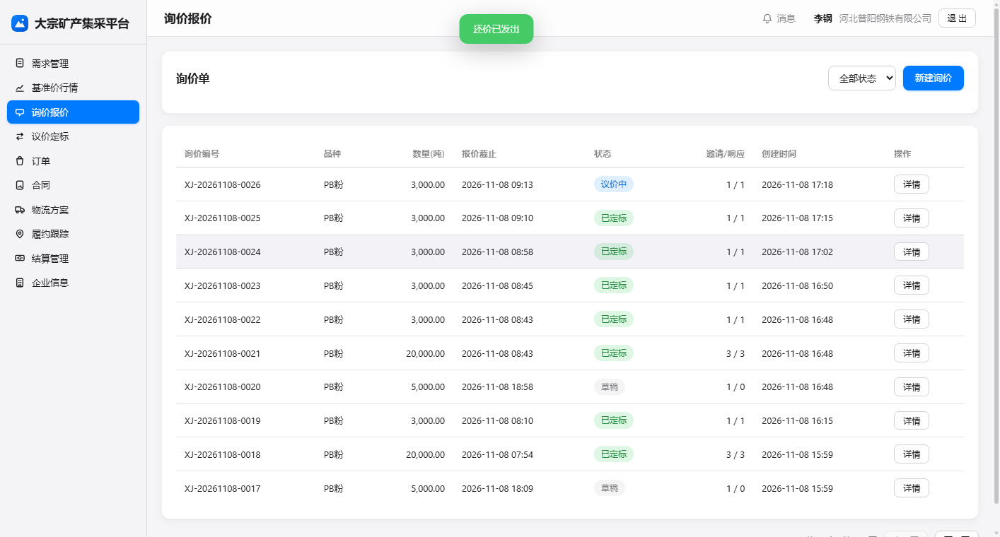
- 操作：在比价快照/详情弹窗点「议价」→ 弹窗填还价单价 `850`（元/吨）→「发出还价」
- 预期：toast「还价已发出」，产生新一轮议价；原报价轮次自动失效，供方需对新价响应

**S11 中矿接受还价**（中矿） 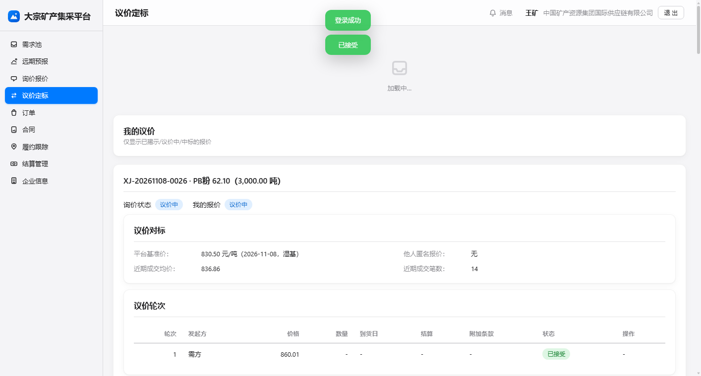
- 入口：「议价定标」→ 列表该询价行 → 点「接受」→「确 定」
- 预期：toast「已接受」；其余在途轮次自动失效

**S12 普阳定标**（普阳） 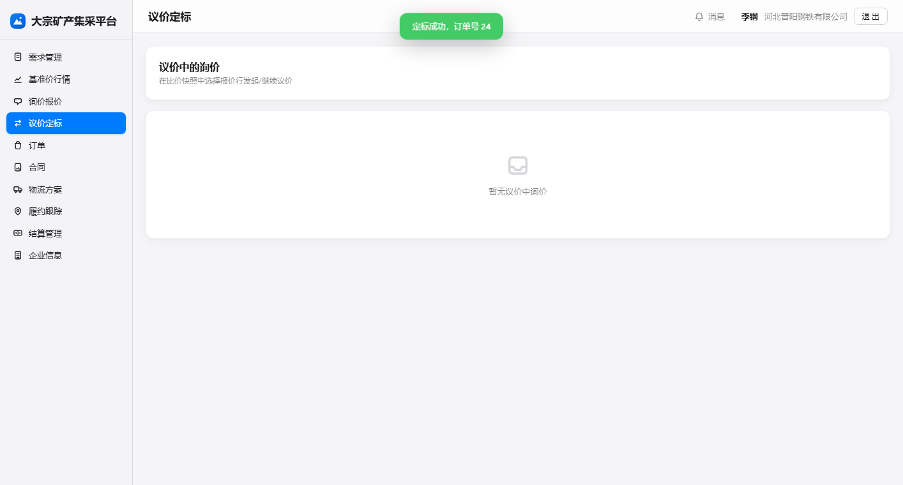
- 入口：「议价定标」→ 点「比价/议价」打开比价快照 → 行内点「定标」→「确 定」
- 预期：toast「定标成功」；自动生成订单 DD-…（供方 48h 内须确认），未中标报价自动置 LOSE，询价状态变为「已定标」

#### 阶段四：订单与合同双签

**S13 中矿确认订单**（中矿） 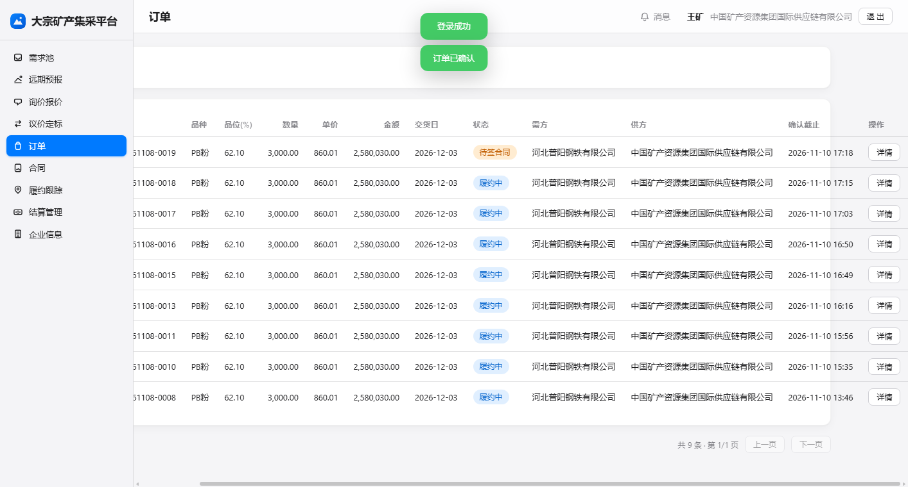
- 入口：「订单」→ 列表该订单行（状态=待确认）→「确认订单」→「确 定」
- 预期：toast「订单已确认」，订单进入待生成合同；48h 未确认订单自动失效

**S14 普阳生成合同**（普阳） 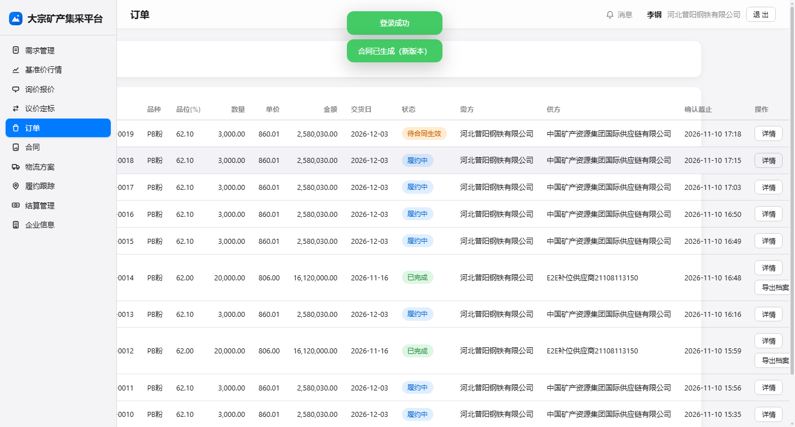
- 入口：「订单」→「生成合同」（已确认订单行内）
- 预期：toast「合同已生成」，自动跳转/前往「合同」页可见待签合同（HT-…，状态=待供方签署，版本 1）
- 注意：合同页顶部固定提示「需方签署后供方方可签署；已生效合同不可作废」

**S15 订单详情渲染**（普阳） 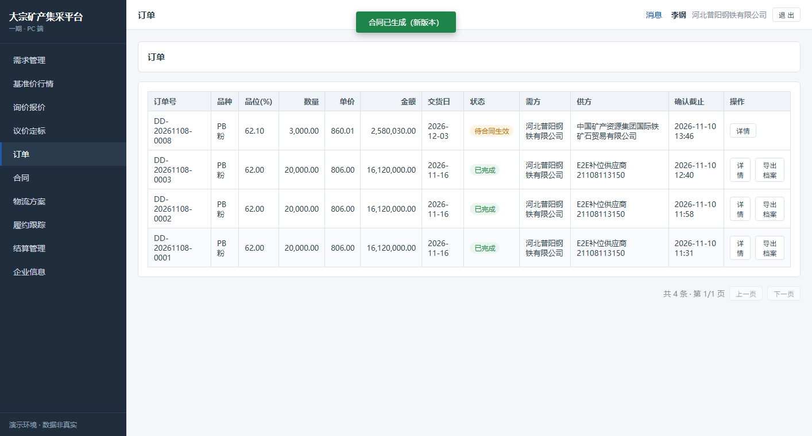
- 操作：点「详情」→ 弹窗「订单详情」正常展示订单与关联合同信息（编号/品种/数量/单价/交货信息等键值网格）

**S16 需方签署合同**（普阳） 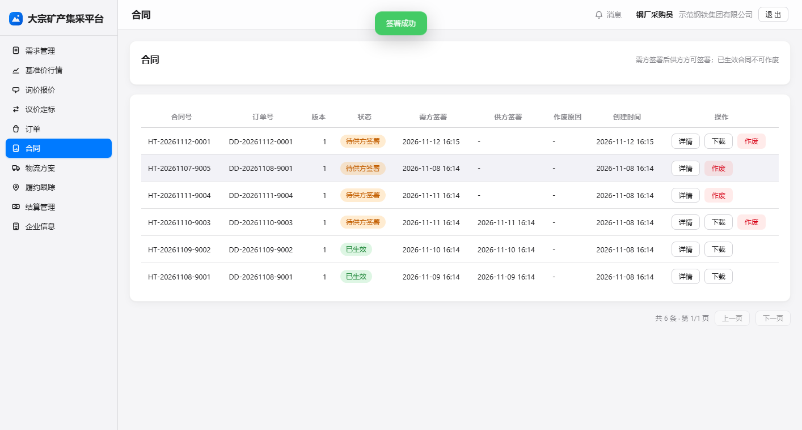
- 入口：「合同」→ 该合同行「需方签署」
- 操作：弹窗内勾选「已核对条款」复选框 → 上传盖章件（PDF/图片文件选择）→「签 署」
- 预期：toast「签署成功」，合同状态变为「待供方签署」（需方先签属预期顺序），列表「需方签署」列出现签署时间
- 注意：行内「详情」可随时查看合同，下载可导出；「作废」仅对未生效合同显示（红色按钮），需填作废原因

**S17 供方签署合同**（中矿） 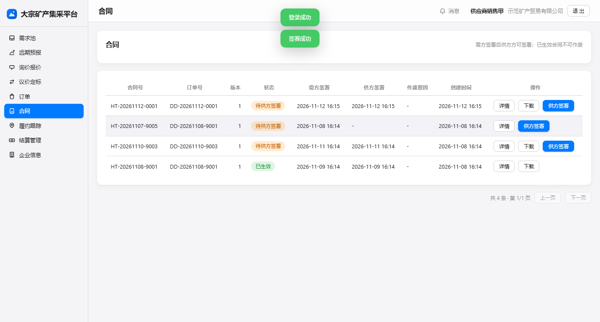
- 入口：中矿登录 →「合同」→「供方签署」→ 同 S16 勾选+上传+「签 署」
- 预期：toast「签署成功」，合同状态变为「已生效」，订单进入履约中；此时「作废」按钮消失

#### 阶段五：质检、结算与付款

**S18 结算工作台渲染**（普阳） 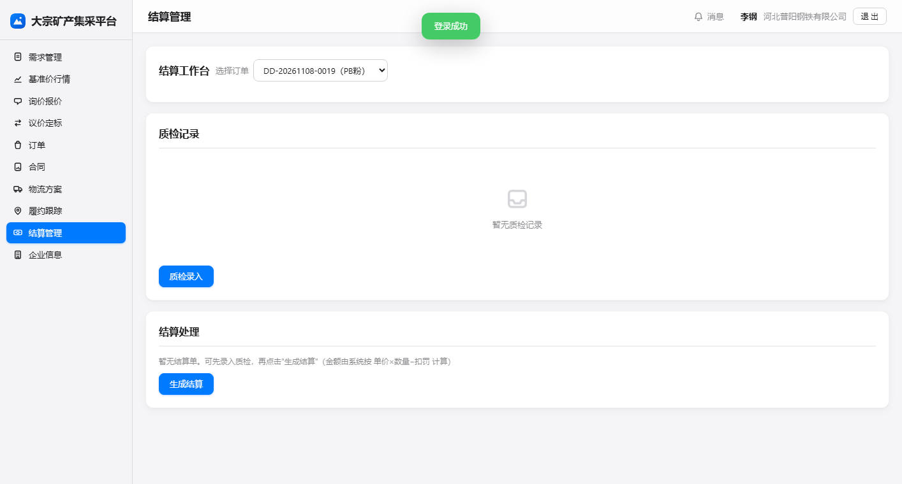
- 入口：「结算管理」→ 页面顶部出现「结算工作台」标题与「选择订单」下拉（选项格式：订单号 + 品种，如 DD-…-0013 (PB粉)），下方为「质检记录」「结算处理」两块卡片
- 注意：结算工作台按订单维度组织，先选订单再做质检与结算

**S19 质检录入**（普阳） 
- 操作：「质检录入」→ 弹窗填实收数量 `2980`（吨，≤ 订单数量）、检验指标 `Fe 62.1%，水分 7.8%`（多行文本，结论默认合格）→「保 存」
- 预期：toast「质检记录已保存」，质检记录表新增一行（质检编号 ZJ-…、实收数量、指标、结论=合格胶囊、时间）
- 注意：实收数量超差会自动产生预警（预警处理页可见）；可录入多条，结算默认取最近一条合格质检实收

**S20 生成结算**（普阳） 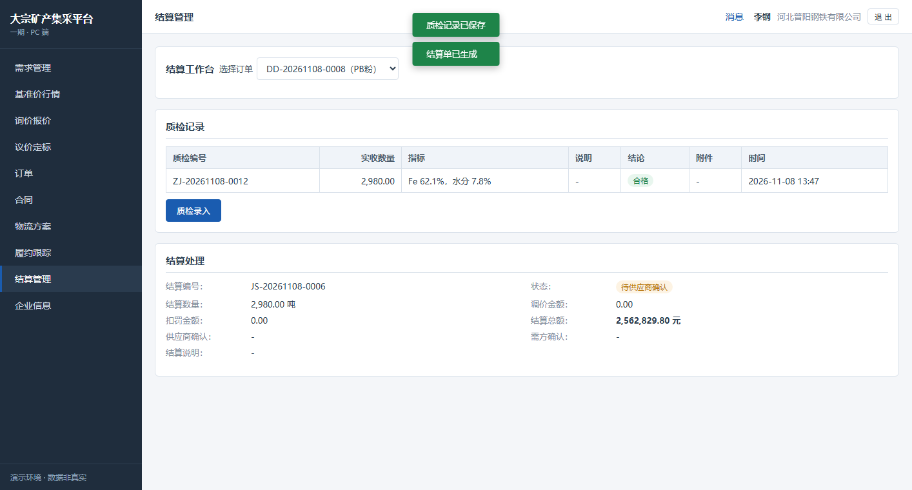
- 操作：「生成结算」→ 弹窗结算数量默认填最近合格质检实收 `2980` → 可改 →「生 成」
- 预期：toast「结算单已生成」，「结算处理」卡片展示：结算编号 JS-…、结算数量、状态=「待供应商确认」胶囊、结算金额=数量×定标单价（如 2980 × 860 = 2,562,829.80 元）

**S21 中矿供应商确认结算**（中矿） 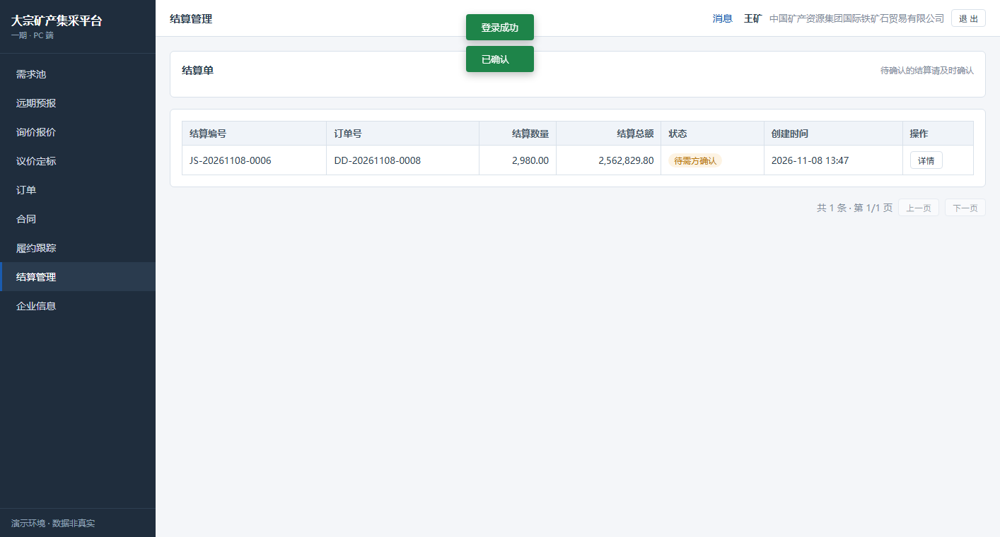
- 入口：中矿登录 →「结算管理」→ 列表出现该结算单（状态=待供应商确认）→「供应商确认」→「确 定」
- 预期：toast「已确认」，状态变为待需方确认

**S22 普阳需方确认+付款登记**（普阳） 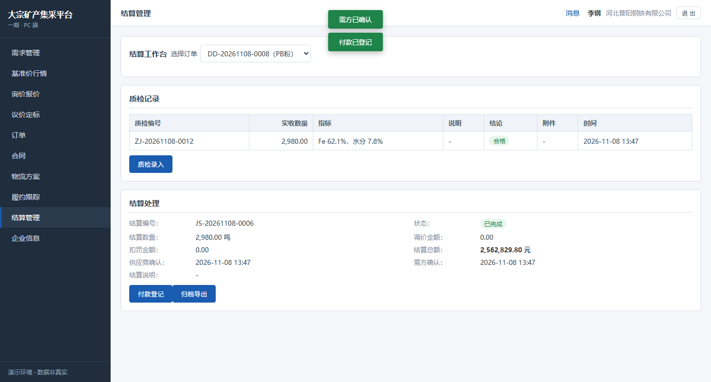
- 操作①：「结算管理」→「需方确认」→「确 定」→ toast「需方已确认」（双向确认后结算冻结，不可再改）
- 操作②：「付款登记」→ 弹窗金额预填结算总额、付款日期预填今天 → 可补充付款说明 →「登 记」→ toast「付款已登记」，结算完成（状态=已付款）
- 后续：可在「订单」页对该订单「归档导出」下载档案 zip（含需求/询价/订单/合同/结算单据）

**S23 console 错误检查** 
- 验收：全程浏览器 console 无 SEVERE 级错误（检测脚本由 Selenium 逐页收集判定；手工检测可按 F12 打开开发者工具在 Console 面板核对）
- 注意：网络 404 的静态探测请求、浏览器插件告警不计入；出现 SEVERE 需截图并附接口响应定位

## 5. 常见问题排查方案

### 5.1 启动类

| 现象 | 排查步骤 |
|------|----------|
| `python run.py` 报数据库连接失败 | ① `docker ps` 确认容器在运行；② `docker compose up -d` 启动；③ 核对 `MINE_PG_DSN` 与 docker-compose.yml 中端口/密码一致 |
| 端口 8000 被占用 | `Get-NetTCPConnection -LocalPort 8000` 找到 PID → `Stop-Process -Id <PID> -Force`；或改 `MINE_PORT` 启动 |
| 页面空白/静态资源 404 | 确认从项目根目录启动（前端目录 frontend 由后端托管） |
| 登录提示账号不存在 | 先核对所用账号与 3.4 节口径一致：本演示库为 139 号段基线（中矿/普阳/承运商）；**全新 seed 库**为 138 号段示范企业（首次启动需 `python run.py` 完成 seed，启动日志输出「演示数据已写入」）。管理员 13800000000 两种环境均存在 |

### 5.2 业务操作类

| 现象 | 原因与处理 |
|------|------------|
| 询价保存失败提示「2 小时/7 天」 | 截止时间必须 ≥ 当前+2h 且 ≤ 到货日期前 7 天。弹窗底部会显示具体原因（修复后不再静默失败）；注意用**本地北京时间**填写 |
| 页面时间与本地时间差 8 小时（历史数据） | 存量数据需执行第 3.6 节迁移脚本；新环境已通过会话时区（Asia/Shanghai）根治 |
| 需求单提交后无法修改名称等字段 | 属预期：提交后关键字段锁定（40901）。需先「撤回」，状态为「已撤回」后「重新提交」生成新版本（撤回态不可直接编辑） |
| 供应商看不到他人报价 | 属预期：密封报价，截止揭示前仅见自己的报价；需方在截止前也不可见 |
| 揭示按钮不可用 | 询价未到截止时间（40901）；紧急验证时可直连库把 deadline 调到过去（仅测试） |
| 合同无法供方先签 | 属预期顺序：需方先签（40901） |
| 重复报价被拦截（40902） | 同一询价同一供应商存在在途报价，请先在报价列表修改/撤回原报价 |
| 结算无法再次确认（40901） | 双向确认后结算冻结，属预期 |
| 企业注册提示重复信用代码（40902） | 换未注册的统一社会信用代码 |
| 上传文件失败 | 单文件 ≤20MB；执照仅注册流程免登录上传，其余需登录 |

### 5.3 时间与时区专题（BUG-06 相关）

- 平台统一业务时区为 **Asia/Shanghai**：数据库会话时区由后端固定（`backend/db.py` 的 `BUSINESS_TZ`，可用 `MINE_PG_TZ` 覆盖），容器环境变量 TZ/PGTZ 已同步设置
- 验证方法：任一列表页「创建时间」应与本地时间一致（±1 分钟）
- 若发现整库时间仍差 8 小时：确认后端已重启到修复后版本，并已执行 3.6 节迁移

### 5.4 测试与验证

- 回归测试失败先确认：服务在 8000 端口运行中、数据库可达、基线账号未被删除
- E2E 全链路脚本会自适应发现基线账号并在供应商不足 3 家时自动补位注册
- 测试证据（截图/结果）存于 `test-evidence-20261108/`

## 6. 目录结构速览

```
mine_platform_demo/
├── run.py                  # 启动入口（建表+seed+Flask）
├── docker-compose.yml      # PostgreSQL 14 容器（含时区配置）
├── requirements.txt
├── backend/                # Flask 后端（api/ 业务接口，state_machine.py 状态机，seed.py 演示数据）
├── frontend/               # 原生 JS SPA（js/pages/ 各页面模块）
├── docs/
│   ├── schema_postgresql.sql       # 建表脚本
│   ├── migrations/                 # 一次性数据迁移（如 BUG-06 时区修复）
│   └── PROJECT_GUIDE.md            # 项目内部指南
├── tests/                  # e2e_full_chain.py 全链路 / test_bugfix_regression.py BUG 回归 / e2e_helpers.py 封装
└── test-evidence-20261108/ # 本轮测试与修复证据
```

## 7. 已知问题修复记录（2026-11-08）

| BUG | 现象 | 根因 | 修复 | 回归验证 |
|-----|------|------|------|----------|
| BUG-01 | 管理后台状态字典页显示"无流转" | 后端 /admin/dicts 返回嵌套 dict `{from:[to...]}`，前端按行数组渲染 | frontend/js/pages/admin.js 展开嵌套 dict 为行数组 | 回归 PASS |
| BUG-02 | 新建需求明细：下拉已选品种仍报"明细不完整" | 明细行 select 默认显示第一项但未回写数据模型 | frontend/js/pages/demand.js 默认选中项回写模型 | 回归 PASS |
| BUG-03 | 编辑需求明细弹窗恒显示"暂无明细"，误存清空明细 | 编辑时 items=[] 未从 existing.items 回填 | frontend/js/pages/demand.js 回填并映射既有明细 | 回归 PASS（回读+原样回存） |
| BUG-04 | 需求撤回后无重提入口，流程中断 | 后端支持 WITHDRAWN→SUBMITTED（版本+1），UI 缺按钮 | frontend/js/pages/demand.js 增加"重新提交"入口并修正撤回文案 | 回归 PASS（version==2） |
| BUG-05 | 企业用户个人资料页误显示"平台管理员无企业档案" | /companies/me 对企业用户返回平铺字段，前端只读 d.company 嵌套 | frontend/js/pages/misc.js 兼容平铺/嵌套两种形状 | 回归 PASS |
| BUG-06 | 页面时间差 8 小时；按页面时间+3h 填截止被"+2h"拦截 | PG 容器 UTC，DB now() 与应用/用户本地语义不一致 | 三层修复：会话时区（backend/db.py、backend/__init__.py）+ 容器 TZ/PGTZ（docker-compose.yml）+ 存量数据迁移（docs/migrations/） | 回归 PASS（created_at=本地±10min；+2h10min 可建、+1h 被拦） |
| BUG-07 | 询价弹窗校验失败仅 toast 3 秒即消失，"静默失败" | 弱反馈：toast 短暂 + 弹窗常开无错误区 | frontend/js/pages/trade.js 弹窗内持久错误区 + 本地预校验 | 回归 PASS（40001 message 明确） |
| BUG-08 | 所有日期/数字输入框实际都是纯文本框（type 参数被忽略，涉及 13 处：到货日/截止时间/品位/金额等） | frontend/js/ui.js 的 UI.input 未把 type 赋给 input 元素 | UI.input 增加 `if (type) el.type = type` | UI 专项 S03/S04 日期渲染为 date/datetime-local 控件，PASS |
| BUG-09 | 新建需求保存必失败，报"数值格式错误：grade" | 品位字段用文本框+「牌号」文案引导输文本（如 ZH-1），而 DB 字段为 NUMERIC(5,2) 数值品位 | frontend/js/pages/demand.js 改数字输入+「品位(%)」标签；trade/order/admin 展示文案同步为品位(%) | UI 专项 S03 输入 62.1 保存+提交 PASS；E2E 97/97 PASS |
| BUG-10 | 「合同」页永远空白：无表格、无空态、无网络请求、无报错（静默失败） | frontend/js/pages/order.js 的 Pages.contract 定义了 load() 但从未调用（探针证实 fetch 从未发出） | 函数结尾补 `await load();` | UI 专项 S16 合同列表出现待签行并完成需方签署，PASS |
| BUG-11 | 供应商「结算管理」页永远空白（与 BUG-10 同为静默失败模式） | frontend/js/pages/settle.js 供应商分支定义 load()/acts() 但从未调用 | 结尾补 `await load();`；并系统化排查全部 17 个 Pages 函数确认无同类遗漏 | UI 专项 S21 供应商结算列表出现「供应商确认」按钮，PASS |

修复验证结果：BUG 回归 17/17 PASS；E2E 全链路 97/97 PASS（FAIL 0）；UI 可视化专项 23/23 PASS（FAIL 0，过程见 4.5 节与 `docs/前端可视化专项检测报告-20261108.md`）。
